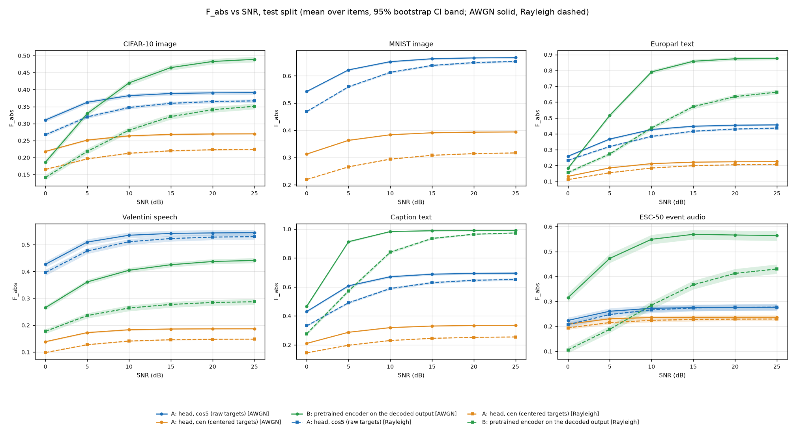
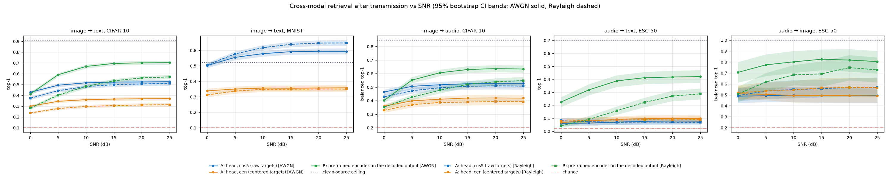
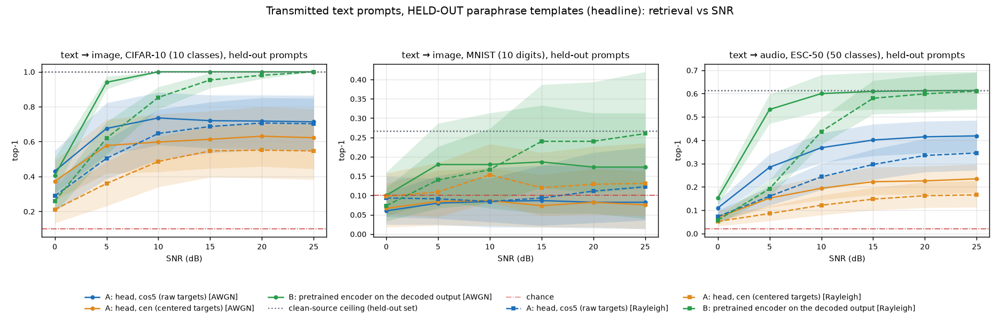
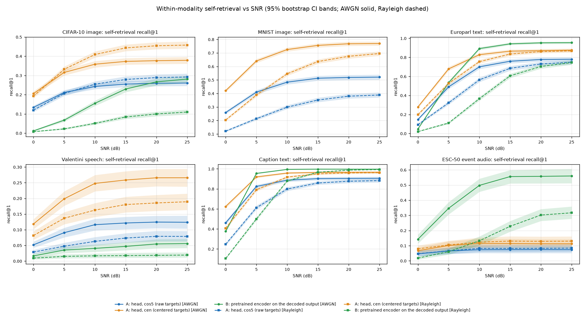

# Week 5b, Stage 2: co-primary variants, three seeds, cross-modal channel experiments

## Findings (authored after the results; every number below is copied from the generated tables further down)

**1. Final variant: `cen`, by the amended rule, applied exactly as declared.** On validation, with 3-seed means and the median over the 12 (task, channel) pairs, `cen` wins all three scale-free criteria: AUC at 0 dB 0.986 vs 0.949 (`cos5`), pooled Spearman 0.469 vs 0.322, item-noise/range 0.546 vs 0.915 (lower is better). Dynamic range (0.071 vs 0.130) and the clean ceiling C (0.244 vs 0.486) favour `cos5` but were declared context only. Both variants are strictly increasing on 12/12 pairs, for every individual seed. The original pre-registered rule, re-applied unchanged to the 3-seed means, still picks `cos5` through its dynamic-range tie-breaker, so the two rules disagree and the amendment decided the outcome. That amendment was declared after seeing a single-seed tie and before any Stage 2 seed existed (section 0).

**A tension to carry into Week 6.** `cen` gives the cleaner, more discriminative Fidelity signal, but its embeddings are consistently *worse for cross-modal retrieval* than `cos5`: for example CIFAR-10 image→text top-1 at 10 dB on AWGN is 0.36 (`cen`) vs 0.52 (`cos5`), and text→image (held-out prompts) 0.60 vs 0.74. A Fidelity built on `cen` and a retrieval-useful common space are therefore not the same head. The rule was not adjusted after seeing this.

**2. Fidelity behaves well, with stated limits.** F_abs (and F_ret, and the centered cosine) are strictly increasing in SNR on all 12 pairs for both variants; raw cosine is strictly increasing on only 5 of 12 (`cos5`, test), which is the Week 5 problem. For the final variant the matched-vs-mismatched AUC at 0 dB is 0.93 to 1.00 for the A heads (0.94 for speech and 0.93 for ESC-50), against 0.71 to 0.98 for approach B. Pooled Spearman with SNR is modest (0.10 to 0.67 across pairs, reported as measured), because per-item scatter is large compared with the SNR trend. The curves saturate early: for the final variant F_abs reaches 90% of its clean value at 1.0 to 11.3 dB depending on domain and channel (approach B: up to 18.1 dB, under Rayleigh), and for ESC-50 event audio the curve is nearly flat above 5 dB (only 71% of bootstrap resamples are strictly increasing on AWGN). Head-seed spread is small: median sd over seeds of clean F_abs 0.002, of AUC at 0 dB 0.0003, of dynamic range 0.001 (largest sd: 0.018, 0.002, 0.007).

**Equal F across modalities does not yet mean equal semantic damage.** F_abs is normalised inside each domain's own anchor space and its ceiling C ranges from 0.15 (speech, `cen`) to 0.99 (caption text, approach B), partly reflecting instrument weakness (CLIP on MNIST digits, CLAP on speech) and head quality. Comparing F across modalities needs the human study.

**3. Approach A vs approach B (test split, top-1; paired difference A − B with 95% CI over items; same items and channel noise).** The pattern is consistent across pairs: B wins when the channel is clean and the decoded output lies in the pretrained encoder's domain; A wins at low SNR and under Rayleigh (the decoder is fragile to zero-forcing outliers), and wherever the pretrained encoder does not carry the content.

| pair | B vs A at ≥ 10 dB on AWGN | low SNR / Rayleigh |
|---|---|---|
| image → text, CIFAR-10 (10 prompts) | B ahead: `cos5` − B = −0.15 [−0.17, −0.13] at 10 dB | `cos5` ahead at 0 dB (+0.02 AWGN, +0.09 Rayleigh); tie at 10 dB Rayleigh (0.00 [−0.02, 0.02]) |
| image → text, MNIST | B not applicable (decode() returns logits) | `cos5` top-1 0.58 to 0.65 at 10 dB and above, above the clean CLIP ceiling of 0.52 (explanation not verified) |
| image → audio, CIFAR-10 (class level, 5 classes) | B ahead: −0.09 [−0.12, −0.06] | `cos5` ahead at 0 dB (+0.06 AWGN, +0.08 Rayleigh); tie at 10 dB Rayleigh (+0.02 [−0.01, 0.05]) |
| audio → text, ESC-50 (50 prompts) | B far ahead: 0.39 vs 0.07 (−0.32 [−0.37, −0.27]) | A is at 0.06 to 0.10 even noise-free; B is poor at 0 dB Rayleigh (0.04) |
| audio → image, ESC-50 (class level, 5 classes, 64 test clips) | B ahead: 0.80 vs 0.50 (−0.31 [−0.40, −0.21]) | gap narrows under Rayleigh (−0.13 [−0.24, −0.01]); CIs are wide (n = 64) |
| text → image, CIFAR-10 (held-out prompts) | B ahead: 1.00 vs 0.74 (`cos5`) at 10 dB | Rayleigh, 10 dB: B 0.85 vs `cos5` 0.65 |
| text → audio, ESC-50 (held-out prompts) | B ahead: 0.60 vs 0.37 (`cos5`) at 10 dB | Rayleigh, 5 dB: `cos5` 0.16 vs B 0.19 (close) |
| text → image, MNIST (held-out prompts) | A at chance (0.08 to 0.15); B 0.14 to 0.26 | inconclusive: 30 prompts and a clean ceiling of only 0.27 |
| within-modality, Europarl text recall@1 | B ahead at 10 dB AWGN (0.89 vs `cen` 0.83, `cos5` 0.70) | Rayleigh 10 dB: `cen` 0.76 ≫ B 0.37; 0 dB: A ahead everywhere |
| within-modality, caption text recall@1 | B ≈ 0.99 vs `cen` 0.96 at 10 dB | Rayleigh 10 dB: `cen` 0.92 vs B 0.88 |
| within-modality, speech recall@1 | A ≫ B: `cen` 0.25 vs B 0.04 at 10 dB | B is near chance everywhere (CLAP is not a speech-content model) |
| within-modality, ESC-50 recall@1 | B ≫ A: 0.50 vs 0.12 (`cen`) at 10 dB | Rayleigh 10 dB: B 0.13 vs A 0.12 (tie) |

A is nearly flat in SNR (its curve is close to its noise-free value from about 10 dB), so A's ceiling is set by the transceiver's encoder, not by the channel. That is the dominant limit for CIFAR-10 (the Week 4 encoder was trained for pixel MSE: noise-free image → text top-1 0.52 against a clean ceiling of 0.91), and it is the reason B's decoder, which reconstructs content, wins on clean channels.

**4. Transmitted text: held-out paraphrases (headline) vs training-time templates.** The raw gap (training-time minus held-out top-1) mixes two effects, so I report both. Part of it is CLIP's own template wording: for ESC-50 the clean ceiling is 0.75 on the training-time templates and 0.61 on the held-out ones (gap +0.133) before any transmission. The transceiver's optimism is the held-out set's *extra* loss relative to its own ceiling:
- **Approach B (the transceiver's decoder):** about zero on AWGN at 10 dB and above (ESC-50 +0.01 [0.00, 0.02] at 10 dB; CIFAR-10 +0.00), +0.04 to +0.05 at 5 dB; under Rayleigh it is real at low SNR: CIFAR-10 +0.22 [+0.08, +0.35] at 5 dB and +0.09 [0.00, +0.17] at 10 dB, ESC-50 +0.11 [+0.03, +0.19] at 5 dB and +0.10 [+0.05, +0.15] at 10 dB; it vanishes by 25 dB. So the training-template numbers overstate held-out performance by up to about 0.1 to 0.2 under a poor channel and by about 0 on a clean one.
- **Approach A (heads):** no optimism, and slightly negative for ESC-50 (−0.10 to −0.16, CIs mostly excluding 0), because the heads never saw the prompts. A plausible reason for the sign (not tested) is that the short training-time templates, including bare class names, are out of distribution for heads trained on caption-length sentences.
- **MNIST** is inconclusive (CIs of about ±0.15 on 10 and 30 prompts).

**5. Audio status and limits.**
- *Event audio (ESC-50) is the weak link.* The transceiver and its heads are trained on 1,200 clips. The clean-source ceiling for audio → text is 0.70, but even noise-free the A heads reach only 0.08 to 0.10 top-1 (chance 0.02): the loss is the encoder and head, not the channel. Within the modality, class-prototype retrieval is 0.21 (`cos5`) to 0.28 (`cen`) for A against 0.67 for B at 10 dB on AWGN. F_abs has the lowest ceiling here (C = 0.24 to 0.28) and the flattest response (pooled Spearman 0.10 to 0.18, SNR at 90% of clean about 1 to 6 dB).
- *Overfitting.* Baseline ESC-50 heads reached their best validation loss at epoch 21 to 43 of 100 (Stage 1), so dropout and weight decay were added by the declared rule; the winner (dropout 0.5, weight decay 1e-2, mean rank 1.25) still has its best epoch at 85 to 99 of 100, so it was not converged at the epoch cap.
- *Speech* is a secondary task: CLAP embeddings of 1 s speech clips are tightly clustered (residual random-pair cosine 0.14 in S), A recall@1 is 0.12 to 0.27 on AWGN, approach B is near chance, and F_abs has C = 0.15 to 0.19 (`cen`).
- Audio → image uses only 64 test-fold clips over 5 shared classes; its intervals are wide.

**6. What was not done:** the ImageBind clean-only ablation (optional, last; skipped, so nothing was derived from ImageBind weights), the CIFAR-100 and COCO-image checks, and any human-study calibration of F.

## 0. Protocol declaration (written before any Stage 2 seed was run)

Record `outputs/week5b/stage2/protocol_declared.json`, declared at **2026-10-24T11:42:26+00:00** (UTC), hashing the Stage 1 variant choice (`cos5`, sha256 `8df4ac5ba905178d…`) and the held-out prompt templates (sha256 `868a2bf89de249b6…`).

**POST-HOC AMENDMENT, declared before any Stage 2 seed was run.** Stage 1 compared the head variants on one seed. All three were strictly increasing on all 12 (task, channel) pairs, so the pre-registered rule was decided by its tie-breaker, the dynamic range of F_abs, which depends on the scale of F_abs (the clean ceiling C) and picked cos5. The scale-free criteria (AUC at 0 dB, pooled Spearman, item-noise/range) favoured cen. After seeing that single-seed result, cos5 and cen are carried into Stage 2 as co-primary variants.

Final-variant rule (applied exactly as written once the 3-seed numbers existed): for each criterion, take each (task, channel) pair's mean over the 3 head seeds, then the median over the 12 pairs; the variant that is better on at least 2 of the 3 criteria is the final headline variant Criteria: **auc_at_0dB** (higher is better; matched-vs-mismatched AUC of F_abs at 0 dB); **pooled_spearman** (higher is better; Spearman between F_abs and SNR pooled over items, draws and SNR points); **item_noise_over_range** (lower is better; standard deviation over items of the draw-averaged F_abs at 10 dB divided by (mean F_abs at 25 dB minus mean F_abs at 0 dB)). Context only, not selection: dynamic range of F_abs, clean ceiling C, per-pair win counts, strictly-increasing counts.

Held-out prompt templates (written once, never used for vocabulary, transceiver training or head training; zero `<unk>` and no verbatim overlap asserted in `semcom.data.prompts`):

| task | training-time templates (a) | held-out paraphrase templates (b) |
|---|---|---|
| cifar10 | 'a photo of a {c}' | 'a picture of a {c}'; 'an image of a {c}'; 'there is a {c} in this photo' |
| mnist | 'a handwritten digit {c}' | 'a handwritten number {c}'; 'the digit {c} written by hand'; 'an image of the number {c}' |
| esc50 | 'This is a sound of {}.'; '{}'; 'the sound of {}' | 'a recording of {c}'; 'you can hear {c}'; 'audio of {c} playing' |

## 1. Heads (3 seeds × {cos5, cen} × 6 tasks × 2 channels)

| task | channel | variant | seed | schedule | best epoch / epochs run | early stop | best val loss | dropout | weight decay | min |
|---|---|---|---|---|---|---|---|---|---|---|
| CIFAR-10 image | awgn | cos5 | 42 | cosine | 28 / 40 (max 40) | no | 3.931 | 0.1 | 0.0001 | 2.4 |
| CIFAR-10 image | awgn | cos5 | 43 | cosine | 24 / 40 (max 40) | no | 3.895 | 0.1 | 0.0001 | 1.1 |
| CIFAR-10 image | awgn | cos5 | 44 | cosine | 26 / 40 (max 40) | no | 3.899 | 0.1 | 0.0001 | 0.4 |
| CIFAR-10 image | awgn | cen | 42 | cosine | 17 / 40 (max 40) | no | 2.258 | 0.1 | 0.0001 | 14.0 |
| CIFAR-10 image | awgn | cen | 43 | cosine | 15 / 40 (max 40) | no | 2.261 | 0.1 | 0.0001 | 1.0 |
| CIFAR-10 image | awgn | cen | 44 | cosine | 15 / 40 (max 40) | no | 2.276 | 0.1 | 0.0001 | 0.4 |
| CIFAR-10 image | rayleigh | cos5 | 42 | cosine | 39 / 40 (max 40) | no | 3.671 | 0.1 | 0.0001 | 2.5 |
| CIFAR-10 image | rayleigh | cos5 | 43 | cosine | 38 / 40 (max 40) | no | 3.647 | 0.1 | 0.0001 | 1.1 |
| CIFAR-10 image | rayleigh | cos5 | 44 | cosine | 40 / 40 (max 40) | no | 3.669 | 0.1 | 0.0001 | 0.4 |
| CIFAR-10 image | rayleigh | cen | 42 | cosine | 40 / 40 (max 40) | no | 1.961 | 0.1 | 0.0001 | 1.1 |
| CIFAR-10 image | rayleigh | cen | 43 | cosine | 38 / 40 (max 40) | no | 1.934 | 0.1 | 0.0001 | 0.7 |
| CIFAR-10 image | rayleigh | cen | 44 | cosine | 40 / 40 (max 40) | no | 1.956 | 0.1 | 0.0001 | 0.4 |
| MNIST image | awgn | cos5 | 42 | cosine | 37 / 40 (max 40) | no | 2.235 | 0.1 | 0.0001 | 0.3 |
| MNIST image | awgn | cos5 | 43 | cosine | 39 / 40 (max 40) | no | 2.224 | 0.1 | 0.0001 | 0.3 |
| MNIST image | awgn | cos5 | 44 | cosine | 38 / 40 (max 40) | no | 2.234 | 0.1 | 0.0001 | 0.3 |
| MNIST image | awgn | cen | 42 | cosine | 40 / 40 (max 40) | no | 0.581 | 0.1 | 0.0001 | 0.3 |
| MNIST image | awgn | cen | 43 | cosine | 39 / 40 (max 40) | no | 0.577 | 0.1 | 0.0001 | 0.3 |
| MNIST image | awgn | cen | 44 | cosine | 39 / 40 (max 40) | no | 0.579 | 0.1 | 0.0001 | 0.3 |
| MNIST image | rayleigh | cos5 | 42 | cosine | 39 / 40 (max 40) | no | 2.692 | 0.1 | 0.0001 | 0.3 |
| MNIST image | rayleigh | cos5 | 43 | cosine | 39 / 40 (max 40) | no | 2.690 | 0.1 | 0.0001 | 0.3 |
| MNIST image | rayleigh | cos5 | 44 | cosine | 39 / 40 (max 40) | no | 2.694 | 0.1 | 0.0001 | 0.3 |
| MNIST image | rayleigh | cen | 42 | cosine | 40 / 40 (max 40) | no | 0.977 | 0.1 | 0.0001 | 0.3 |
| MNIST image | rayleigh | cen | 43 | cosine | 40 / 40 (max 40) | no | 0.975 | 0.1 | 0.0001 | 0.3 |
| MNIST image | rayleigh | cen | 44 | cosine | 40 / 40 (max 40) | no | 0.987 | 0.1 | 0.0001 | 0.3 |
| Europarl text | awgn | cos5 | 42 | plateau | 79 / 80 (max 80) | no | 2.210 | 0.1 | 0.0001 | 13.0 |
| Europarl text | awgn | cos5 | 43 | plateau | 77 / 80 (max 80) | no | 2.183 | 0.1 | 0.0001 | 14.7 |
| Europarl text | awgn | cos5 | 44 | plateau | 79 / 80 (max 80) | no | 2.166 | 0.1 | 0.0001 | 14.9 |
| Europarl text | awgn | cen | 42 | plateau | 77 / 80 (max 80) | no | 0.826 | 0.1 | 0.0001 | 14.7 |
| Europarl text | awgn | cen | 43 | plateau | 80 / 80 (max 80) | no | 0.804 | 0.1 | 0.0001 | 14.7 |
| Europarl text | awgn | cen | 44 | plateau | 80 / 80 (max 80) | no | 0.762 | 0.1 | 0.0001 | 15.0 |
| Europarl text | rayleigh | cos5 | 42 | plateau | 79 / 80 (max 80) | no | 2.759 | 0.1 | 0.0001 | 13.8 |
| Europarl text | rayleigh | cos5 | 43 | plateau | 80 / 80 (max 80) | no | 2.677 | 0.1 | 0.0001 | 29.6 |
| Europarl text | rayleigh | cos5 | 44 | plateau | 80 / 80 (max 80) | no | 2.678 | 0.1 | 0.0001 | 14.9 |
| Europarl text | rayleigh | cen | 42 | plateau | 80 / 80 (max 80) | no | 1.034 | 0.1 | 0.0001 | 28.7 |
| Europarl text | rayleigh | cen | 43 | plateau | 80 / 80 (max 80) | no | 1.026 | 0.1 | 0.0001 | 14.9 |
| Europarl text | rayleigh | cen | 44 | plateau | 79 / 80 (max 80) | no | 1.008 | 0.1 | 0.0001 | 14.3 |
| Valentini speech | awgn | cos5 | 42 | plateau | 77 / 80 (max 80) | no | 2.595 | 0.1 | 0.0001 | 4.0 |
| Valentini speech | awgn | cos5 | 43 | plateau | 76 / 80 (max 80) | no | 2.609 | 0.1 | 0.0001 | 4.0 |
| Valentini speech | awgn | cos5 | 44 | plateau | 64 / 72 (max 80) | yes | 2.620 | 0.1 | 0.0001 | 3.5 |
| Valentini speech | awgn | cen | 42 | plateau | 64 / 72 (max 80) | yes | 1.466 | 0.1 | 0.0001 | 3.6 |
| Valentini speech | awgn | cen | 43 | plateau | 66 / 74 (max 80) | yes | 1.479 | 0.1 | 0.0001 | 3.7 |
| Valentini speech | awgn | cen | 44 | plateau | 75 / 80 (max 80) | no | 1.441 | 0.1 | 0.0001 | 4.5 |
| Valentini speech | rayleigh | cos5 | 42 | plateau | 78 / 80 (max 80) | no | 3.250 | 0.1 | 0.0001 | 4.1 |
| Valentini speech | rayleigh | cos5 | 43 | plateau | 53 / 61 (max 80) | yes | 3.201 | 0.1 | 0.0001 | 3.1 |
| Valentini speech | rayleigh | cos5 | 44 | plateau | 68 / 76 (max 80) | yes | 3.189 | 0.1 | 0.0001 | 3.9 |
| Valentini speech | rayleigh | cen | 42 | plateau | 64 / 72 (max 80) | yes | 1.937 | 0.1 | 0.0001 | 3.7 |
| Valentini speech | rayleigh | cen | 43 | plateau | 80 / 80 (max 80) | no | 1.902 | 0.1 | 0.0001 | 4.1 |
| Valentini speech | rayleigh | cen | 44 | plateau | 79 / 80 (max 80) | no | 1.935 | 0.1 | 0.0001 | 3.8 |
| Caption text | awgn | cos5 | 42 | plateau | 77 / 80 (max 80) | no | 0.950 | 0.1 | 0.0001 | 69.2 |
| Caption text | awgn | cos5 | 43 | plateau | 79 / 80 (max 80) | no | 1.037 | 0.1 | 0.0001 | 35.2 |
| Caption text | awgn | cos5 | 44 | plateau | 77 / 80 (max 80) | no | 0.951 | 0.1 | 0.0001 | 24.2 |
| Caption text | awgn | cen | 42 | plateau | 80 / 80 (max 80) | no | 0.372 | 0.1 | 0.0001 | 107.1 |
| Caption text | awgn | cen | 43 | plateau | 57 / 65 (max 80) | yes | 0.401 | 0.1 | 0.0001 | 19.7 |
| Caption text | awgn | cen | 44 | plateau | 59 / 67 (max 80) | yes | 0.381 | 0.1 | 0.0001 | 20.1 |
| Caption text | rayleigh | cos5 | 42 | plateau | 80 / 80 (max 80) | no | 1.489 | 0.1 | 0.0001 | 84.2 |
| Caption text | rayleigh | cos5 | 43 | plateau | 79 / 80 (max 80) | no | 1.462 | 0.1 | 0.0001 | 31.7 |
| Caption text | rayleigh | cos5 | 44 | plateau | 76 / 80 (max 80) | no | 1.491 | 0.1 | 0.0001 | 24.2 |
| Caption text | rayleigh | cen | 42 | plateau | 77 / 80 (max 80) | no | 0.515 | 0.1 | 0.0001 | 116.6 |
| Caption text | rayleigh | cen | 43 | plateau | 80 / 80 (max 80) | no | 0.514 | 0.1 | 0.0001 | 24.3 |
| Caption text | rayleigh | cen | 44 | plateau | 76 / 80 (max 80) | no | 0.505 | 0.1 | 0.0001 | 26.9 |
| ESC-50 event audio | awgn | cos5 | 42 | cosine | 85 / 100 (max 100) | no | 4.282 | 0.5 | 0.01 | 1.9 |
| ESC-50 event audio | awgn | cos5 | 43 | cosine | 92 / 100 (max 100) | no | 4.263 | 0.5 | 0.01 | 0.6 |
| ESC-50 event audio | awgn | cos5 | 44 | cosine | 84 / 100 (max 100) | no | 4.253 | 0.5 | 0.01 | 0.6 |
| ESC-50 event audio | awgn | cen | 42 | cosine | 89 / 100 (max 100) | no | 2.253 | 0.5 | 0.01 | 2.6 |
| ESC-50 event audio | awgn | cen | 43 | cosine | 55 / 100 (max 100) | no | 2.285 | 0.5 | 0.01 | 0.6 |
| ESC-50 event audio | awgn | cen | 44 | cosine | 72 / 100 (max 100) | no | 2.246 | 0.5 | 0.01 | 0.6 |
| ESC-50 event audio | rayleigh | cos5 | 42 | cosine | 99 / 100 (max 100) | no | 4.202 | 0.5 | 0.01 | 2.7 |
| ESC-50 event audio | rayleigh | cos5 | 43 | cosine | 100 / 100 (max 100) | no | 4.165 | 0.5 | 0.01 | 0.6 |
| ESC-50 event audio | rayleigh | cos5 | 44 | cosine | 100 / 100 (max 100) | no | 4.204 | 0.5 | 0.01 | 0.6 |
| ESC-50 event audio | rayleigh | cen | 42 | cosine | 93 / 100 (max 100) | no | 2.222 | 0.5 | 0.01 | 4.0 |
| ESC-50 event audio | rayleigh | cen | 43 | cosine | 100 / 100 (max 100) | no | 2.173 | 0.5 | 0.01 | 0.6 |
| ESC-50 event audio | rayleigh | cen | 44 | cosine | 100 / 100 (max 100) | no | 2.185 | 0.5 | 0.01 | 0.6 |

**ESC-50 head regularisation comparison (seed 42 only; validation loss is the identical objective for all three settings; lower is better):**

| case | baseline (dropout 0.1, wd 1e-4) | R1 (0.3, 1e-3) | R2 (0.5, 1e-2) |
|---|---|---|---|
| cos5/awgn | 4.501 (ep 21) | 4.346 (ep 39) | 4.282 (ep 85) |
| cos5/rayleigh | 4.321 (ep 34) | 4.170 (ep 86) | 4.202 (ep 99) |
| cen/awgn | 2.636 (ep 25) | 2.398 (ep 55) | 2.253 (ep 89) |
| cen/rayleigh | 2.455 (ep 37) | 2.226 (ep 83) | 2.222 (ep 93) |
| **mean rank** | **3.00** | **1.75** | **1.25** |

The lowest mean rank wins and ties go to the baseline: **R2** (dropout 0.5, weight decay 0.01) was applied to all three ESC-50 seeds. The winner's best epochs are close to the 100-epoch cap, so it may still have been improving; the epoch cap was not raised.

## 2. Final variant under the amended rule

**Status: complete.**

**Amended rule (validation, scale-free criteria, 3-seed means, median over the 12 (task, channel) pairs):**

| criterion | direction | cos5 | cen | better |
|---|---|---|---|---|
| auc_at_0dB | higher is better | 0.9486 | 0.9864 | cen |
| pooled_spearman | higher is better | 0.3215 | 0.4694 | cen |
| item_noise_over_range | lower is better | 0.9148 | 0.5459 | cen |

Criteria won: {'cos5': 0, 'cen': 3}. **Final headline variant under the amended rule: `cen`.**

Context only (NOT selection criteria under the amended rule): `cos5`: median dynamic range 0.130, median clean ceiling C 0.486, strictly increasing on 12/12 pairs (all 3 seeds); `cen`: median dynamic range 0.071, median clean ceiling C 0.244, strictly increasing on 12/12 pairs (all 3 seeds).

**Original pre-registered rule re-applied unchanged to the same 3-seed means** (strictly increasing pairs, then median dynamic range, then median AUC at 0 dB): picks `cos5`. Its summary: `cos5`: 12/12 increasing, median range 0.130, median AUC at 0 dB 0.951; `cen`: 12/12 increasing, median range 0.071, median AUC at 0 dB 0.988. It is shown for transparency; it is not the selection rule.

## 3. Fidelity: F_abs (headline), F_ret, C and the cosine baselines

Equal F across modalities does **not** yet mean equal semantic damage. F_abs is normalised within each domain's own anchor space (CLIP for image and text, CLAP-through-the-bridge for audio), and the clean ceiling C partly reflects instrument weakness (CLIP on MNIST digits, CLAP on speech and on 1,200 training clips). Cross-system comparisons are valid within a domain only; calibrating F against human judgements across modalities is what the human study is for.

**Every interval in this document excludes transceiver-training variance:** the Week 4 transceivers and the two Stage 1 transceivers (caption text, ESC-50 event audio) are single-seed. Item-level 95% CIs are percentile bootstraps over test items; the head-seed spread (mean ± sd over 3 seeds) is reported in separate columns and tables, never mixed into a CI. Each item's score is first averaged over 5 independent noise draws (and over the 3 head seeds for approach A).

#### `A_cos5`, test split

**F_abs per SNR, mean [95% bootstrap CI over items]** (items per domain: see section 8; 5 noise draws per item; mean over 3 head seeds per item).

| domain | channel | 0 dB | 5 dB | 10 dB | 15 dB | 20 dB | 25 dB | clean |
|---|---|---|---|---|---|---|---|---|
| CIFAR-10 image | AWGN | 0.311 [0.305, 0.316] | 0.363 [0.357, 0.368] | 0.382 [0.376, 0.387] | 0.388 [0.383, 0.394] | 0.390 [0.385, 0.396] | 0.391 [0.385, 0.397] | 0.391 [0.385, 0.397] |
| CIFAR-10 image | Rayleigh | 0.267 [0.262, 0.272] | 0.320 [0.315, 0.324] | 0.347 [0.342, 0.352] | 0.360 [0.354, 0.364] | 0.365 [0.360, 0.370] | 0.367 [0.362, 0.372] | 0.368 [0.363, 0.373] |
| MNIST image | AWGN | 0.542 [0.538, 0.546] | 0.622 [0.618, 0.625] | 0.652 [0.648, 0.655] | 0.662 [0.659, 0.666] | 0.666 [0.662, 0.669] | 0.667 [0.663, 0.670] | 0.667 [0.663, 0.671] |
| MNIST image | Rayleigh | 0.468 [0.465, 0.472] | 0.560 [0.555, 0.563] | 0.613 [0.608, 0.617] | 0.638 [0.634, 0.642] | 0.648 [0.644, 0.652] | 0.653 [0.648, 0.657] | 0.655 [0.651, 0.659] |
| Europarl text | AWGN | 0.258 [0.252, 0.265] | 0.367 [0.360, 0.373] | 0.427 [0.420, 0.434] | 0.448 [0.441, 0.454] | 0.454 [0.447, 0.461] | 0.456 [0.449, 0.463] | 0.457 [0.450, 0.464] |
| Europarl text | Rayleigh | 0.233 [0.227, 0.239] | 0.320 [0.313, 0.326] | 0.383 [0.377, 0.390] | 0.416 [0.410, 0.423] | 0.430 [0.423, 0.437] | 0.436 [0.429, 0.442] | 0.439 [0.432, 0.446] |
| Valentini speech | AWGN | 0.427 [0.415, 0.438] | 0.510 [0.498, 0.520] | 0.535 [0.524, 0.546] | 0.542 [0.531, 0.553] | 0.544 [0.533, 0.554] | 0.544 [0.534, 0.555] | 0.545 [0.534, 0.555] |
| Valentini speech | Rayleigh | 0.396 [0.385, 0.407] | 0.477 [0.466, 0.487] | 0.511 [0.500, 0.521] | 0.523 [0.512, 0.533] | 0.528 [0.517, 0.539] | 0.530 [0.519, 0.540] | 0.531 [0.520, 0.541] |
| Caption text | AWGN | 0.430 [0.422, 0.437] | 0.607 [0.598, 0.616] | 0.670 [0.661, 0.679] | 0.688 [0.679, 0.696] | 0.693 [0.684, 0.702] | 0.695 [0.686, 0.703] | 0.695 [0.687, 0.704] |
| Caption text | Rayleigh | 0.331 [0.324, 0.338] | 0.490 [0.482, 0.498] | 0.589 [0.580, 0.597] | 0.629 [0.621, 0.638] | 0.645 [0.637, 0.654] | 0.651 [0.643, 0.660] | 0.655 [0.647, 0.664] |
| ESC-50 event audio | AWGN | 0.224 [0.211, 0.235] | 0.260 [0.247, 0.272] | 0.272 [0.259, 0.285] | 0.275 [0.261, 0.287] | 0.276 [0.262, 0.288] | 0.276 [0.262, 0.288] | 0.276 [0.263, 0.288] |
| ESC-50 event audio | Rayleigh | 0.207 [0.194, 0.218] | 0.247 [0.234, 0.259] | 0.266 [0.254, 0.278] | 0.273 [0.261, 0.286] | 0.276 [0.263, 0.288] | 0.277 [0.265, 0.289] | 0.277 [0.265, 0.290] |

**F_abs summary statistics.** 'increasing' is on the point estimates of the mean curve; 'resamples increasing' is the share of bootstrap resamples in which the mean curve is strictly increasing; Spearman is pooled over items, draws and SNR points, reported as measured (no threshold); 'SNR at 90%' is the lowest SNR at which mean F_abs reaches 90% of its clean value (interval over bootstrap resamples; ≤ lowest grid point means already reached at 0 dB). AUC is matched-vs-mismatched pairs. The last three columns are head-seed spread (mean ± sd over 3 seeds), separate from the CIs.

| domain | channel | increasing | resamples increasing | range 25-0 dB | pooled Spearman | SNR at 90% of clean | AUC 0 dB | AUC 10 dB | C | item sd / range at 10 dB | seed spread AUC 0 dB | seed spread range | seed spread clean F_abs |
|---|---|---|---|---|---|---|---|---|---|---|---|---|---|
| CIFAR-10 image | AWGN | yes | 1.00 | 0.081 [0.079, 0.083] | 0.183 [0.175, 0.190] | 4.0 dB [3.9, 4.1] | 0.955 [0.950, 0.961] | 0.970 [0.965, 0.975] | 0.391 | 1.60 | 0.949 ± 0.002 | 0.081 ± 0.001 | 0.391 ± 0.001 |
| CIFAR-10 image | Rayleigh | yes | 1.00 | 0.100 [0.098, 0.102] | 0.266 [0.255, 0.275] | 7.1 dB [6.9, 7.2] | 0.956 [0.951, 0.962] | 0.975 [0.971, 0.979] | 0.368 | 1.13 | 0.953 ± 0.001 | 0.100 ± 0.001 | 0.368 ± 0.001 |
| MNIST image | AWGN | yes | 1.00 | 0.125 [0.122, 0.127] | 0.386 [0.376, 0.397] | 3.7 dB [3.6, 3.7] | 0.994 [0.992, 0.996] | 0.995 [0.993, 0.997] | 0.667 | 0.75 | 0.994 ± 0.000 | 0.125 ± 0.001 | 0.667 ± 0.001 |
| MNIST image | Rayleigh | yes | 1.00 | 0.184 [0.182, 0.187] | 0.522 [0.509, 0.533] | 7.8 dB [7.7, 7.9] | 0.989 [0.986, 0.992] | 0.992 [0.989, 0.994] | 0.655 | 0.53 | 0.989 ± 0.000 | 0.184 ± 0.002 | 0.655 ± 0.001 |
| Europarl text | AWGN | yes | 1.00 | 0.198 [0.194, 0.202] | 0.478 [0.465, 0.493] | 8.7 dB [8.6, 8.8] | 0.951 [0.943, 0.957] | 0.994 [0.992, 0.996] | 0.457 | 0.54 | 0.949 ± 0.001 | 0.198 ± 0.001 | 0.457 ± 0.003 |
| Europarl text | Rayleigh | yes | 1.00 | 0.203 [0.198, 0.207] | 0.517 [0.502, 0.533] | 11.8 dB [11.5, 12.0] | 0.926 [0.914, 0.934] | 0.988 [0.985, 0.991] | 0.439 | 0.52 | 0.924 ± 0.002 | 0.203 ± 0.002 | 0.439 ± 0.003 |
| Valentini speech | AWGN | yes | 1.00 | 0.118 [0.114, 0.122] | 0.205 [0.194, 0.217] | 3.8 dB [3.7, 4.0] | 0.856 [0.841, 0.871] | 0.884 [0.869, 0.897] | 0.545 | 1.34 | 0.855 ± 0.001 | 0.118 ± 0.009 | 0.545 ± 0.004 |
| Valentini speech | Rayleigh | yes | 1.00 | 0.134 [0.129, 0.138] | 0.231 [0.222, 0.243] | 5.1 dB [4.9, 5.5] | 0.815 [0.797, 0.832] | 0.853 [0.838, 0.868] | 0.531 | 1.19 | 0.814 ± 0.001 | 0.134 ± 0.000 | 0.531 ± 0.003 |
| Caption text | AWGN | yes | 1.00 | 0.265 [0.260, 0.270] | 0.466 [0.454, 0.478] | 6.5 dB [6.4, 6.6] | 0.993 [0.991, 0.995] | 0.999 [0.998, 1.000] | 0.695 | 0.52 | 0.993 ± 0.001 | 0.265 ± 0.004 | 0.695 ± 0.011 |
| Caption text | Rayleigh | yes | 1.00 | 0.321 [0.315, 0.326] | 0.582 [0.569, 0.595] | 10.1 dB [9.9, 10.3] | 0.978 [0.974, 0.983] | 0.999 [0.998, 0.999] | 0.655 | 0.43 | 0.977 ± 0.002 | 0.321 ± 0.003 | 0.655 ± 0.007 |
| ESC-50 event audio | AWGN | yes | 1.00 | 0.052 [0.047, 0.058] | 0.124 [0.108, 0.141] | 3.4 dB [2.9, 3.8] | 0.880 [0.859, 0.900] | 0.909 [0.887, 0.926] | 0.276 | 2.47 | 0.879 ± 0.001 | 0.052 ± 0.002 | 0.276 ± 0.001 |
| ESC-50 event audio | Rayleigh | yes | 1.00 | 0.070 [0.064, 0.076] | 0.182 [0.163, 0.206] | 5.7 dB [4.9, 6.4] | 0.867 [0.843, 0.888] | 0.905 [0.884, 0.921] | 0.277 | 1.76 | 0.866 ± 0.003 | 0.070 ± 0.001 | 0.277 ± 0.001 |

**F_ret per SNR (retained fraction of the clean margin; channel loss only) with C (clean ceiling = clean F_abs, so F_abs = F_ret × C).**

| domain | channel | 0 dB | 5 dB | 10 dB | 15 dB | 20 dB | 25 dB | C |
|---|---|---|---|---|---|---|---|---|
| CIFAR-10 image | AWGN | 0.794 [0.779, 0.807] | 0.927 [0.912, 0.940] | 0.976 [0.961, 0.990] | 0.993 [0.977, 1.007] | 0.997 [0.982, 1.011] | 0.999 [0.984, 1.013] | 0.391 |
| CIFAR-10 image | Rayleigh | 0.726 [0.713, 0.739] | 0.869 [0.855, 0.882] | 0.944 [0.930, 0.957] | 0.977 [0.963, 0.990] | 0.991 [0.978, 1.005] | 0.997 [0.983, 1.010] | 0.368 |
| MNIST image | AWGN | 0.813 [0.807, 0.818] | 0.932 [0.926, 0.937] | 0.977 [0.971, 0.982] | 0.993 [0.987, 0.998] | 0.997 [0.992, 1.003] | 0.999 [0.993, 1.005] | 0.667 |
| MNIST image | Rayleigh | 0.715 [0.709, 0.721] | 0.854 [0.848, 0.860] | 0.935 [0.928, 0.941] | 0.974 [0.967, 0.980] | 0.989 [0.983, 0.996] | 0.996 [0.990, 1.002] | 0.655 |
| Europarl text | AWGN | 0.565 [0.552, 0.579] | 0.802 [0.788, 0.816] | 0.934 [0.919, 0.949] | 0.979 [0.964, 0.994] | 0.993 [0.978, 1.008] | 0.998 [0.983, 1.013] | 0.457 |
| Europarl text | Rayleigh | 0.531 [0.517, 0.545] | 0.729 [0.714, 0.744] | 0.874 [0.858, 0.889] | 0.949 [0.933, 0.964] | 0.980 [0.965, 0.996] | 0.993 [0.977, 1.008] | 0.439 |
| Valentini speech | AWGN | 0.784 [0.763, 0.804] | 0.936 [0.915, 0.956] | 0.982 [0.962, 1.002] | 0.995 [0.975, 1.015] | 0.998 [0.979, 1.018] | 0.999 [0.980, 1.019] | 0.545 |
| Valentini speech | Rayleigh | 0.747 [0.725, 0.768] | 0.898 [0.878, 0.918] | 0.963 [0.942, 0.983] | 0.985 [0.965, 1.005] | 0.995 [0.975, 1.015] | 0.998 [0.978, 1.019] | 0.531 |
| Caption text | AWGN | 0.618 [0.607, 0.628] | 0.873 [0.860, 0.885] | 0.963 [0.951, 0.976] | 0.989 [0.976, 1.001] | 0.996 [0.984, 1.009] | 0.999 [0.987, 1.011] | 0.695 |
| Caption text | Rayleigh | 0.505 [0.494, 0.516] | 0.748 [0.736, 0.761] | 0.899 [0.886, 0.912] | 0.960 [0.948, 0.974] | 0.986 [0.973, 0.999] | 0.995 [0.982, 1.008] | 0.655 |
| ESC-50 event audio | AWGN | 0.810 [0.764, 0.852] | 0.944 [0.897, 0.987] | 0.986 [0.937, 1.031] | 0.996 [0.947, 1.041] | 0.999 [0.950, 1.044] | 1.000 [0.951, 1.045] | 0.276 |
| ESC-50 event audio | Rayleigh | 0.745 [0.700, 0.787] | 0.891 [0.845, 0.932] | 0.959 [0.914, 1.004] | 0.985 [0.939, 1.029] | 0.995 [0.950, 1.039] | 0.998 [0.954, 1.042] | 0.277 |

**Baselines: centered cosine and raw cosine** (raw = cosine to the anchor in the space the head was trained in; for `cen` heads it equals the centered cosine; approach B has no raw baseline).

| domain | channel | baseline | increasing | resamples increasing | range 25-0 dB | pooled Spearman | SNR at 90% of clean | AUC 0 dB | AUC 10 dB |
|---|---|---|---|---|---|---|---|---|---|
| CIFAR-10 image | AWGN | centered cosine | yes | 1.00 | 0.082 [0.080, 0.084] | 0.187 [0.180, 0.195] | 4.1 dB [4.0, 4.2] | 0.956 [0.950, 0.962] | 0.970 [0.966, 0.975] |
| CIFAR-10 image | AWGN | raw cosine | yes | 1.00 | 0.011 [0.010, 0.011] | 0.110 [0.104, 0.117] | 0.0 dB [0.0, 0.0] (≤ lowest grid point) | 0.957 [0.951, 0.963] | 0.970 [0.965, 0.974] |
| CIFAR-10 image | Rayleigh | centered cosine | yes | 1.00 | 0.101 [0.099, 0.103] | 0.272 [0.261, 0.282] | 7.2 dB [7.0, 7.4] | 0.957 [0.952, 0.962] | 0.975 [0.971, 0.979] |
| CIFAR-10 image | Rayleigh | raw cosine | no | 0.00 | 0.009 [0.008, 0.010] | 0.105 [0.096, 0.113] | 0.0 dB [0.0, 0.0] (≤ lowest grid point) | 0.956 [0.950, 0.962] | 0.976 [0.972, 0.980] |
| MNIST image | AWGN | centered cosine | yes | 1.00 | 0.128 [0.126, 0.131] | 0.400 [0.390, 0.411] | 3.8 dB [3.7, 3.8] | 0.994 [0.991, 0.996] | 0.995 [0.993, 0.997] |
| MNIST image | AWGN | raw cosine | no | 0.41 | 0.004 [0.004, 0.004] | 0.122 [0.111, 0.131] | 0.0 dB [0.0, 0.0] (≤ lowest grid point) | 0.994 [0.992, 0.996] | 0.996 [0.994, 0.997] |
| MNIST image | Rayleigh | centered cosine | yes | 1.00 | 0.188 [0.185, 0.191] | 0.533 [0.520, 0.544] | 7.9 dB [7.8, 8.0] | 0.989 [0.986, 0.992] | 0.992 [0.989, 0.994] |
| MNIST image | Rayleigh | raw cosine | yes | 1.00 | 0.007 [0.006, 0.007] | 0.220 [0.206, 0.234] | 0.0 dB [0.0, 0.0] (≤ lowest grid point) | 0.990 [0.987, 0.992] | 0.993 [0.991, 0.995] |
| Europarl text | AWGN | centered cosine | yes | 1.00 | 0.199 [0.195, 0.204] | 0.485 [0.472, 0.499] | 8.8 dB [8.7, 8.9] | 0.952 [0.944, 0.959] | 0.994 [0.992, 0.996] |
| Europarl text | AWGN | raw cosine | yes | 0.98 | 0.028 [0.027, 0.029] | 0.312 [0.294, 0.329] | 0.0 dB [0.0, 0.0] (≤ lowest grid point) | 0.934 [0.922, 0.944] | 0.986 [0.981, 0.990] |
| Europarl text | Rayleigh | centered cosine | yes | 1.00 | 0.204 [0.200, 0.209] | 0.526 [0.511, 0.542] | 11.9 dB [11.7, 12.1] | 0.928 [0.916, 0.936] | 0.989 [0.986, 0.992] |
| Europarl text | Rayleigh | raw cosine | no | 0.01 | 0.025 [0.024, 0.026] | 0.311 [0.291, 0.330] | 0.0 dB [0.0, 0.0] (≤ lowest grid point) | 0.923 [0.911, 0.934] | 0.981 [0.975, 0.986] |
| Valentini speech | AWGN | centered cosine | yes | 1.00 | 0.118 [0.114, 0.122] | 0.245 [0.233, 0.255] | 3.9 dB [3.8, 4.0] | 0.839 [0.825, 0.855] | 0.873 [0.860, 0.886] |
| Valentini speech | AWGN | raw cosine | no | 0.00 | 0.003 [0.002, 0.004] | -0.008 [-0.024, 0.009] | 0.0 dB [0.0, 0.0] (≤ lowest grid point) | 0.887 [0.874, 0.901] | 0.929 [0.917, 0.942] |
| Valentini speech | Rayleigh | centered cosine | yes | 1.00 | 0.143 [0.139, 0.148] | 0.294 [0.282, 0.307] | 6.3 dB [6.0, 6.5] | 0.805 [0.788, 0.821] | 0.842 [0.827, 0.856] |
| Valentini speech | Rayleigh | raw cosine | no | 0.00 | 0.004 [0.003, 0.006] | 0.025 [0.008, 0.043] | 0.0 dB [0.0, 0.0] (≤ lowest grid point) | 0.858 [0.840, 0.873] | 0.904 [0.890, 0.917] |
| Caption text | AWGN | centered cosine | yes | 1.00 | 0.270 [0.265, 0.275] | 0.520 [0.506, 0.532] | 6.6 dB [6.5, 6.8] | 0.991 [0.988, 0.993] | 0.999 [0.998, 0.999] |
| Caption text | AWGN | raw cosine | yes | 1.00 | 0.094 [0.091, 0.097] | 0.472 [0.454, 0.485] | 0.6 dB [0.4, 0.7] | 0.939 [0.931, 0.946] | 0.994 [0.991, 0.995] |
| Caption text | Rayleigh | centered cosine | yes | 1.00 | 0.331 [0.326, 0.337] | 0.640 [0.628, 0.653] | 10.2 dB [10.0, 10.4] | 0.978 [0.974, 0.983] | 0.998 [0.998, 0.999] |
| Caption text | Rayleigh | raw cosine | yes | 1.00 | 0.104 [0.102, 0.107] | 0.572 [0.554, 0.587] | 2.0 dB [1.8, 2.2] | 0.919 [0.908, 0.928] | 0.991 [0.988, 0.994] |
| ESC-50 event audio | AWGN | centered cosine | yes | 1.00 | 0.051 [0.046, 0.057] | 0.125 [0.108, 0.144] | 3.0 dB [2.6, 3.4] | 0.881 [0.859, 0.901] | 0.910 [0.887, 0.926] |
| ESC-50 event audio | AWGN | raw cosine | no | 0.00 | 0.004 [-0.000, 0.008] | 0.010 [-0.002, 0.025] | 0.0 dB [0.0, 0.0] (≤ lowest grid point) | 0.891 [0.873, 0.910] | 0.918 [0.901, 0.934] |
| ESC-50 event audio | Rayleigh | centered cosine | yes | 1.00 | 0.068 [0.062, 0.074] | 0.183 [0.162, 0.206] | 4.8 dB [4.4, 5.4] | 0.869 [0.845, 0.889] | 0.906 [0.885, 0.922] |
| ESC-50 event audio | Rayleigh | raw cosine | no | 0.00 | -0.000 [-0.004, 0.004] | -0.006 [-0.023, 0.009] | 0.0 dB [0.0, 0.0] (≤ lowest grid point) | 0.882 [0.862, 0.901] | 0.922 [0.904, 0.938] |

#### `A_cen` (final headline variant), test split

**F_abs per SNR, mean [95% bootstrap CI over items]** (items per domain: see section 8; 5 noise draws per item; mean over 3 head seeds per item).

| domain | channel | 0 dB | 5 dB | 10 dB | 15 dB | 20 dB | 25 dB | clean |
|---|---|---|---|---|---|---|---|---|
| CIFAR-10 image | AWGN | 0.218 [0.215, 0.221] | 0.251 [0.249, 0.254] | 0.264 [0.261, 0.267] | 0.268 [0.265, 0.271] | 0.269 [0.266, 0.272] | 0.270 [0.267, 0.273] | 0.270 [0.267, 0.273] |
| CIFAR-10 image | Rayleigh | 0.165 [0.163, 0.167] | 0.196 [0.194, 0.198] | 0.213 [0.211, 0.215] | 0.220 [0.218, 0.222] | 0.223 [0.221, 0.225] | 0.224 [0.222, 0.226] | 0.225 [0.223, 0.227] |
| MNIST image | AWGN | 0.312 [0.311, 0.314] | 0.363 [0.361, 0.364] | 0.383 [0.382, 0.385] | 0.391 [0.389, 0.392] | 0.393 [0.391, 0.395] | 0.394 [0.392, 0.395] | 0.394 [0.392, 0.396] |
| MNIST image | Rayleigh | 0.219 [0.218, 0.220] | 0.266 [0.264, 0.267] | 0.294 [0.293, 0.295] | 0.308 [0.307, 0.309] | 0.314 [0.313, 0.315] | 0.317 [0.315, 0.318] | 0.318 [0.317, 0.320] |
| Europarl text | AWGN | 0.132 [0.130, 0.134] | 0.185 [0.183, 0.187] | 0.212 [0.209, 0.214] | 0.221 [0.218, 0.224] | 0.224 [0.221, 0.226] | 0.225 [0.222, 0.227] | 0.225 [0.222, 0.228] |
| Europarl text | Rayleigh | 0.111 [0.109, 0.113] | 0.154 [0.152, 0.156] | 0.184 [0.182, 0.186] | 0.199 [0.197, 0.201] | 0.205 [0.202, 0.207] | 0.207 [0.205, 0.210] | 0.209 [0.206, 0.211] |
| Valentini speech | AWGN | 0.139 [0.136, 0.141] | 0.172 [0.169, 0.175] | 0.183 [0.180, 0.186] | 0.186 [0.183, 0.189] | 0.186 [0.183, 0.189] | 0.187 [0.184, 0.190] | 0.187 [0.184, 0.190] |
| Valentini speech | Rayleigh | 0.098 [0.096, 0.100] | 0.127 [0.125, 0.129] | 0.141 [0.139, 0.143] | 0.146 [0.144, 0.148] | 0.147 [0.145, 0.150] | 0.148 [0.146, 0.150] | 0.148 [0.146, 0.151] |
| Caption text | AWGN | 0.209 [0.207, 0.212] | 0.286 [0.283, 0.289] | 0.319 [0.316, 0.322] | 0.329 [0.326, 0.333] | 0.333 [0.330, 0.336] | 0.334 [0.331, 0.338] | 0.335 [0.332, 0.338] |
| Caption text | Rayleigh | 0.144 [0.143, 0.146] | 0.197 [0.195, 0.199] | 0.229 [0.227, 0.232] | 0.245 [0.242, 0.247] | 0.251 [0.249, 0.254] | 0.254 [0.252, 0.256] | 0.255 [0.253, 0.258] |
| ESC-50 event audio | AWGN | 0.209 [0.201, 0.216] | 0.230 [0.222, 0.238] | 0.235 [0.227, 0.243] | 0.236 [0.228, 0.244] | 0.236 [0.228, 0.244] | 0.236 [0.228, 0.244] | 0.236 [0.228, 0.244] |
| ESC-50 event audio | Rayleigh | 0.194 [0.187, 0.201] | 0.215 [0.208, 0.222] | 0.224 [0.216, 0.231] | 0.227 [0.220, 0.235] | 0.229 [0.221, 0.236] | 0.229 [0.221, 0.236] | 0.229 [0.222, 0.237] |

**F_abs summary statistics.** 'increasing' is on the point estimates of the mean curve; 'resamples increasing' is the share of bootstrap resamples in which the mean curve is strictly increasing; Spearman is pooled over items, draws and SNR points, reported as measured (no threshold); 'SNR at 90%' is the lowest SNR at which mean F_abs reaches 90% of its clean value (interval over bootstrap resamples; ≤ lowest grid point means already reached at 0 dB). AUC is matched-vs-mismatched pairs. The last three columns are head-seed spread (mean ± sd over 3 seeds), separate from the CIs.

| domain | channel | increasing | resamples increasing | range 25-0 dB | pooled Spearman | SNR at 90% of clean | AUC 0 dB | AUC 10 dB | C | item sd / range at 10 dB | seed spread AUC 0 dB | seed spread range | seed spread clean F_abs |
|---|---|---|---|---|---|---|---|---|---|---|---|---|---|
| CIFAR-10 image | AWGN | yes | 1.00 | 0.052 [0.051, 0.053] | 0.221 [0.214, 0.230] | 3.7 dB [3.7, 3.8] | 0.985 [0.982, 0.988] | 0.991 [0.989, 0.993] | 0.270 | 1.32 | 0.980 ± 0.001 | 0.052 ± 0.001 | 0.270 ± 0.003 |
| CIFAR-10 image | Rayleigh | yes | 1.00 | 0.059 [0.058, 0.060] | 0.346 [0.336, 0.357] | 6.9 dB [6.7, 7.0] | 0.989 [0.986, 0.991] | 0.994 [0.992, 0.995] | 0.225 | 0.86 | 0.987 ± 0.000 | 0.059 ± 0.001 | 0.225 ± 0.001 |
| MNIST image | AWGN | yes | 1.00 | 0.081 [0.080, 0.082] | 0.500 [0.490, 0.511] | 4.2 dB [4.1, 4.2] | 0.999 [0.998, 1.000] | 0.999 [0.999, 1.000] | 0.394 | 0.49 | 0.999 ± 0.000 | 0.081 ± 0.001 | 0.394 ± 0.001 |
| MNIST image | Rayleigh | yes | 1.00 | 0.098 [0.096, 0.099] | 0.662 [0.652, 0.673] | 8.7 dB [8.6, 8.7] | 0.997 [0.996, 0.998] | 0.999 [0.998, 1.000] | 0.318 | 0.34 | 0.997 ± 0.000 | 0.098 ± 0.000 | 0.318 ± 0.000 |
| Europarl text | AWGN | yes | 1.00 | 0.093 [0.092, 0.095] | 0.560 [0.547, 0.574] | 8.3 dB [8.2, 8.4] | 0.995 [0.993, 0.997] | 1.000 [0.999, 1.000] | 0.225 | 0.42 | 0.994 ± 0.000 | 0.093 ± 0.001 | 0.225 ± 0.002 |
| Europarl text | Rayleigh | yes | 1.00 | 0.096 [0.094, 0.098] | 0.648 [0.633, 0.662] | 11.3 dB [11.1, 11.4] | 0.989 [0.985, 0.992] | 0.999 [0.998, 0.999] | 0.209 | 0.36 | 0.988 ± 0.000 | 0.096 ± 0.001 | 0.209 ± 0.002 |
| Valentini speech | AWGN | yes | 1.00 | 0.048 [0.047, 0.049] | 0.308 [0.296, 0.322] | 4.4 dB [4.3, 4.5] | 0.943 [0.932, 0.952] | 0.961 [0.953, 0.968] | 0.187 | 0.90 | 0.942 ± 0.002 | 0.048 ± 0.001 | 0.187 ± 0.002 |
| Valentini speech | Rayleigh | yes | 1.00 | 0.050 [0.049, 0.051] | 0.405 [0.392, 0.423] | 7.2 dB [7.1, 7.4] | 0.926 [0.914, 0.936] | 0.948 [0.938, 0.955] | 0.148 | 0.68 | 0.925 ± 0.002 | 0.050 ± 0.002 | 0.148 ± 0.003 |
| Caption text | AWGN | yes | 1.00 | 0.125 [0.123, 0.127] | 0.561 [0.548, 0.571] | 7.3 dB [7.2, 7.4] | 0.999 [0.999, 1.000] | 1.000 [1.000, 1.000] | 0.335 | 0.40 | 0.999 ± 0.000 | 0.125 ± 0.007 | 0.335 ± 0.018 |
| Caption text | Rayleigh | yes | 1.00 | 0.110 [0.108, 0.111] | 0.675 [0.660, 0.687] | 10.2 dB [10.0, 10.4] | 0.998 [0.997, 0.999] | 1.000 [1.000, 1.000] | 0.255 | 0.32 | 0.998 ± 0.000 | 0.110 ± 0.002 | 0.255 ± 0.005 |
| ESC-50 event audio | AWGN | yes | 0.71 | 0.028 [0.024, 0.031] | 0.098 [0.082, 0.113] | 1.0 dB [0.3, 1.6] | 0.932 [0.913, 0.946] | 0.946 [0.929, 0.960] | 0.236 | 2.90 | 0.930 ± 0.002 | 0.028 ± 0.000 | 0.236 ± 0.002 |
| ESC-50 event audio | Rayleigh | yes | 1.00 | 0.035 [0.032, 0.038] | 0.152 [0.138, 0.172] | 3.0 dB [2.5, 3.5] | 0.928 [0.906, 0.944] | 0.942 [0.924, 0.957] | 0.229 | 2.11 | 0.927 ± 0.001 | 0.035 ± 0.001 | 0.229 ± 0.002 |

**F_ret per SNR (retained fraction of the clean margin; channel loss only) with C (clean ceiling = clean F_abs, so F_abs = F_ret × C).**

| domain | channel | 0 dB | 5 dB | 10 dB | 15 dB | 20 dB | 25 dB | C |
|---|---|---|---|---|---|---|---|---|
| CIFAR-10 image | AWGN | 0.808 [0.798, 0.818] | 0.931 [0.921, 0.942] | 0.977 [0.966, 0.989] | 0.993 [0.982, 1.004] | 0.998 [0.987, 1.009] | 0.999 [0.988, 1.010] | 0.270 |
| CIFAR-10 image | Rayleigh | 0.734 [0.725, 0.743] | 0.873 [0.863, 0.882] | 0.946 [0.936, 0.956] | 0.978 [0.968, 0.988] | 0.992 [0.982, 1.001] | 0.997 [0.987, 1.006] | 0.225 |
| MNIST image | AWGN | 0.793 [0.789, 0.796] | 0.921 [0.916, 0.925] | 0.973 [0.968, 0.977] | 0.991 [0.987, 0.995] | 0.997 [0.993, 1.001] | 0.999 [0.995, 1.003] | 0.394 |
| MNIST image | Rayleigh | 0.689 [0.685, 0.693] | 0.835 [0.830, 0.839] | 0.924 [0.920, 0.928] | 0.968 [0.964, 0.972] | 0.987 [0.983, 0.992] | 0.995 [0.991, 1.000] | 0.318 |
| Europarl text | AWGN | 0.584 [0.576, 0.593] | 0.822 [0.811, 0.832] | 0.941 [0.929, 0.951] | 0.981 [0.969, 0.992] | 0.994 [0.981, 1.005] | 0.998 [0.986, 1.010] | 0.225 |
| Europarl text | Rayleigh | 0.533 [0.524, 0.541] | 0.739 [0.730, 0.749] | 0.882 [0.872, 0.892] | 0.953 [0.942, 0.964] | 0.980 [0.969, 0.992] | 0.993 [0.982, 1.005] | 0.209 |
| Valentini speech | AWGN | 0.742 [0.727, 0.756] | 0.923 [0.907, 0.938] | 0.979 [0.963, 0.995] | 0.994 [0.978, 1.010] | 0.998 [0.982, 1.014] | 0.999 [0.983, 1.016] | 0.187 |
| Valentini speech | Rayleigh | 0.661 [0.648, 0.676] | 0.859 [0.845, 0.874] | 0.950 [0.936, 0.966] | 0.984 [0.969, 0.999] | 0.995 [0.980, 1.010] | 0.998 [0.983, 1.014] | 0.148 |
| Caption text | AWGN | 0.626 [0.619, 0.633] | 0.855 [0.846, 0.864] | 0.951 [0.942, 0.961] | 0.984 [0.975, 0.994] | 0.995 [0.986, 1.005] | 0.998 [0.989, 1.008] | 0.335 |
| Caption text | Rayleigh | 0.565 [0.558, 0.572] | 0.770 [0.763, 0.778] | 0.898 [0.890, 0.907] | 0.957 [0.949, 0.966] | 0.984 [0.975, 0.993] | 0.994 [0.985, 1.003] | 0.255 |
| ESC-50 event audio | AWGN | 0.883 [0.851, 0.914] | 0.974 [0.941, 1.006] | 0.995 [0.961, 1.028] | 0.999 [0.965, 1.032] | 1.000 [0.966, 1.033] | 1.000 [0.966, 1.034] | 0.236 |
| ESC-50 event audio | Rayleigh | 0.845 [0.815, 0.875] | 0.937 [0.905, 0.967] | 0.976 [0.944, 1.008] | 0.991 [0.958, 1.023] | 0.997 [0.964, 1.029] | 0.999 [0.966, 1.031] | 0.229 |

**Baselines: centered cosine and raw cosine** (raw = cosine to the anchor in the space the head was trained in; for `cen` heads it equals the centered cosine; approach B has no raw baseline).

| domain | channel | baseline | increasing | resamples increasing | range 25-0 dB | pooled Spearman | SNR at 90% of clean | AUC 0 dB | AUC 10 dB |
|---|---|---|---|---|---|---|---|---|---|
| CIFAR-10 image | AWGN | centered cosine | yes | 1.00 | 0.052 [0.051, 0.053] | 0.223 [0.216, 0.233] | 3.8 dB [3.7, 3.9] | 0.985 [0.983, 0.988] | 0.991 [0.989, 0.993] |
| CIFAR-10 image | AWGN | raw cosine | yes | 1.00 | 0.052 [0.051, 0.053] | 0.223 [0.216, 0.233] | 3.8 dB [3.7, 3.9] | 0.985 [0.983, 0.988] | 0.991 [0.989, 0.993] |
| CIFAR-10 image | Rayleigh | centered cosine | yes | 1.00 | 0.059 [0.058, 0.060] | 0.348 [0.338, 0.359] | 6.9 dB [6.7, 7.0] | 0.989 [0.987, 0.991] | 0.994 [0.992, 0.996] |
| CIFAR-10 image | Rayleigh | raw cosine | yes | 1.00 | 0.059 [0.058, 0.060] | 0.348 [0.338, 0.359] | 6.9 dB [6.7, 7.0] | 0.989 [0.987, 0.991] | 0.994 [0.992, 0.996] |
| MNIST image | AWGN | centered cosine | yes | 1.00 | 0.085 [0.084, 0.086] | 0.525 [0.516, 0.536] | 4.3 dB [4.3, 4.4] | 0.999 [0.998, 1.000] | 0.999 [0.999, 1.000] |
| MNIST image | AWGN | raw cosine | yes | 1.00 | 0.085 [0.084, 0.086] | 0.525 [0.516, 0.536] | 4.3 dB [4.3, 4.4] | 0.999 [0.998, 1.000] | 0.999 [0.999, 1.000] |
| MNIST image | Rayleigh | centered cosine | yes | 1.00 | 0.101 [0.100, 0.102] | 0.683 [0.674, 0.694] | 8.8 dB [8.7, 8.9] | 0.997 [0.996, 0.998] | 0.999 [0.998, 1.000] |
| MNIST image | Rayleigh | raw cosine | yes | 1.00 | 0.101 [0.100, 0.102] | 0.683 [0.674, 0.694] | 8.8 dB [8.7, 8.9] | 0.997 [0.996, 0.998] | 0.999 [0.998, 1.000] |
| Europarl text | AWGN | centered cosine | yes | 1.00 | 0.093 [0.091, 0.095] | 0.560 [0.547, 0.575] | 8.3 dB [8.2, 8.4] | 0.995 [0.993, 0.997] | 1.000 [0.999, 1.000] |
| Europarl text | AWGN | raw cosine | yes | 1.00 | 0.093 [0.091, 0.095] | 0.560 [0.547, 0.575] | 8.3 dB [8.2, 8.4] | 0.995 [0.993, 0.997] | 1.000 [0.999, 1.000] |
| Europarl text | Rayleigh | centered cosine | yes | 1.00 | 0.096 [0.094, 0.098] | 0.649 [0.634, 0.663] | 11.3 dB [11.1, 11.5] | 0.989 [0.985, 0.992] | 0.999 [0.998, 0.999] |
| Europarl text | Rayleigh | raw cosine | yes | 1.00 | 0.096 [0.094, 0.098] | 0.649 [0.634, 0.663] | 11.3 dB [11.1, 11.5] | 0.989 [0.985, 0.992] | 0.999 [0.998, 0.999] |
| Valentini speech | AWGN | centered cosine | no | 0.00 | 0.024 [0.023, 0.025] | 0.221 [0.206, 0.234] | 1.2 dB [1.0, 1.4] | 0.943 [0.932, 0.953] | 0.968 [0.960, 0.974] |
| Valentini speech | AWGN | raw cosine | no | 0.00 | 0.024 [0.023, 0.025] | 0.221 [0.206, 0.234] | 1.2 dB [1.0, 1.4] | 0.943 [0.932, 0.953] | 0.968 [0.960, 0.974] |
| Valentini speech | Rayleigh | centered cosine | no | 0.47 | 0.024 [0.023, 0.025] | 0.279 [0.266, 0.297] | 2.8 dB [2.6, 3.0] | 0.932 [0.919, 0.942] | 0.953 [0.943, 0.961] |
| Valentini speech | Rayleigh | raw cosine | no | 0.47 | 0.024 [0.023, 0.025] | 0.279 [0.266, 0.297] | 2.8 dB [2.6, 3.0] | 0.932 [0.919, 0.942] | 0.953 [0.943, 0.961] |
| Caption text | AWGN | centered cosine | yes | 1.00 | 0.122 [0.120, 0.124] | 0.590 [0.577, 0.602] | 7.3 dB [7.2, 7.4] | 0.999 [0.998, 1.000] | 1.000 [1.000, 1.000] |
| Caption text | AWGN | raw cosine | yes | 1.00 | 0.122 [0.120, 0.124] | 0.590 [0.577, 0.602] | 7.3 dB [7.2, 7.4] | 0.999 [0.998, 1.000] | 1.000 [1.000, 1.000] |
| Caption text | Rayleigh | centered cosine | yes | 1.00 | 0.108 [0.106, 0.110] | 0.701 [0.688, 0.714] | 10.2 dB [10.0, 10.4] | 0.998 [0.996, 0.999] | 1.000 [1.000, 1.000] |
| Caption text | Rayleigh | raw cosine | yes | 1.00 | 0.108 [0.106, 0.110] | 0.701 [0.688, 0.714] | 10.2 dB [10.0, 10.4] | 0.998 [0.996, 0.999] | 1.000 [1.000, 1.000] |
| ESC-50 event audio | AWGN | centered cosine | no | 0.10 | 0.024 [0.021, 0.028] | 0.091 [0.075, 0.108] | 0.0 dB [0.0, 0.6] (≤ lowest grid point) | 0.931 [0.913, 0.947] | 0.948 [0.929, 0.962] |
| ESC-50 event audio | AWGN | raw cosine | no | 0.10 | 0.024 [0.021, 0.028] | 0.091 [0.075, 0.108] | 0.0 dB [0.0, 0.6] (≤ lowest grid point) | 0.931 [0.913, 0.947] | 0.948 [0.929, 0.962] |
| ESC-50 event audio | Rayleigh | centered cosine | yes | 0.95 | 0.026 [0.023, 0.028] | 0.116 [0.101, 0.135] | 0.5 dB [0.0, 1.2] | 0.928 [0.906, 0.944] | 0.943 [0.925, 0.957] |
| ESC-50 event audio | Rayleigh | raw cosine | yes | 0.95 | 0.026 [0.023, 0.028] | 0.116 [0.101, 0.135] | 0.5 dB [0.0, 1.2] | 0.928 [0.906, 0.944] | 0.943 [0.925, 0.957] |

#### `B`, test split

**F_abs per SNR, mean [95% bootstrap CI over items]** (items per domain: see section 8; 5 noise draws per item; one deterministic decoder, no head seeds).

| domain | channel | 0 dB | 5 dB | 10 dB | 15 dB | 20 dB | 25 dB | clean |
|---|---|---|---|---|---|---|---|---|
| CIFAR-10 image | AWGN | 0.186 [0.178, 0.194] | 0.329 [0.322, 0.337] | 0.420 [0.411, 0.427] | 0.465 [0.457, 0.472] | 0.483 [0.474, 0.491] | 0.489 [0.481, 0.497] | 0.493 [0.484, 0.501] |
| CIFAR-10 image | Rayleigh | 0.142 [0.134, 0.150] | 0.218 [0.210, 0.226] | 0.281 [0.273, 0.289] | 0.320 [0.312, 0.329] | 0.341 [0.332, 0.350] | 0.351 [0.342, 0.359] | 0.357 [0.348, 0.365] |
| Europarl text | AWGN | 0.182 [0.172, 0.191] | 0.516 [0.504, 0.528] | 0.790 [0.778, 0.803] | 0.858 [0.846, 0.869] | 0.873 [0.862, 0.884] | 0.876 [0.865, 0.887] | 0.877 [0.866, 0.888] |
| Europarl text | Rayleigh | 0.156 [0.147, 0.165] | 0.273 [0.262, 0.283] | 0.437 [0.424, 0.448] | 0.571 [0.556, 0.583] | 0.634 [0.620, 0.648] | 0.663 [0.649, 0.677] | 0.678 [0.663, 0.693] |
| Valentini speech | AWGN | 0.265 [0.256, 0.273] | 0.361 [0.352, 0.370] | 0.405 [0.396, 0.414] | 0.425 [0.416, 0.434] | 0.437 [0.428, 0.446] | 0.441 [0.432, 0.450] | 0.444 [0.434, 0.453] |
| Valentini speech | Rayleigh | 0.177 [0.168, 0.185] | 0.236 [0.226, 0.245] | 0.264 [0.252, 0.274] | 0.277 [0.266, 0.287] | 0.285 [0.273, 0.295] | 0.287 [0.276, 0.298] | 0.287 [0.275, 0.298] |
| Caption text | AWGN | 0.466 [0.455, 0.477] | 0.912 [0.905, 0.920] | 0.982 [0.977, 0.987] | 0.988 [0.983, 0.993] | 0.989 [0.985, 0.994] | 0.990 [0.985, 0.994] | 0.990 [0.986, 0.995] |
| Caption text | Rayleigh | 0.276 [0.266, 0.287] | 0.572 [0.560, 0.584] | 0.840 [0.830, 0.849] | 0.935 [0.928, 0.942] | 0.964 [0.958, 0.970] | 0.973 [0.967, 0.978] | 0.977 [0.971, 0.982] |
| ESC-50 event audio | AWGN | 0.315 [0.299, 0.332] | 0.472 [0.454, 0.491] | 0.549 [0.529, 0.567] | 0.569 [0.548, 0.587] | 0.566 [0.545, 0.584] | 0.564 [0.543, 0.582] | 0.567 [0.546, 0.586] |
| ESC-50 event audio | Rayleigh | 0.105 [0.093, 0.118] | 0.188 [0.174, 0.202] | 0.285 [0.268, 0.300] | 0.366 [0.348, 0.383] | 0.412 [0.394, 0.430] | 0.430 [0.411, 0.448] | 0.424 [0.405, 0.443] |

**F_abs summary statistics.** 'increasing' is on the point estimates of the mean curve; 'resamples increasing' is the share of bootstrap resamples in which the mean curve is strictly increasing; Spearman is pooled over items, draws and SNR points, reported as measured (no threshold); 'SNR at 90%' is the lowest SNR at which mean F_abs reaches 90% of its clean value (interval over bootstrap resamples; ≤ lowest grid point means already reached at 0 dB). AUC is matched-vs-mismatched pairs. The last three columns are head-seed spread (mean ± sd over 3 seeds), separate from the CIs.

| domain | channel | increasing | resamples increasing | range 25-0 dB | pooled Spearman | SNR at 90% of clean | AUC 0 dB | AUC 10 dB | C | item sd / range at 10 dB | seed spread AUC 0 dB | seed spread range | seed spread clean F_abs |
|---|---|---|---|---|---|---|---|---|---|---|---|---|---|
| CIFAR-10 image | AWGN | yes | 1.00 | 0.303 [0.295, 0.309] | 0.441 [0.430, 0.454] | 12.6 dB [12.4, 12.8] | 0.774 [0.759, 0.787] | 0.938 [0.930, 0.944] | 0.493 | 0.63 | - | - | - |
| CIFAR-10 image | Rayleigh | yes | 1.00 | 0.209 [0.203, 0.215] | 0.337 [0.326, 0.349] | 15.1 dB [14.8, 15.6] | 0.713 [0.698, 0.728] | 0.856 [0.843, 0.866] | 0.357 | 0.90 | - | - | - |
| Europarl text | AWGN | yes | 0.99 | 0.693 [0.681, 0.706] | 0.700 [0.688, 0.716] | 10.0 dB [9.8, 10.4] | 0.836 [0.818, 0.853] | 0.997 [0.996, 0.998] | 0.877 | 0.28 | - | - | - |
| Europarl text | Rayleigh | yes | 1.00 | 0.507 [0.495, 0.520] | 0.679 [0.664, 0.693] | 18.1 dB [17.6, 18.5] | 0.792 [0.772, 0.809] | 0.970 [0.964, 0.976] | 0.678 | 0.37 | - | - | - |
| Valentini speech | AWGN | yes | 1.00 | 0.176 [0.167, 0.185] | 0.382 [0.361, 0.403] | 9.4 dB [8.9, 9.9] | 0.816 [0.796, 0.834] | 0.879 [0.865, 0.895] | 0.444 | 0.77 | - | - | - |
| Valentini speech | Rayleigh | yes | 1.00 | 0.110 [0.103, 0.117] | 0.227 [0.207, 0.249] | 9.0 dB [8.3, 9.6] | 0.768 [0.747, 0.790] | 0.810 [0.789, 0.829] | 0.287 | 1.42 | - | - | - |
| Caption text | AWGN | yes | 0.75 | 0.524 [0.511, 0.535] | 0.539 [0.531, 0.547] | 4.8 dB [4.7, 4.8] | 0.978 [0.973, 0.983] | 1.000 [1.000, 1.000] | 0.990 | 0.15 | - | - | - |
| Caption text | Rayleigh | yes | 1.00 | 0.697 [0.684, 0.708] | 0.773 [0.766, 0.781] | 12.1 dB [11.8, 12.3] | 0.920 [0.909, 0.931] | 0.999 [0.998, 0.999] | 0.977 | 0.22 | - | - | - |
| ESC-50 event audio | AWGN | no | 0.01 | 0.249 [0.230, 0.268] | 0.347 [0.319, 0.380] | 7.5 dB [6.6, 8.1] | 0.923 [0.906, 0.940] | 0.978 [0.969, 0.986] | 0.567 | 0.79 | - | - | - |
| ESC-50 event audio | Rayleigh | yes | 1.00 | 0.324 [0.306, 0.344] | 0.545 [0.513, 0.578] | 16.7 dB [15.7, 17.5] | 0.715 [0.680, 0.750] | 0.908 [0.890, 0.926] | 0.424 | 0.52 | - | - | - |

**F_ret per SNR (retained fraction of the clean margin; channel loss only) with C (clean ceiling = clean F_abs, so F_abs = F_ret × C).**

| domain | channel | 0 dB | 5 dB | 10 dB | 15 dB | 20 dB | 25 dB | C |
|---|---|---|---|---|---|---|---|---|
| CIFAR-10 image | AWGN | 0.378 [0.362, 0.395] | 0.669 [0.653, 0.684] | 0.852 [0.835, 0.868] | 0.943 [0.927, 0.959] | 0.980 [0.963, 0.996] | 0.993 [0.976, 1.009] | 0.493 |
| CIFAR-10 image | Rayleigh | 0.397 [0.377, 0.420] | 0.612 [0.590, 0.635] | 0.787 [0.765, 0.810] | 0.899 [0.876, 0.923] | 0.956 [0.932, 0.980] | 0.984 [0.960, 1.007] | 0.357 |
| Europarl text | AWGN | 0.208 [0.197, 0.218] | 0.589 [0.575, 0.602] | 0.902 [0.888, 0.915] | 0.978 [0.966, 0.992] | 0.996 [0.984, 1.009] | 0.999 [0.987, 1.012] | 0.877 |
| Europarl text | Rayleigh | 0.230 [0.217, 0.243] | 0.402 [0.387, 0.417] | 0.645 [0.626, 0.661] | 0.842 [0.821, 0.861] | 0.936 [0.914, 0.956] | 0.978 [0.957, 0.999] | 0.678 |
| Valentini speech | AWGN | 0.598 [0.578, 0.616] | 0.814 [0.793, 0.833] | 0.912 [0.891, 0.932] | 0.958 [0.938, 0.978] | 0.985 [0.964, 1.006] | 0.994 [0.972, 1.015] | 0.444 |
| Valentini speech | Rayleigh | 0.617 [0.586, 0.646] | 0.822 [0.786, 0.854] | 0.920 [0.880, 0.955] | 0.966 [0.925, 1.001] | 0.992 [0.950, 1.028] | 1.001 [0.960, 1.038] | 0.287 |
| Caption text | AWGN | 0.470 [0.459, 0.482] | 0.921 [0.914, 0.929] | 0.992 [0.987, 0.997] | 0.998 [0.993, 1.002] | 0.999 [0.995, 1.004] | 0.999 [0.995, 1.004] | 0.990 |
| Caption text | Rayleigh | 0.282 [0.273, 0.294] | 0.585 [0.573, 0.598] | 0.860 [0.850, 0.870] | 0.957 [0.950, 0.964] | 0.987 [0.981, 0.993] | 0.996 [0.990, 1.002] | 0.977 |
| ESC-50 event audio | AWGN | 0.555 [0.527, 0.587] | 0.833 [0.801, 0.866] | 0.968 [0.934, 1.000] | 1.003 [0.968, 1.035] | 0.999 [0.962, 1.031] | 0.995 [0.957, 1.028] | 0.567 |
| ESC-50 event audio | Rayleigh | 0.249 [0.218, 0.278] | 0.443 [0.410, 0.476] | 0.672 [0.633, 0.708] | 0.864 [0.821, 0.904] | 0.972 [0.928, 1.015] | 1.014 [0.969, 1.057] | 0.424 |

**Baselines: centered cosine and raw cosine** (raw = cosine to the anchor in the space the head was trained in; for `cen` heads it equals the centered cosine; approach B has no raw baseline).

| domain | channel | baseline | increasing | resamples increasing | range 25-0 dB | pooled Spearman | SNR at 90% of clean | AUC 0 dB | AUC 10 dB |
|---|---|---|---|---|---|---|---|---|---|
| CIFAR-10 image | AWGN | centered cosine | yes | 1.00 | 0.301 [0.294, 0.308] | 0.440 [0.429, 0.453] | 12.5 dB [12.3, 12.7] | 0.774 [0.759, 0.786] | 0.938 [0.930, 0.945] |
| CIFAR-10 image | Rayleigh | centered cosine | yes | 1.00 | 0.208 [0.202, 0.214] | 0.335 [0.324, 0.347] | 14.9 dB [14.6, 15.3] | 0.713 [0.698, 0.727] | 0.856 [0.843, 0.866] |
| Europarl text | AWGN | centered cosine | yes | 0.98 | 0.690 [0.678, 0.702] | 0.697 [0.686, 0.712] | 10.0 dB [9.8, 10.4] | 0.835 [0.817, 0.852] | 0.997 [0.996, 0.998] |
| Europarl text | Rayleigh | centered cosine | yes | 1.00 | 0.505 [0.494, 0.519] | 0.678 [0.662, 0.691] | 18.0 dB [17.6, 18.5] | 0.791 [0.771, 0.809] | 0.970 [0.964, 0.976] |
| Valentini speech | AWGN | centered cosine | yes | 1.00 | 0.167 [0.160, 0.173] | 0.414 [0.394, 0.436] | 10.0 dB [9.5, 10.7] | 0.800 [0.782, 0.818] | 0.867 [0.852, 0.883] |
| Valentini speech | Rayleigh | centered cosine | yes | 1.00 | 0.103 [0.097, 0.109] | 0.278 [0.255, 0.299] | 11.8 dB [10.9, 12.6] | 0.759 [0.739, 0.781] | 0.804 [0.784, 0.823] |
| Caption text | AWGN | centered cosine | yes | 0.79 | 0.506 [0.495, 0.516] | 0.613 [0.603, 0.621] | 4.7 dB [4.6, 4.8] | 0.969 [0.963, 0.975] | 1.000 [1.000, 1.000] |
| Caption text | Rayleigh | centered cosine | yes | 1.00 | 0.681 [0.670, 0.691] | 0.825 [0.817, 0.833] | 11.9 dB [11.6, 12.2] | 0.904 [0.892, 0.916] | 0.998 [0.998, 0.999] |
| ESC-50 event audio | AWGN | centered cosine | no | 0.01 | 0.252 [0.233, 0.271] | 0.360 [0.332, 0.393] | 7.5 dB [6.7, 8.1] | 0.925 [0.908, 0.942] | 0.979 [0.970, 0.987] |
| ESC-50 event audio | Rayleigh | centered cosine | yes | 1.00 | 0.327 [0.309, 0.347] | 0.558 [0.526, 0.591] | 16.7 dB [15.8, 17.5] | 0.715 [0.680, 0.751] | 0.909 [0.892, 0.927] |

#### `A_cos5`, val split

**F_abs per SNR, mean [95% bootstrap CI over items]** (items per domain: see section 8; 5 noise draws per item; mean over 3 head seeds per item).

| domain | channel | 0 dB | 5 dB | 10 dB | 15 dB | 20 dB | 25 dB | clean |
|---|---|---|---|---|---|---|---|---|
| CIFAR-10 image | AWGN | 0.313 [0.305, 0.321] | 0.363 [0.355, 0.371] | 0.381 [0.374, 0.390] | 0.387 [0.379, 0.395] | 0.389 [0.381, 0.398] | 0.390 [0.382, 0.398] | 0.390 [0.382, 0.399] |
| CIFAR-10 image | Rayleigh | 0.268 [0.262, 0.275] | 0.318 [0.311, 0.325] | 0.345 [0.338, 0.352] | 0.357 [0.350, 0.364] | 0.362 [0.355, 0.370] | 0.364 [0.357, 0.371] | 0.365 [0.358, 0.372] |
| MNIST image | AWGN | 0.548 [0.543, 0.553] | 0.630 [0.625, 0.635] | 0.660 [0.655, 0.665] | 0.671 [0.666, 0.676] | 0.674 [0.669, 0.680] | 0.676 [0.670, 0.681] | 0.676 [0.671, 0.681] |
| MNIST image | Rayleigh | 0.479 [0.474, 0.484] | 0.569 [0.564, 0.575] | 0.623 [0.618, 0.628] | 0.648 [0.643, 0.653] | 0.659 [0.654, 0.664] | 0.663 [0.658, 0.668] | 0.666 [0.660, 0.671] |
| Europarl text | AWGN | 0.260 [0.254, 0.266] | 0.368 [0.362, 0.374] | 0.431 [0.423, 0.437] | 0.452 [0.445, 0.459] | 0.459 [0.451, 0.466] | 0.461 [0.453, 0.468] | 0.462 [0.454, 0.469] |
| Europarl text | Rayleigh | 0.233 [0.227, 0.240] | 0.320 [0.314, 0.327] | 0.386 [0.380, 0.393] | 0.420 [0.413, 0.426] | 0.434 [0.427, 0.441] | 0.440 [0.433, 0.446] | 0.443 [0.436, 0.449] |
| Valentini speech | AWGN | 0.415 [0.405, 0.423] | 0.497 [0.489, 0.505] | 0.524 [0.515, 0.532] | 0.531 [0.523, 0.539] | 0.533 [0.525, 0.541] | 0.534 [0.526, 0.542] | 0.534 [0.526, 0.542] |
| Valentini speech | Rayleigh | 0.377 [0.367, 0.387] | 0.456 [0.447, 0.464] | 0.491 [0.482, 0.499] | 0.503 [0.494, 0.512] | 0.508 [0.499, 0.516] | 0.509 [0.500, 0.517] | 0.510 [0.501, 0.518] |
| Caption text | AWGN | 0.419 [0.412, 0.426] | 0.612 [0.605, 0.620] | 0.679 [0.672, 0.687] | 0.698 [0.691, 0.705] | 0.703 [0.696, 0.711] | 0.705 [0.698, 0.712] | 0.706 [0.699, 0.713] |
| Caption text | Rayleigh | 0.311 [0.305, 0.318] | 0.485 [0.478, 0.492] | 0.589 [0.582, 0.596] | 0.635 [0.628, 0.642] | 0.652 [0.645, 0.659] | 0.659 [0.652, 0.665] | 0.662 [0.655, 0.669] |
| ESC-50 event audio | AWGN | 0.238 [0.225, 0.249] | 0.279 [0.266, 0.290] | 0.292 [0.279, 0.304] | 0.296 [0.283, 0.308] | 0.297 [0.284, 0.309] | 0.298 [0.285, 0.309] | 0.298 [0.285, 0.309] |
| ESC-50 event audio | Rayleigh | 0.223 [0.210, 0.234] | 0.266 [0.253, 0.277] | 0.288 [0.275, 0.299] | 0.296 [0.283, 0.306] | 0.299 [0.286, 0.310] | 0.300 [0.287, 0.311] | 0.301 [0.288, 0.312] |

**F_abs summary statistics.** 'increasing' is on the point estimates of the mean curve; 'resamples increasing' is the share of bootstrap resamples in which the mean curve is strictly increasing; Spearman is pooled over items, draws and SNR points, reported as measured (no threshold); 'SNR at 90%' is the lowest SNR at which mean F_abs reaches 90% of its clean value (interval over bootstrap resamples; ≤ lowest grid point means already reached at 0 dB). AUC is matched-vs-mismatched pairs. The last three columns are head-seed spread (mean ± sd over 3 seeds), separate from the CIs.

| domain | channel | increasing | resamples increasing | range 25-0 dB | pooled Spearman | SNR at 90% of clean | AUC 0 dB | AUC 10 dB | C | item sd / range at 10 dB | seed spread AUC 0 dB | seed spread range | seed spread clean F_abs |
|---|---|---|---|---|---|---|---|---|---|---|---|---|---|
| CIFAR-10 image | AWGN | yes | 1.00 | 0.077 [0.074, 0.080] | 0.168 [0.160, 0.180] | 3.8 dB [3.7, 4.0] | 0.957 [0.950, 0.965] | 0.970 [0.964, 0.976] | 0.390 | 1.72 | 0.951 ± 0.004 | 0.077 ± 0.000 | 0.390 ± 0.001 |
| CIFAR-10 image | Rayleigh | yes | 1.00 | 0.095 [0.093, 0.098] | 0.248 [0.236, 0.264] | 7.0 dB [6.7, 7.2] | 0.953 [0.945, 0.961] | 0.971 [0.965, 0.977] | 0.365 | 1.23 | 0.950 ± 0.002 | 0.095 ± 0.001 | 0.365 ± 0.001 |
| MNIST image | AWGN | yes | 1.00 | 0.127 [0.125, 0.130] | 0.394 [0.380, 0.411] | 3.7 dB [3.6, 3.8] | 0.995 [0.992, 0.997] | 0.995 [0.992, 0.998] | 0.676 | 0.70 | 0.995 ± 0.000 | 0.127 ± 0.002 | 0.676 ± 0.001 |
| MNIST image | Rayleigh | yes | 1.00 | 0.184 [0.181, 0.188] | 0.533 [0.517, 0.551] | 7.8 dB [7.7, 7.9] | 0.991 [0.986, 0.994] | 0.994 [0.991, 0.997] | 0.666 | 0.48 | 0.990 ± 0.000 | 0.184 ± 0.002 | 0.666 ± 0.000 |
| Europarl text | AWGN | yes | 1.00 | 0.201 [0.195, 0.205] | 0.479 [0.463, 0.496] | 8.8 dB [8.7, 8.9] | 0.949 [0.941, 0.958] | 0.994 [0.991, 0.996] | 0.462 | 0.55 | 0.947 ± 0.002 | 0.201 ± 0.001 | 0.462 ± 0.003 |
| Europarl text | Rayleigh | yes | 1.00 | 0.206 [0.201, 0.212] | 0.529 [0.513, 0.547] | 11.8 dB [11.6, 12.0] | 0.928 [0.919, 0.938] | 0.990 [0.987, 0.993] | 0.443 | 0.51 | 0.927 ± 0.001 | 0.206 ± 0.002 | 0.443 ± 0.003 |
| Valentini speech | AWGN | yes | 1.00 | 0.119 [0.116, 0.123] | 0.224 [0.214, 0.235] | 4.0 dB [3.9, 4.1] | 0.922 [0.912, 0.932] | 0.949 [0.941, 0.956] | 0.534 | 1.18 | 0.921 ± 0.001 | 0.119 ± 0.008 | 0.534 ± 0.004 |
| Valentini speech | Rayleigh | yes | 1.00 | 0.132 [0.128, 0.136] | 0.252 [0.241, 0.267] | 5.5 dB [5.1, 5.8] | 0.894 [0.882, 0.905] | 0.930 [0.920, 0.939] | 0.510 | 1.12 | 0.894 ± 0.002 | 0.132 ± 0.001 | 0.510 ± 0.002 |
| Caption text | AWGN | yes | 1.00 | 0.286 [0.282, 0.291] | 0.512 [0.501, 0.525] | 6.7 dB [6.6, 6.8] | 0.993 [0.991, 0.995] | 0.999 [0.998, 0.999] | 0.706 | 0.42 | 0.993 ± 0.001 | 0.286 ± 0.006 | 0.706 ± 0.010 |
| Caption text | Rayleigh | yes | 1.00 | 0.347 [0.342, 0.352] | 0.635 [0.624, 0.649] | 10.8 dB [10.6, 11.0] | 0.975 [0.970, 0.980] | 0.998 [0.997, 0.999] | 0.662 | 0.35 | 0.974 ± 0.002 | 0.347 ± 0.003 | 0.662 ± 0.007 |
| ESC-50 event audio | AWGN | yes | 1.00 | 0.060 [0.054, 0.066] | 0.140 [0.122, 0.153] | 3.7 dB [3.2, 4.0] | 0.898 [0.876, 0.917] | 0.926 [0.907, 0.942] | 0.298 | 2.04 | 0.897 ± 0.002 | 0.060 ± 0.002 | 0.298 ± 0.002 |
| ESC-50 event audio | Rayleigh | yes | 1.00 | 0.077 [0.071, 0.083] | 0.200 [0.175, 0.216] | 6.0 dB [5.3, 6.7] | 0.888 [0.866, 0.910] | 0.928 [0.908, 0.943] | 0.301 | 1.55 | 0.887 ± 0.003 | 0.077 ± 0.001 | 0.301 ± 0.002 |

**F_ret per SNR (retained fraction of the clean margin; channel loss only) with C (clean ceiling = clean F_abs, so F_abs = F_ret × C).**

| domain | channel | 0 dB | 5 dB | 10 dB | 15 dB | 20 dB | 25 dB | C |
|---|---|---|---|---|---|---|---|---|
| CIFAR-10 image | AWGN | 0.802 [0.782, 0.822] | 0.930 [0.910, 0.951] | 0.977 [0.957, 0.999] | 0.992 [0.971, 1.013] | 0.998 [0.977, 1.019] | 0.999 [0.978, 1.021] | 0.390 |
| CIFAR-10 image | Rayleigh | 0.736 [0.717, 0.754] | 0.871 [0.851, 0.890] | 0.945 [0.925, 0.965] | 0.978 [0.959, 0.998] | 0.993 [0.974, 1.014] | 0.997 [0.977, 1.017] | 0.365 |
| MNIST image | AWGN | 0.811 [0.804, 0.818] | 0.932 [0.924, 0.940] | 0.977 [0.969, 0.984] | 0.993 [0.985, 1.001] | 0.998 [0.990, 1.005] | 0.999 [0.992, 1.007] | 0.676 |
| MNIST image | Rayleigh | 0.720 [0.712, 0.728] | 0.855 [0.847, 0.863] | 0.936 [0.927, 0.943] | 0.973 [0.965, 0.981] | 0.990 [0.982, 0.998] | 0.996 [0.988, 1.004] | 0.666 |
| Europarl text | AWGN | 0.564 [0.551, 0.576] | 0.797 [0.783, 0.811] | 0.933 [0.917, 0.947] | 0.980 [0.964, 0.994] | 0.993 [0.977, 1.008] | 0.998 [0.982, 1.013] | 0.462 |
| Europarl text | Rayleigh | 0.527 [0.514, 0.541] | 0.723 [0.709, 0.738] | 0.873 [0.858, 0.887] | 0.948 [0.933, 0.963] | 0.980 [0.964, 0.995] | 0.993 [0.977, 1.007] | 0.443 |
| Valentini speech | AWGN | 0.776 [0.759, 0.793] | 0.931 [0.914, 0.946] | 0.980 [0.964, 0.996] | 0.994 [0.978, 1.009] | 0.998 [0.982, 1.014] | 0.999 [0.984, 1.015] | 0.534 |
| Valentini speech | Rayleigh | 0.740 [0.720, 0.758] | 0.894 [0.876, 0.910] | 0.963 [0.945, 0.978] | 0.987 [0.969, 1.003] | 0.995 [0.977, 1.012] | 0.998 [0.980, 1.014] | 0.510 |
| Caption text | AWGN | 0.594 [0.583, 0.603] | 0.867 [0.857, 0.878] | 0.962 [0.952, 0.973] | 0.988 [0.978, 0.999] | 0.997 [0.986, 1.007] | 0.999 [0.989, 1.009] | 0.706 |
| Caption text | Rayleigh | 0.470 [0.460, 0.480] | 0.733 [0.722, 0.743] | 0.890 [0.879, 0.900] | 0.959 [0.948, 0.969] | 0.985 [0.974, 0.995] | 0.995 [0.984, 1.005] | 0.662 |
| ESC-50 event audio | AWGN | 0.798 [0.755, 0.835] | 0.937 [0.895, 0.973] | 0.982 [0.938, 1.020] | 0.995 [0.951, 1.033] | 0.998 [0.955, 1.037] | 0.999 [0.957, 1.039] | 0.298 |
| ESC-50 event audio | Rayleigh | 0.742 [0.700, 0.777] | 0.885 [0.840, 0.920] | 0.957 [0.915, 0.993] | 0.983 [0.941, 1.019] | 0.994 [0.952, 1.030] | 0.998 [0.955, 1.033] | 0.301 |

**Baselines: centered cosine and raw cosine** (raw = cosine to the anchor in the space the head was trained in; for `cen` heads it equals the centered cosine; approach B has no raw baseline).

| domain | channel | baseline | increasing | resamples increasing | range 25-0 dB | pooled Spearman | SNR at 90% of clean | AUC 0 dB | AUC 10 dB |
|---|---|---|---|---|---|---|---|---|---|
| CIFAR-10 image | AWGN | centered cosine | yes | 1.00 | 0.078 [0.076, 0.081] | 0.173 [0.165, 0.184] | 3.9 dB [3.8, 4.1] | 0.958 [0.951, 0.966] | 0.971 [0.965, 0.976] |
| CIFAR-10 image | AWGN | raw cosine | no | 0.39 | 0.010 [0.009, 0.011] | 0.102 [0.094, 0.113] | 0.0 dB [0.0, 0.0] (≤ lowest grid point) | 0.957 [0.949, 0.965] | 0.969 [0.963, 0.975] |
| CIFAR-10 image | Rayleigh | centered cosine | yes | 1.00 | 0.097 [0.094, 0.100] | 0.255 [0.244, 0.271] | 7.1 dB [6.9, 7.4] | 0.954 [0.946, 0.962] | 0.972 [0.966, 0.978] |
| CIFAR-10 image | Rayleigh | raw cosine | no | 0.00 | 0.008 [0.007, 0.009] | 0.101 [0.091, 0.112] | 0.0 dB [0.0, 0.0] (≤ lowest grid point) | 0.956 [0.948, 0.964] | 0.973 [0.966, 0.979] |
| MNIST image | AWGN | centered cosine | yes | 1.00 | 0.127 [0.124, 0.130] | 0.399 [0.384, 0.416] | 3.7 dB [3.6, 3.8] | 0.995 [0.993, 0.998] | 0.996 [0.993, 0.998] |
| MNIST image | AWGN | raw cosine | yes | 0.80 | 0.003 [0.003, 0.004] | 0.102 [0.090, 0.116] | 0.0 dB [0.0, 0.0] (≤ lowest grid point) | 0.996 [0.994, 0.998] | 0.997 [0.993, 0.999] |
| MNIST image | Rayleigh | centered cosine | yes | 1.00 | 0.184 [0.180, 0.187] | 0.540 [0.525, 0.559] | 7.8 dB [7.7, 7.9] | 0.991 [0.987, 0.995] | 0.995 [0.991, 0.997] |
| MNIST image | Rayleigh | raw cosine | yes | 0.85 | 0.006 [0.005, 0.006] | 0.198 [0.183, 0.214] | 0.0 dB [0.0, 0.0] (≤ lowest grid point) | 0.993 [0.989, 0.996] | 0.996 [0.994, 0.998] |
| Europarl text | AWGN | centered cosine | yes | 1.00 | 0.202 [0.197, 0.207] | 0.485 [0.468, 0.503] | 8.9 dB [8.8, 9.0] | 0.951 [0.943, 0.959] | 0.994 [0.992, 0.996] |
| Europarl text | AWGN | raw cosine | yes | 0.74 | 0.029 [0.028, 0.030] | 0.307 [0.287, 0.326] | 0.0 dB [0.0, 0.0] (≤ lowest grid point) | 0.926 [0.914, 0.939] | 0.978 [0.971, 0.985] |
| Europarl text | Rayleigh | centered cosine | yes | 1.00 | 0.209 [0.203, 0.214] | 0.537 [0.522, 0.557] | 12.0 dB [11.8, 12.2] | 0.930 [0.921, 0.940] | 0.991 [0.988, 0.993] |
| Europarl text | Rayleigh | raw cosine | no | 0.02 | 0.026 [0.025, 0.027] | 0.301 [0.285, 0.321] | 0.0 dB [0.0, 0.0] (≤ lowest grid point) | 0.918 [0.906, 0.932] | 0.975 [0.967, 0.982] |
| Valentini speech | AWGN | centered cosine | yes | 1.00 | 0.124 [0.120, 0.128] | 0.263 [0.252, 0.276] | 4.0 dB [3.9, 4.1] | 0.915 [0.904, 0.925] | 0.946 [0.938, 0.953] |
| Valentini speech | AWGN | raw cosine | no | 0.00 | 0.006 [0.005, 0.007] | 0.052 [0.039, 0.065] | 0.0 dB [0.0, 0.0] (≤ lowest grid point) | 0.932 [0.922, 0.942] | 0.966 [0.959, 0.973] |
| Valentini speech | Rayleigh | centered cosine | yes | 1.00 | 0.147 [0.143, 0.151] | 0.308 [0.295, 0.323] | 6.2 dB [5.9, 6.4] | 0.888 [0.874, 0.899] | 0.925 [0.916, 0.935] |
| Valentini speech | Rayleigh | raw cosine | no | 0.00 | 0.009 [0.008, 0.010] | 0.083 [0.071, 0.101] | 0.0 dB [0.0, 0.0] (≤ lowest grid point) | 0.905 [0.892, 0.917] | 0.948 [0.940, 0.957] |
| Caption text | AWGN | centered cosine | yes | 1.00 | 0.288 [0.283, 0.293] | 0.523 [0.512, 0.536] | 6.8 dB [6.7, 6.9] | 0.993 [0.991, 0.995] | 0.999 [0.998, 0.999] |
| Caption text | AWGN | raw cosine | yes | 1.00 | 0.106 [0.103, 0.109] | 0.483 [0.469, 0.497] | 1.3 dB [1.2, 1.5] | 0.954 [0.945, 0.962] | 0.996 [0.994, 0.998] |
| Caption text | Rayleigh | centered cosine | yes | 1.00 | 0.351 [0.345, 0.356] | 0.646 [0.636, 0.660] | 10.8 dB [10.6, 11.0] | 0.976 [0.970, 0.980] | 0.998 [0.997, 0.999] |
| Caption text | Rayleigh | raw cosine | yes | 1.00 | 0.118 [0.115, 0.120] | 0.590 [0.576, 0.606] | 2.9 dB [2.8, 3.1] | 0.928 [0.917, 0.939] | 0.995 [0.992, 0.997] |
| ESC-50 event audio | AWGN | centered cosine | yes | 1.00 | 0.059 [0.053, 0.065] | 0.142 [0.124, 0.157] | 3.4 dB [2.9, 3.8] | 0.900 [0.877, 0.919] | 0.928 [0.909, 0.944] |
| ESC-50 event audio | AWGN | raw cosine | no | 0.00 | 0.011 [0.008, 0.015] | 0.040 [0.024, 0.057] | 0.0 dB [0.0, 0.0] (≤ lowest grid point) | 0.919 [0.899, 0.938] | 0.937 [0.919, 0.954] |
| ESC-50 event audio | Rayleigh | centered cosine | yes | 1.00 | 0.076 [0.069, 0.082] | 0.200 [0.176, 0.217] | 5.3 dB [4.7, 6.1] | 0.890 [0.869, 0.911] | 0.929 [0.910, 0.944] |
| ESC-50 event audio | Rayleigh | raw cosine | no | 0.00 | 0.006 [0.002, 0.010] | 0.019 [0.000, 0.034] | 0.0 dB [0.0, 0.0] (≤ lowest grid point) | 0.908 [0.887, 0.930] | 0.942 [0.923, 0.958] |

#### `A_cen` (final headline variant), val split

**F_abs per SNR, mean [95% bootstrap CI over items]** (items per domain: see section 8; 5 noise draws per item; mean over 3 head seeds per item).

| domain | channel | 0 dB | 5 dB | 10 dB | 15 dB | 20 dB | 25 dB | clean |
|---|---|---|---|---|---|---|---|---|
| CIFAR-10 image | AWGN | 0.219 [0.215, 0.223] | 0.252 [0.248, 0.256] | 0.264 [0.260, 0.268] | 0.267 [0.264, 0.271] | 0.269 [0.265, 0.273] | 0.269 [0.265, 0.273] | 0.269 [0.265, 0.273] |
| CIFAR-10 image | Rayleigh | 0.166 [0.163, 0.169] | 0.197 [0.194, 0.200] | 0.213 [0.210, 0.216] | 0.220 [0.217, 0.223] | 0.223 [0.220, 0.226] | 0.224 [0.221, 0.227] | 0.225 [0.222, 0.228] |
| MNIST image | AWGN | 0.318 [0.316, 0.321] | 0.370 [0.368, 0.373] | 0.392 [0.389, 0.394] | 0.399 [0.397, 0.401] | 0.402 [0.399, 0.404] | 0.402 [0.400, 0.405] | 0.403 [0.401, 0.405] |
| MNIST image | Rayleigh | 0.223 [0.221, 0.225] | 0.271 [0.269, 0.272] | 0.300 [0.299, 0.302] | 0.315 [0.313, 0.317] | 0.322 [0.320, 0.324] | 0.324 [0.322, 0.326] | 0.326 [0.324, 0.328] |
| Europarl text | AWGN | 0.132 [0.130, 0.134] | 0.186 [0.184, 0.188] | 0.213 [0.211, 0.215] | 0.223 [0.220, 0.225] | 0.225 [0.223, 0.228] | 0.226 [0.224, 0.229] | 0.227 [0.224, 0.229] |
| Europarl text | Rayleigh | 0.112 [0.111, 0.114] | 0.155 [0.153, 0.157] | 0.185 [0.183, 0.187] | 0.199 [0.197, 0.202] | 0.206 [0.203, 0.208] | 0.208 [0.206, 0.210] | 0.210 [0.207, 0.212] |
| Valentini speech | AWGN | 0.152 [0.149, 0.154] | 0.187 [0.184, 0.189] | 0.198 [0.195, 0.200] | 0.201 [0.198, 0.203] | 0.201 [0.199, 0.204] | 0.202 [0.199, 0.204] | 0.202 [0.199, 0.204] |
| Valentini speech | Rayleigh | 0.109 [0.107, 0.112] | 0.141 [0.139, 0.143] | 0.155 [0.153, 0.157] | 0.160 [0.158, 0.162] | 0.162 [0.160, 0.164] | 0.162 [0.160, 0.164] | 0.163 [0.161, 0.165] |
| Caption text | AWGN | 0.205 [0.203, 0.207] | 0.285 [0.282, 0.287] | 0.319 [0.316, 0.321] | 0.330 [0.327, 0.332] | 0.334 [0.331, 0.336] | 0.335 [0.332, 0.337] | 0.335 [0.332, 0.338] |
| Caption text | Rayleigh | 0.139 [0.137, 0.141] | 0.194 [0.192, 0.196] | 0.228 [0.226, 0.229] | 0.245 [0.243, 0.246] | 0.251 [0.249, 0.253] | 0.254 [0.252, 0.256] | 0.256 [0.254, 0.258] |
| ESC-50 event audio | AWGN | 0.217 [0.209, 0.224] | 0.240 [0.233, 0.248] | 0.246 [0.239, 0.254] | 0.247 [0.239, 0.255] | 0.247 [0.240, 0.255] | 0.247 [0.240, 0.255] | 0.247 [0.240, 0.255] |
| ESC-50 event audio | Rayleigh | 0.204 [0.198, 0.210] | 0.226 [0.219, 0.232] | 0.235 [0.228, 0.242] | 0.238 [0.231, 0.245] | 0.240 [0.232, 0.246] | 0.240 [0.233, 0.247] | 0.240 [0.233, 0.247] |

**F_abs summary statistics.** 'increasing' is on the point estimates of the mean curve; 'resamples increasing' is the share of bootstrap resamples in which the mean curve is strictly increasing; Spearman is pooled over items, draws and SNR points, reported as measured (no threshold); 'SNR at 90%' is the lowest SNR at which mean F_abs reaches 90% of its clean value (interval over bootstrap resamples; ≤ lowest grid point means already reached at 0 dB). AUC is matched-vs-mismatched pairs. The last three columns are head-seed spread (mean ± sd over 3 seeds), separate from the CIs.

| domain | channel | increasing | resamples increasing | range 25-0 dB | pooled Spearman | SNR at 90% of clean | AUC 0 dB | AUC 10 dB | C | item sd / range at 10 dB | seed spread AUC 0 dB | seed spread range | seed spread clean F_abs |
|---|---|---|---|---|---|---|---|---|---|---|---|---|---|
| CIFAR-10 image | AWGN | yes | 1.00 | 0.050 [0.048, 0.052] | 0.207 [0.199, 0.221] | 3.5 dB [3.4, 3.7] | 0.985 [0.980, 0.989] | 0.990 [0.986, 0.993] | 0.269 | 1.38 | 0.980 ± 0.000 | 0.050 ± 0.001 | 0.269 ± 0.003 |
| CIFAR-10 image | Rayleigh | yes | 1.00 | 0.058 [0.056, 0.059] | 0.332 [0.319, 0.350] | 6.7 dB [6.6, 6.9] | 0.987 [0.982, 0.991] | 0.992 [0.989, 0.995] | 0.225 | 0.90 | 0.985 ± 0.001 | 0.058 ± 0.001 | 0.225 ± 0.001 |
| MNIST image | AWGN | yes | 1.00 | 0.084 [0.083, 0.086] | 0.525 [0.511, 0.540] | 4.2 dB [4.2, 4.3] | 0.999 [0.997, 1.000] | 0.999 [0.998, 1.000] | 0.403 | 0.45 | 0.999 ± 0.000 | 0.084 ± 0.001 | 0.403 ± 0.001 |
| MNIST image | Rayleigh | yes | 1.00 | 0.101 [0.099, 0.103] | 0.688 [0.674, 0.703] | 8.8 dB [8.6, 8.9] | 0.997 [0.995, 0.999] | 0.999 [0.997, 1.000] | 0.326 | 0.30 | 0.997 ± 0.000 | 0.101 ± 0.000 | 0.326 ± 0.000 |
| Europarl text | AWGN | yes | 1.00 | 0.094 [0.092, 0.096] | 0.559 [0.546, 0.575] | 8.3 dB [8.3, 8.4] | 0.994 [0.992, 0.996] | 1.000 [0.999, 1.000] | 0.227 | 0.43 | 0.993 ± 0.000 | 0.094 ± 0.001 | 0.227 ± 0.001 |
| Europarl text | Rayleigh | yes | 1.00 | 0.096 [0.094, 0.098] | 0.653 [0.640, 0.668] | 11.3 dB [11.1, 11.5] | 0.989 [0.986, 0.992] | 0.999 [0.999, 1.000] | 0.210 | 0.35 | 0.988 ± 0.000 | 0.096 ± 0.001 | 0.210 ± 0.002 |
| Valentini speech | AWGN | yes | 1.00 | 0.050 [0.049, 0.051] | 0.334 [0.320, 0.349] | 4.3 dB [4.2, 4.4] | 0.979 [0.973, 0.984] | 0.989 [0.986, 0.992] | 0.202 | 0.78 | 0.978 ± 0.001 | 0.050 ± 0.001 | 0.202 ± 0.002 |
| Valentini speech | Rayleigh | yes | 1.00 | 0.053 [0.052, 0.054] | 0.423 [0.409, 0.440] | 7.0 dB [6.8, 7.2] | 0.967 [0.960, 0.974] | 0.984 [0.980, 0.988] | 0.163 | 0.63 | 0.967 ± 0.001 | 0.053 ± 0.002 | 0.163 ± 0.003 |
| Caption text | AWGN | yes | 1.00 | 0.129 [0.127, 0.131] | 0.601 [0.590, 0.611] | 7.5 dB [7.4, 7.6] | 1.000 [0.999, 1.000] | 1.000 [1.000, 1.000] | 0.335 | 0.34 | 1.000 ± 0.000 | 0.129 ± 0.008 | 0.335 ± 0.018 |
| Caption text | Rayleigh | yes | 1.00 | 0.115 [0.113, 0.117] | 0.720 [0.709, 0.731] | 10.8 dB [10.7, 11.0] | 0.999 [0.997, 0.999] | 1.000 [1.000, 1.000] | 0.256 | 0.27 | 0.998 ± 0.000 | 0.115 ± 0.002 | 0.256 ± 0.005 |
| ESC-50 event audio | AWGN | yes | 1.00 | 0.031 [0.027, 0.035] | 0.122 [0.104, 0.141] | 1.3 dB [0.6, 1.9] | 0.949 [0.933, 0.964] | 0.957 [0.944, 0.969] | 0.247 | 2.40 | 0.948 ± 0.001 | 0.031 ± 0.000 | 0.247 ± 0.002 |
| ESC-50 event audio | Rayleigh | yes | 1.00 | 0.036 [0.032, 0.039] | 0.173 [0.153, 0.195] | 2.8 dB [2.3, 3.2] | 0.953 [0.938, 0.966] | 0.962 [0.949, 0.974] | 0.240 | 1.87 | 0.952 ± 0.001 | 0.036 ± 0.001 | 0.240 ± 0.003 |

**F_ret per SNR (retained fraction of the clean margin; channel loss only) with C (clean ceiling = clean F_abs, so F_abs = F_ret × C).**

| domain | channel | 0 dB | 5 dB | 10 dB | 15 dB | 20 dB | 25 dB | C |
|---|---|---|---|---|---|---|---|---|
| CIFAR-10 image | AWGN | 0.814 [0.799, 0.828] | 0.935 [0.921, 0.951] | 0.979 [0.965, 0.994] | 0.993 [0.979, 1.008] | 0.998 [0.983, 1.013] | 0.999 [0.985, 1.014] | 0.269 |
| CIFAR-10 image | Rayleigh | 0.740 [0.727, 0.752] | 0.875 [0.862, 0.888] | 0.946 [0.933, 0.960] | 0.979 [0.966, 0.993] | 0.993 [0.979, 1.007] | 0.997 [0.983, 1.011] | 0.225 |
| MNIST image | AWGN | 0.790 [0.784, 0.796] | 0.920 [0.914, 0.925] | 0.972 [0.967, 0.978] | 0.991 [0.985, 0.997] | 0.997 [0.992, 1.003] | 0.999 [0.994, 1.005] | 0.403 |
| MNIST image | Rayleigh | 0.685 [0.679, 0.691] | 0.831 [0.825, 0.837] | 0.923 [0.917, 0.928] | 0.968 [0.961, 0.973] | 0.988 [0.982, 0.994] | 0.995 [0.989, 1.001] | 0.326 |
| Europarl text | AWGN | 0.583 [0.575, 0.591] | 0.820 [0.811, 0.830] | 0.940 [0.929, 0.950] | 0.982 [0.971, 0.994] | 0.994 [0.983, 1.006] | 0.998 [0.987, 1.010] | 0.227 |
| Europarl text | Rayleigh | 0.536 [0.529, 0.544] | 0.739 [0.731, 0.748] | 0.882 [0.872, 0.892] | 0.952 [0.942, 0.962] | 0.981 [0.971, 0.992] | 0.993 [0.982, 1.004] | 0.210 |
| Valentini speech | AWGN | 0.751 [0.739, 0.764] | 0.925 [0.913, 0.937] | 0.980 [0.968, 0.992] | 0.994 [0.982, 1.007] | 0.998 [0.986, 1.011] | 0.999 [0.988, 1.012] | 0.202 |
| Valentini speech | Rayleigh | 0.673 [0.660, 0.686] | 0.865 [0.852, 0.878] | 0.953 [0.941, 0.966] | 0.985 [0.971, 0.998] | 0.995 [0.981, 1.007] | 0.998 [0.985, 1.011] | 0.163 |
| Caption text | AWGN | 0.612 [0.606, 0.618] | 0.849 [0.842, 0.856] | 0.951 [0.942, 0.959] | 0.984 [0.976, 0.992] | 0.995 [0.986, 1.003] | 0.998 [0.990, 1.006] | 0.335 |
| Caption text | Rayleigh | 0.543 [0.536, 0.550] | 0.759 [0.752, 0.766] | 0.889 [0.882, 0.896] | 0.956 [0.948, 0.963] | 0.982 [0.975, 0.990] | 0.993 [0.986, 1.001] | 0.256 |
| ESC-50 event audio | AWGN | 0.875 [0.846, 0.904] | 0.971 [0.942, 1.002] | 0.994 [0.964, 1.026] | 0.998 [0.968, 1.031] | 0.999 [0.969, 1.032] | 1.000 [0.969, 1.032] | 0.247 |
| ESC-50 event audio | Rayleigh | 0.850 [0.824, 0.876] | 0.939 [0.911, 0.965] | 0.978 [0.949, 1.006] | 0.991 [0.961, 1.019] | 0.997 [0.967, 1.025] | 0.999 [0.969, 1.027] | 0.240 |

**Baselines: centered cosine and raw cosine** (raw = cosine to the anchor in the space the head was trained in; for `cen` heads it equals the centered cosine; approach B has no raw baseline).

| domain | channel | baseline | increasing | resamples increasing | range 25-0 dB | pooled Spearman | SNR at 90% of clean | AUC 0 dB | AUC 10 dB |
|---|---|---|---|---|---|---|---|---|---|
| CIFAR-10 image | AWGN | centered cosine | yes | 1.00 | 0.051 [0.049, 0.052] | 0.212 [0.203, 0.225] | 3.6 dB [3.5, 3.8] | 0.985 [0.981, 0.989] | 0.990 [0.987, 0.993] |
| CIFAR-10 image | AWGN | raw cosine | yes | 1.00 | 0.051 [0.049, 0.052] | 0.212 [0.203, 0.225] | 3.6 dB [3.5, 3.8] | 0.985 [0.981, 0.989] | 0.990 [0.987, 0.993] |
| CIFAR-10 image | Rayleigh | centered cosine | yes | 1.00 | 0.058 [0.057, 0.060] | 0.338 [0.324, 0.354] | 6.9 dB [6.7, 7.1] | 0.987 [0.982, 0.991] | 0.992 [0.989, 0.995] |
| CIFAR-10 image | Rayleigh | raw cosine | yes | 1.00 | 0.058 [0.057, 0.060] | 0.338 [0.324, 0.354] | 6.9 dB [6.7, 7.1] | 0.987 [0.982, 0.991] | 0.992 [0.989, 0.995] |
| MNIST image | AWGN | centered cosine | yes | 1.00 | 0.084 [0.083, 0.086] | 0.519 [0.505, 0.535] | 4.3 dB [4.2, 4.3] | 0.999 [0.998, 1.000] | 0.999 [0.998, 1.000] |
| MNIST image | AWGN | raw cosine | yes | 1.00 | 0.084 [0.083, 0.086] | 0.519 [0.505, 0.535] | 4.3 dB [4.2, 4.3] | 0.999 [0.998, 1.000] | 0.999 [0.998, 1.000] |
| MNIST image | Rayleigh | centered cosine | yes | 1.00 | 0.101 [0.099, 0.102] | 0.686 [0.672, 0.700] | 8.8 dB [8.7, 8.9] | 0.997 [0.995, 0.999] | 0.999 [0.998, 1.000] |
| MNIST image | Rayleigh | raw cosine | yes | 1.00 | 0.101 [0.099, 0.102] | 0.686 [0.672, 0.700] | 8.8 dB [8.7, 8.9] | 0.997 [0.995, 0.999] | 0.999 [0.998, 1.000] |
| Europarl text | AWGN | centered cosine | yes | 1.00 | 0.093 [0.091, 0.095] | 0.555 [0.542, 0.572] | 8.4 dB [8.3, 8.4] | 0.994 [0.992, 0.996] | 1.000 [0.999, 1.000] |
| Europarl text | AWGN | raw cosine | yes | 1.00 | 0.093 [0.091, 0.095] | 0.555 [0.542, 0.572] | 8.4 dB [8.3, 8.4] | 0.994 [0.992, 0.996] | 1.000 [0.999, 1.000] |
| Europarl text | Rayleigh | centered cosine | yes | 1.00 | 0.095 [0.093, 0.097] | 0.650 [0.637, 0.665] | 11.4 dB [11.2, 11.5] | 0.989 [0.986, 0.993] | 0.999 [0.999, 1.000] |
| Europarl text | Rayleigh | raw cosine | yes | 1.00 | 0.095 [0.093, 0.097] | 0.650 [0.637, 0.665] | 11.4 dB [11.2, 11.5] | 0.989 [0.986, 0.993] | 0.999 [0.999, 1.000] |
| Valentini speech | AWGN | centered cosine | no | 0.03 | 0.028 [0.027, 0.029] | 0.251 [0.238, 0.264] | 1.6 dB [1.5, 1.8] | 0.984 [0.980, 0.988] | 0.993 [0.991, 0.995] |
| Valentini speech | AWGN | raw cosine | no | 0.03 | 0.028 [0.027, 0.029] | 0.251 [0.238, 0.264] | 1.6 dB [1.5, 1.8] | 0.984 [0.980, 0.988] | 0.993 [0.991, 0.995] |
| Valentini speech | Rayleigh | centered cosine | no | 0.41 | 0.028 [0.027, 0.029] | 0.313 [0.300, 0.327] | 3.1 dB [2.9, 3.2] | 0.976 [0.970, 0.981] | 0.989 [0.985, 0.993] |
| Valentini speech | Rayleigh | raw cosine | no | 0.41 | 0.028 [0.027, 0.029] | 0.313 [0.300, 0.327] | 3.1 dB [2.9, 3.2] | 0.976 [0.970, 0.981] | 0.989 [0.985, 0.993] |
| Caption text | AWGN | centered cosine | yes | 1.00 | 0.129 [0.127, 0.131] | 0.603 [0.592, 0.614] | 7.5 dB [7.4, 7.6] | 1.000 [0.999, 1.000] | 1.000 [1.000, 1.000] |
| Caption text | AWGN | raw cosine | yes | 1.00 | 0.129 [0.127, 0.131] | 0.603 [0.592, 0.614] | 7.5 dB [7.4, 7.6] | 1.000 [0.999, 1.000] | 1.000 [1.000, 1.000] |
| Caption text | Rayleigh | centered cosine | yes | 1.00 | 0.115 [0.113, 0.117] | 0.722 [0.711, 0.734] | 10.9 dB [10.7, 11.0] | 0.998 [0.997, 0.999] | 1.000 [1.000, 1.000] |
| Caption text | Rayleigh | raw cosine | yes | 1.00 | 0.115 [0.113, 0.117] | 0.722 [0.711, 0.734] | 10.9 dB [10.7, 11.0] | 0.998 [0.997, 0.999] | 1.000 [1.000, 1.000] |
| ESC-50 event audio | AWGN | centered cosine | yes | 0.86 | 0.028 [0.024, 0.032] | 0.116 [0.097, 0.134] | 0.4 dB [0.0, 1.1] | 0.952 [0.936, 0.966] | 0.960 [0.946, 0.971] |
| ESC-50 event audio | AWGN | raw cosine | yes | 0.86 | 0.028 [0.024, 0.032] | 0.116 [0.097, 0.134] | 0.4 dB [0.0, 1.1] | 0.952 [0.936, 0.966] | 0.960 [0.946, 0.971] |
| ESC-50 event audio | Rayleigh | centered cosine | yes | 0.90 | 0.027 [0.024, 0.030] | 0.140 [0.120, 0.160] | 0.6 dB [0.0, 1.3] | 0.954 [0.939, 0.968] | 0.964 [0.951, 0.976] |
| ESC-50 event audio | Rayleigh | raw cosine | yes | 0.90 | 0.027 [0.024, 0.030] | 0.140 [0.120, 0.160] | 0.6 dB [0.0, 1.3] | 0.954 [0.939, 0.968] | 0.964 [0.951, 0.976] |

## 4. Cross-modal channel experiments (test split)

Top-1 is class-level retrieval: the transmitted item's embedding in S against clean class prompts or clean class prototypes. Every cell is mean [95% bootstrap CI over items]; A rows average the per-item score over 3 head seeds, and the seed spread is in the separate tables below. Chance levels are in the table captions. The Week 4 / Stage 1 transceivers are single-seed, so CIs exclude transceiver-training variance. 'Noise-free transceiver' is the same system with an identity channel (the SNR → ∞ limit); the gap between it and the clean-source ceiling is the encoder's own loss.

**image → text, CIFAR-10 (10 class prompts): top1, AWGN.** class-level, 10 class prompts; chance 0.10.

| method | 0 dB | 5 dB | 10 dB | 15 dB | 25 dB |
|---|---|---|---|---|---|
| clean-source ceiling (frozen anchor) | 0.912 [0.900, 0.924] | 0.912 [0.900, 0.924] | 0.912 [0.900, 0.924] | 0.912 [0.900, 0.924] | 0.912 [0.900, 0.924] |
| A: head, cos5 (raw targets) | 0.429 [0.414, 0.443] | 0.494 [0.477, 0.510] | 0.516 [0.499, 0.533] | 0.522 [0.504, 0.540] | 0.526 [0.508, 0.545] |
|   A_cos5, noise-free transceiver | 0.525 [0.505, 0.543] | 0.525 [0.505, 0.543] | 0.525 [0.505, 0.543] | 0.525 [0.505, 0.543] | 0.525 [0.505, 0.543] |
| A: head, cen (centered targets) | 0.299 [0.288, 0.312] | 0.344 [0.330, 0.360] | 0.360 [0.345, 0.376] | 0.365 [0.349, 0.381] | 0.370 [0.353, 0.387] |
|   A_cen, noise-free transceiver | 0.368 [0.352, 0.386] | 0.368 [0.352, 0.386] | 0.368 [0.352, 0.386] | 0.368 [0.352, 0.386] | 0.368 [0.352, 0.386] |
| B: pretrained encoder on the decoded output | 0.412 [0.395, 0.429] | 0.591 [0.572, 0.607] | 0.668 [0.650, 0.684] | 0.695 [0.678, 0.713] | 0.703 [0.684, 0.722] |
|   B, noise-free transceiver | 0.708 [0.688, 0.728] | 0.708 [0.688, 0.728] | 0.708 [0.688, 0.728] | 0.708 [0.688, 0.728] | 0.708 [0.688, 0.728] |

**image → text, CIFAR-10 (10 class prompts): top5, AWGN.** class-level, 10 class prompts; chance 0.50.

| method | 0 dB | 5 dB | 10 dB | 15 dB | 25 dB |
|---|---|---|---|---|---|
| clean-source ceiling (frozen anchor) | 0.997 [0.994, 0.999] | 0.997 [0.994, 0.999] | 0.997 [0.994, 0.999] | 0.997 [0.994, 0.999] | 0.997 [0.994, 0.999] |
| A: head, cos5 (raw targets) | 0.852 [0.842, 0.862] | 0.889 [0.879, 0.899] | 0.905 [0.895, 0.914] | 0.909 [0.900, 0.919] | 0.912 [0.902, 0.921] |
|   A_cos5, noise-free transceiver | 0.912 [0.902, 0.922] | 0.912 [0.902, 0.922] | 0.912 [0.902, 0.922] | 0.912 [0.902, 0.922] | 0.912 [0.902, 0.922] |
| A: head, cen (centered targets) | 0.781 [0.770, 0.792] | 0.807 [0.795, 0.820] | 0.820 [0.808, 0.834] | 0.822 [0.809, 0.835] | 0.825 [0.811, 0.838] |
|   A_cen, noise-free transceiver | 0.825 [0.812, 0.839] | 0.825 [0.812, 0.839] | 0.825 [0.812, 0.839] | 0.825 [0.812, 0.839] | 0.825 [0.812, 0.839] |
| B: pretrained encoder on the decoded output | 0.794 [0.779, 0.807] | 0.908 [0.897, 0.917] | 0.941 [0.933, 0.949] | 0.952 [0.943, 0.960] | 0.956 [0.947, 0.964] |
|   B, noise-free transceiver | 0.957 [0.948, 0.966] | 0.957 [0.948, 0.966] | 0.957 [0.948, 0.966] | 0.957 [0.948, 0.966] | 0.957 [0.948, 0.966] |

Paired difference A − B in top-1, AWGN (same items and the same channel noise; mean [95% bootstrap CI over items]; positive = the head beats the pretrained encoder on the decoded output):

| method | 0 dB | 5 dB | 10 dB | 15 dB | 25 dB |
|---|---|---|---|---|---|
| A: head, cos5 (raw targets) − B | 0.017 [0.001, 0.032] | -0.097 [-0.115, -0.078] | -0.151 [-0.171, -0.133] | -0.173 [-0.194, -0.152] | -0.177 [-0.198, -0.154] |
| A: head, cen (centered targets) − B | -0.113 [-0.129, -0.097] | -0.247 [-0.265, -0.227] | -0.308 [-0.328, -0.288] | -0.330 [-0.352, -0.308] | -0.334 [-0.356, -0.310] |

Seed-to-seed spread of top-1, AWGN (mean ± sd over 3 head seeds):

| method | 0 dB | 5 dB | 10 dB | 15 dB | 25 dB |
|---|---|---|---|---|---|
| A: head, cos5 (raw targets) | 0.429 ± 0.007 | 0.494 ± 0.004 | 0.516 ± 0.001 | 0.522 ± 0.002 | 0.526 ± 0.003 |
| A: head, cen (centered targets) | 0.299 ± 0.013 | 0.344 ± 0.012 | 0.360 ± 0.013 | 0.365 ± 0.011 | 0.370 ± 0.015 |

**image → text, CIFAR-10 (10 class prompts): top1, Rayleigh.** class-level, 10 class prompts; chance 0.10.

| method | 0 dB | 5 dB | 10 dB | 15 dB | 25 dB |
|---|---|---|---|---|---|
| clean-source ceiling (frozen anchor) | 0.912 [0.900, 0.924] | 0.912 [0.900, 0.924] | 0.912 [0.900, 0.924] | 0.912 [0.900, 0.924] | 0.912 [0.900, 0.924] |
| A: head, cos5 (raw targets) | 0.373 [0.360, 0.388] | 0.443 [0.427, 0.460] | 0.482 [0.464, 0.499] | 0.498 [0.479, 0.517] | 0.510 [0.490, 0.529] |
|   A_cos5, noise-free transceiver | 0.511 [0.491, 0.530] | 0.511 [0.491, 0.530] | 0.511 [0.491, 0.530] | 0.511 [0.491, 0.530] | 0.511 [0.491, 0.530] |
| A: head, cen (centered targets) | 0.237 [0.226, 0.247] | 0.278 [0.265, 0.291] | 0.297 [0.282, 0.312] | 0.305 [0.290, 0.322] | 0.314 [0.297, 0.331] |
|   A_cen, noise-free transceiver | 0.313 [0.295, 0.330] | 0.313 [0.295, 0.330] | 0.313 [0.295, 0.330] | 0.313 [0.295, 0.330] | 0.313 [0.295, 0.330] |
| B: pretrained encoder on the decoded output | 0.281 [0.267, 0.296] | 0.402 [0.386, 0.418] | 0.483 [0.465, 0.499] | 0.535 [0.515, 0.552] | 0.571 [0.551, 0.590] |
|   B, noise-free transceiver | 0.576 [0.554, 0.595] | 0.576 [0.554, 0.595] | 0.576 [0.554, 0.595] | 0.576 [0.554, 0.595] | 0.576 [0.554, 0.595] |

**image → text, CIFAR-10 (10 class prompts): top5, Rayleigh.** class-level, 10 class prompts; chance 0.50.

| method | 0 dB | 5 dB | 10 dB | 15 dB | 25 dB |
|---|---|---|---|---|---|
| clean-source ceiling (frozen anchor) | 0.997 [0.994, 0.999] | 0.997 [0.994, 0.999] | 0.997 [0.994, 0.999] | 0.997 [0.994, 0.999] | 0.997 [0.994, 0.999] |
| A: head, cos5 (raw targets) | 0.809 [0.797, 0.820] | 0.854 [0.843, 0.865] | 0.878 [0.866, 0.888] | 0.888 [0.876, 0.900] | 0.893 [0.881, 0.904] |
|   A_cos5, noise-free transceiver | 0.893 [0.881, 0.905] | 0.893 [0.881, 0.905] | 0.893 [0.881, 0.905] | 0.893 [0.881, 0.905] | 0.893 [0.881, 0.905] |
| A: head, cen (centered targets) | 0.715 [0.702, 0.727] | 0.744 [0.731, 0.758] | 0.761 [0.746, 0.774] | 0.768 [0.753, 0.782] | 0.769 [0.754, 0.785] |
|   A_cen, noise-free transceiver | 0.771 [0.755, 0.787] | 0.771 [0.755, 0.787] | 0.771 [0.755, 0.787] | 0.771 [0.755, 0.787] | 0.771 [0.755, 0.787] |
| B: pretrained encoder on the decoded output | 0.748 [0.734, 0.762] | 0.845 [0.832, 0.856] | 0.884 [0.873, 0.895] | 0.903 [0.891, 0.913] | 0.911 [0.899, 0.922] |
|   B, noise-free transceiver | 0.914 [0.900, 0.926] | 0.914 [0.900, 0.926] | 0.914 [0.900, 0.926] | 0.914 [0.900, 0.926] | 0.914 [0.900, 0.926] |

Paired difference A − B in top-1, Rayleigh (same items and the same channel noise; mean [95% bootstrap CI over items]; positive = the head beats the pretrained encoder on the decoded output):

| method | 0 dB | 5 dB | 10 dB | 15 dB | 25 dB |
|---|---|---|---|---|---|
| A: head, cos5 (raw targets) − B | 0.092 [0.077, 0.107] | 0.041 [0.024, 0.059] | -0.001 [-0.019, 0.018] | -0.036 [-0.057, -0.017] | -0.061 [-0.083, -0.039] |
| A: head, cen (centered targets) − B | -0.045 [-0.061, -0.030] | -0.124 [-0.142, -0.106] | -0.186 [-0.205, -0.167] | -0.229 [-0.251, -0.209] | -0.257 [-0.281, -0.235] |

Seed-to-seed spread of top-1, Rayleigh (mean ± sd over 3 head seeds):

| method | 0 dB | 5 dB | 10 dB | 15 dB | 25 dB |
|---|---|---|---|---|---|
| A: head, cos5 (raw targets) | 0.373 ± 0.007 | 0.443 ± 0.002 | 0.482 ± 0.005 | 0.498 ± 0.003 | 0.510 ± 0.004 |
| A: head, cen (centered targets) | 0.237 ± 0.001 | 0.278 ± 0.003 | 0.297 ± 0.008 | 0.305 ± 0.009 | 0.314 ± 0.008 |

**image → text, MNIST (10 digit prompts): top1, AWGN.** class-level, 10 class prompts; chance 0.10.

| method | 0 dB | 5 dB | 10 dB | 15 dB | 25 dB |
|---|---|---|---|---|---|
| clean-source ceiling (frozen anchor) | 0.522 [0.501, 0.543] | 0.522 [0.501, 0.543] | 0.522 [0.501, 0.543] | 0.522 [0.501, 0.543] | 0.522 [0.501, 0.543] |
| A: head, cos5 (raw targets) | 0.502 [0.486, 0.517] | 0.555 [0.537, 0.572] | 0.579 [0.560, 0.597] | 0.592 [0.573, 0.610] | 0.594 [0.574, 0.613] |
|   A_cos5, noise-free transceiver | 0.595 [0.575, 0.614] | 0.595 [0.575, 0.614] | 0.595 [0.575, 0.614] | 0.595 [0.575, 0.614] | 0.595 [0.575, 0.614] |
| A: head, cen (centered targets) | 0.338 [0.323, 0.353] | 0.350 [0.333, 0.367] | 0.356 [0.338, 0.374] | 0.355 [0.337, 0.374] | 0.358 [0.339, 0.377] |
|   A_cen, noise-free transceiver | 0.361 [0.342, 0.380] | 0.361 [0.342, 0.380] | 0.361 [0.342, 0.380] | 0.361 [0.342, 0.380] | 0.361 [0.342, 0.380] |

**image → text, MNIST (10 digit prompts): top5, AWGN.** class-level, 10 class prompts; chance 0.50.

| method | 0 dB | 5 dB | 10 dB | 15 dB | 25 dB |
|---|---|---|---|---|---|
| clean-source ceiling (frozen anchor) | 0.896 [0.882, 0.909] | 0.896 [0.882, 0.909] | 0.896 [0.882, 0.909] | 0.896 [0.882, 0.909] | 0.896 [0.882, 0.909] |
| A: head, cos5 (raw targets) | 0.891 [0.880, 0.901] | 0.908 [0.897, 0.918] | 0.913 [0.902, 0.923] | 0.917 [0.906, 0.927] | 0.918 [0.907, 0.928] |
|   A_cos5, noise-free transceiver | 0.918 [0.907, 0.929] | 0.918 [0.907, 0.929] | 0.918 [0.907, 0.929] | 0.918 [0.907, 0.929] | 0.918 [0.907, 0.929] |
| A: head, cen (centered targets) | 0.809 [0.798, 0.821] | 0.814 [0.801, 0.827] | 0.821 [0.807, 0.834] | 0.823 [0.809, 0.836] | 0.823 [0.808, 0.837] |
|   A_cen, noise-free transceiver | 0.823 [0.807, 0.837] | 0.823 [0.807, 0.837] | 0.823 [0.807, 0.837] | 0.823 [0.807, 0.837] | 0.823 [0.807, 0.837] |

Seed-to-seed spread of top-1, AWGN (mean ± sd over 3 head seeds):

| method | 0 dB | 5 dB | 10 dB | 15 dB | 25 dB |
|---|---|---|---|---|---|
| A: head, cos5 (raw targets) | 0.502 ± 0.006 | 0.555 ± 0.001 | 0.579 ± 0.003 | 0.592 ± 0.002 | 0.594 ± 0.002 |
| A: head, cen (centered targets) | 0.338 ± 0.006 | 0.350 ± 0.009 | 0.356 ± 0.012 | 0.355 ± 0.013 | 0.358 ± 0.015 |

**image → text, MNIST (10 digit prompts): top1, Rayleigh.** class-level, 10 class prompts; chance 0.10.

| method | 0 dB | 5 dB | 10 dB | 15 dB | 25 dB |
|---|---|---|---|---|---|
| clean-source ceiling (frozen anchor) | 0.522 [0.501, 0.543] | 0.522 [0.501, 0.543] | 0.522 [0.501, 0.543] | 0.522 [0.501, 0.543] | 0.522 [0.501, 0.543] |
| A: head, cos5 (raw targets) | 0.506 [0.492, 0.520] | 0.577 [0.561, 0.593] | 0.618 [0.600, 0.634] | 0.639 [0.621, 0.656] | 0.648 [0.630, 0.667] |
|   A_cos5, noise-free transceiver | 0.649 [0.629, 0.667] | 0.649 [0.629, 0.667] | 0.649 [0.629, 0.667] | 0.649 [0.629, 0.667] | 0.649 [0.629, 0.667] |
| A: head, cen (centered targets) | 0.312 [0.298, 0.325] | 0.337 [0.321, 0.352] | 0.348 [0.332, 0.365] | 0.349 [0.332, 0.366] | 0.350 [0.331, 0.367] |
|   A_cen, noise-free transceiver | 0.349 [0.331, 0.366] | 0.349 [0.331, 0.366] | 0.349 [0.331, 0.366] | 0.349 [0.331, 0.366] | 0.349 [0.331, 0.366] |

**image → text, MNIST (10 digit prompts): top5, Rayleigh.** class-level, 10 class prompts; chance 0.50.

| method | 0 dB | 5 dB | 10 dB | 15 dB | 25 dB |
|---|---|---|---|---|---|
| clean-source ceiling (frozen anchor) | 0.896 [0.882, 0.909] | 0.896 [0.882, 0.909] | 0.896 [0.882, 0.909] | 0.896 [0.882, 0.909] | 0.896 [0.882, 0.909] |
| A: head, cos5 (raw targets) | 0.909 [0.900, 0.917] | 0.927 [0.919, 0.935] | 0.936 [0.927, 0.945] | 0.939 [0.930, 0.948] | 0.940 [0.931, 0.950] |
|   A_cos5, noise-free transceiver | 0.941 [0.931, 0.951] | 0.941 [0.931, 0.951] | 0.941 [0.931, 0.951] | 0.941 [0.931, 0.951] | 0.941 [0.931, 0.951] |
| A: head, cen (centered targets) | 0.831 [0.821, 0.840] | 0.842 [0.830, 0.852] | 0.841 [0.829, 0.852] | 0.838 [0.824, 0.851] | 0.835 [0.820, 0.849] |
|   A_cen, noise-free transceiver | 0.834 [0.819, 0.849] | 0.834 [0.819, 0.849] | 0.834 [0.819, 0.849] | 0.834 [0.819, 0.849] | 0.834 [0.819, 0.849] |

Seed-to-seed spread of top-1, Rayleigh (mean ± sd over 3 head seeds):

| method | 0 dB | 5 dB | 10 dB | 15 dB | 25 dB |
|---|---|---|---|---|---|
| A: head, cos5 (raw targets) | 0.506 ± 0.007 | 0.577 ± 0.010 | 0.618 ± 0.012 | 0.639 ± 0.011 | 0.648 ± 0.008 |
| A: head, cen (centered targets) | 0.312 ± 0.005 | 0.337 ± 0.006 | 0.348 ± 0.010 | 0.349 ± 0.013 | 0.350 ± 0.010 |

**image → audio, CIFAR-10 (CLASS-LEVEL, 5 shared classes, balanced accuracy): top1, AWGN.** CLASS-LEVEL over the 5 shared ESC-50/CIFAR-10 classes, balanced accuracy; audio prototypes = clean ESC-50 train folds 1-3; chance 0.20.

| method | 0 dB | 5 dB | 10 dB | 15 dB | 25 dB |
|---|---|---|---|---|---|
| clean-source ceiling (frozen anchor) | 0.847 [0.826, 0.869] | 0.847 [0.826, 0.869] | 0.847 [0.826, 0.869] | 0.847 [0.826, 0.869] | 0.847 [0.826, 0.869] |
| A: head, cos5 (raw targets) | 0.464 [0.444, 0.482] | 0.506 [0.484, 0.527] | 0.517 [0.493, 0.540] | 0.525 [0.501, 0.548] | 0.528 [0.504, 0.552] |
|   A_cos5, noise-free transceiver | 0.527 [0.501, 0.550] | 0.527 [0.501, 0.550] | 0.527 [0.501, 0.550] | 0.527 [0.501, 0.550] | 0.527 [0.501, 0.550] |
| A: head, cen (centered targets) | 0.359 [0.340, 0.376] | 0.399 [0.376, 0.418] | 0.410 [0.386, 0.431] | 0.419 [0.394, 0.442] | 0.419 [0.392, 0.442] |
|   A_cen, noise-free transceiver | 0.419 [0.391, 0.442] | 0.419 [0.391, 0.442] | 0.419 [0.391, 0.442] | 0.419 [0.391, 0.442] | 0.419 [0.391, 0.442] |
| B: pretrained encoder on the decoded output | 0.402 [0.382, 0.419] | 0.552 [0.529, 0.575] | 0.606 [0.581, 0.630] | 0.630 [0.605, 0.656] | 0.633 [0.608, 0.661] |
|   B, noise-free transceiver | 0.633 [0.605, 0.661] | 0.633 [0.605, 0.661] | 0.633 [0.605, 0.661] | 0.633 [0.605, 0.661] | 0.633 [0.605, 0.661] |

Paired difference A − B in top-1, AWGN (same items and the same channel noise; mean [95% bootstrap CI over items]; positive = the head beats the pretrained encoder on the decoded output):

| method | 0 dB | 5 dB | 10 dB | 15 dB | 25 dB |
|---|---|---|---|---|---|
| A: head, cos5 (raw targets) − B | 0.062 [0.040, 0.083] | -0.046 [-0.072, -0.020] | -0.089 [-0.119, -0.059] | -0.105 [-0.138, -0.073] | -0.105 [-0.140, -0.072] |
| A: head, cen (centered targets) − B | -0.042 [-0.065, -0.019] | -0.153 [-0.181, -0.128] | -0.196 [-0.224, -0.166] | -0.211 [-0.243, -0.179] | -0.214 [-0.248, -0.181] |

Seed-to-seed spread of top-1, AWGN (mean ± sd over 3 head seeds):

| method | 0 dB | 5 dB | 10 dB | 15 dB | 25 dB |
|---|---|---|---|---|---|
| A: head, cos5 (raw targets) | 0.464 ± 0.010 | 0.506 ± 0.009 | 0.517 ± 0.011 | 0.525 ± 0.009 | 0.528 ± 0.010 |
| A: head, cen (centered targets) | 0.359 ± 0.012 | 0.399 ± 0.012 | 0.410 ± 0.007 | 0.419 ± 0.012 | 0.419 ± 0.009 |

**image → audio, CIFAR-10 (CLASS-LEVEL, 5 shared classes, balanced accuracy): top1, Rayleigh.** CLASS-LEVEL over the 5 shared ESC-50/CIFAR-10 classes, balanced accuracy; audio prototypes = clean ESC-50 train folds 1-3; chance 0.20.

| method | 0 dB | 5 dB | 10 dB | 15 dB | 25 dB |
|---|---|---|---|---|---|
| clean-source ceiling (frozen anchor) | 0.847 [0.826, 0.869] | 0.847 [0.826, 0.869] | 0.847 [0.826, 0.869] | 0.847 [0.826, 0.869] | 0.847 [0.826, 0.869] |
| A: head, cos5 (raw targets) | 0.428 [0.410, 0.446] | 0.473 [0.452, 0.493] | 0.495 [0.472, 0.517] | 0.506 [0.482, 0.529] | 0.508 [0.482, 0.531] |
|   A_cos5, noise-free transceiver | 0.508 [0.482, 0.532] | 0.508 [0.482, 0.532] | 0.508 [0.482, 0.532] | 0.508 [0.482, 0.532] | 0.508 [0.482, 0.532] |
| A: head, cen (centered targets) | 0.329 [0.312, 0.346] | 0.370 [0.350, 0.390] | 0.386 [0.364, 0.408] | 0.389 [0.365, 0.412] | 0.392 [0.367, 0.416] |
|   A_cen, noise-free transceiver | 0.393 [0.368, 0.418] | 0.393 [0.368, 0.418] | 0.393 [0.368, 0.418] | 0.393 [0.368, 0.418] | 0.393 [0.368, 0.418] |
| B: pretrained encoder on the decoded output | 0.352 [0.336, 0.368] | 0.426 [0.406, 0.445] | 0.477 [0.454, 0.499] | 0.521 [0.498, 0.544] | 0.548 [0.521, 0.576] |
|   B, noise-free transceiver | 0.555 [0.527, 0.585] | 0.555 [0.527, 0.585] | 0.555 [0.527, 0.585] | 0.555 [0.527, 0.585] | 0.555 [0.527, 0.585] |

Paired difference A − B in top-1, Rayleigh (same items and the same channel noise; mean [95% bootstrap CI over items]; positive = the head beats the pretrained encoder on the decoded output):

| method | 0 dB | 5 dB | 10 dB | 15 dB | 25 dB |
|---|---|---|---|---|---|
| A: head, cos5 (raw targets) − B | 0.076 [0.055, 0.095] | 0.047 [0.023, 0.071] | 0.018 [-0.009, 0.046] | -0.015 [-0.044, 0.014] | -0.040 [-0.074, -0.008] |
| A: head, cen (centered targets) − B | -0.023 [-0.044, -0.004] | -0.056 [-0.079, -0.033] | -0.091 [-0.118, -0.064] | -0.132 [-0.163, -0.104] | -0.156 [-0.191, -0.125] |

Seed-to-seed spread of top-1, Rayleigh (mean ± sd over 3 head seeds):

| method | 0 dB | 5 dB | 10 dB | 15 dB | 25 dB |
|---|---|---|---|---|---|
| A: head, cos5 (raw targets) | 0.428 ± 0.004 | 0.473 ± 0.002 | 0.495 ± 0.002 | 0.506 ± 0.002 | 0.508 ± 0.005 |
| A: head, cen (centered targets) | 0.329 ± 0.000 | 0.370 ± 0.001 | 0.386 ± 0.006 | 0.389 ± 0.004 | 0.392 ± 0.003 |

**audio → text, ESC-50 (50 class prompts): top1, AWGN.** 50 ESC-50 class prompts, template 'This is a sound of {}.'; chance 0.02.

| method | 0 dB | 5 dB | 10 dB | 15 dB | 25 dB |
|---|---|---|---|---|---|
| clean-source ceiling (frozen anchor) | 0.702 [0.660, 0.748] | 0.702 [0.660, 0.748] | 0.702 [0.660, 0.748] | 0.702 [0.660, 0.748] | 0.702 [0.660, 0.748] |
| A: head, cos5 (raw targets) | 0.060 [0.040, 0.081] | 0.062 [0.042, 0.084] | 0.070 [0.049, 0.093] | 0.076 [0.053, 0.099] | 0.077 [0.055, 0.100] |
|   A_cos5, noise-free transceiver | 0.077 [0.055, 0.100] | 0.077 [0.055, 0.100] | 0.077 [0.055, 0.100] | 0.077 [0.055, 0.100] | 0.077 [0.055, 0.100] |
| A: head, cen (centered targets) | 0.067 [0.047, 0.089] | 0.078 [0.057, 0.103] | 0.091 [0.069, 0.115] | 0.097 [0.074, 0.123] | 0.097 [0.074, 0.124] |
|   A_cen, noise-free transceiver | 0.097 [0.073, 0.123] | 0.097 [0.073, 0.123] | 0.097 [0.073, 0.123] | 0.097 [0.073, 0.123] | 0.097 [0.073, 0.123] |
| B: pretrained encoder on the decoded output | 0.225 [0.188, 0.264] | 0.319 [0.277, 0.363] | 0.387 [0.341, 0.431] | 0.412 [0.364, 0.457] | 0.421 [0.371, 0.471] |
|   B, noise-free transceiver | 0.425 [0.377, 0.475] | 0.425 [0.377, 0.475] | 0.425 [0.377, 0.475] | 0.425 [0.377, 0.475] | 0.425 [0.377, 0.475] |

**audio → text, ESC-50 (50 class prompts): top5, AWGN.** 50 ESC-50 class prompts, template 'This is a sound of {}.'; chance 0.10.

| method | 0 dB | 5 dB | 10 dB | 15 dB | 25 dB |
|---|---|---|---|---|---|
| clean-source ceiling (frozen anchor) | 0.945 [0.920, 0.965] | 0.945 [0.920, 0.965] | 0.945 [0.920, 0.965] | 0.945 [0.920, 0.965] | 0.945 [0.920, 0.965] |
| A: head, cos5 (raw targets) | 0.286 [0.247, 0.325] | 0.350 [0.308, 0.392] | 0.388 [0.341, 0.431] | 0.393 [0.346, 0.434] | 0.395 [0.347, 0.438] |
|   A_cos5, noise-free transceiver | 0.398 [0.351, 0.440] | 0.398 [0.351, 0.440] | 0.398 [0.351, 0.440] | 0.398 [0.351, 0.440] | 0.398 [0.351, 0.440] |
| A: head, cen (centered targets) | 0.319 [0.280, 0.360] | 0.378 [0.334, 0.424] | 0.396 [0.351, 0.442] | 0.396 [0.350, 0.443] | 0.396 [0.349, 0.443] |
|   A_cen, noise-free transceiver | 0.395 [0.348, 0.443] | 0.395 [0.348, 0.443] | 0.395 [0.348, 0.443] | 0.395 [0.348, 0.443] | 0.395 [0.348, 0.443] |
| B: pretrained encoder on the decoded output | 0.471 [0.428, 0.514] | 0.622 [0.577, 0.666] | 0.695 [0.653, 0.737] | 0.708 [0.666, 0.750] | 0.695 [0.648, 0.739] |
|   B, noise-free transceiver | 0.688 [0.640, 0.733] | 0.688 [0.640, 0.733] | 0.688 [0.640, 0.733] | 0.688 [0.640, 0.733] | 0.688 [0.640, 0.733] |

Paired difference A − B in top-1, AWGN (same items and the same channel noise; mean [95% bootstrap CI over items]; positive = the head beats the pretrained encoder on the decoded output):

| method | 0 dB | 5 dB | 10 dB | 15 dB | 25 dB |
|---|---|---|---|---|---|
| A: head, cos5 (raw targets) − B | -0.165 [-0.208, -0.122] | -0.256 [-0.303, -0.208] | -0.318 [-0.365, -0.266] | -0.337 [-0.387, -0.287] | -0.344 [-0.395, -0.295] |
| A: head, cen (centered targets) − B | -0.158 [-0.199, -0.115] | -0.240 [-0.286, -0.194] | -0.297 [-0.344, -0.248] | -0.315 [-0.365, -0.265] | -0.323 [-0.372, -0.273] |

Seed-to-seed spread of top-1, AWGN (mean ± sd over 3 head seeds):

| method | 0 dB | 5 dB | 10 dB | 15 dB | 25 dB |
|---|---|---|---|---|---|
| A: head, cos5 (raw targets) | 0.060 ± 0.003 | 0.062 ± 0.000 | 0.070 ± 0.004 | 0.076 ± 0.007 | 0.077 ± 0.005 |
| A: head, cen (centered targets) | 0.067 ± 0.010 | 0.078 ± 0.006 | 0.091 ± 0.006 | 0.097 ± 0.007 | 0.097 ± 0.008 |

**audio → text, ESC-50 (50 class prompts): top1, Rayleigh.** 50 ESC-50 class prompts, template 'This is a sound of {}.'; chance 0.02.

| method | 0 dB | 5 dB | 10 dB | 15 dB | 25 dB |
|---|---|---|---|---|---|
| clean-source ceiling (frozen anchor) | 0.702 [0.660, 0.748] | 0.702 [0.660, 0.748] | 0.702 [0.660, 0.748] | 0.702 [0.660, 0.748] | 0.702 [0.660, 0.748] |
| A: head, cos5 (raw targets) | 0.081 [0.057, 0.104] | 0.073 [0.051, 0.097] | 0.068 [0.046, 0.092] | 0.070 [0.048, 0.094] | 0.068 [0.046, 0.091] |
|   A_cos5, noise-free transceiver | 0.066 [0.045, 0.088] | 0.066 [0.045, 0.088] | 0.066 [0.045, 0.088] | 0.066 [0.045, 0.088] | 0.066 [0.045, 0.088] |
| A: head, cen (centered targets) | 0.077 [0.057, 0.100] | 0.083 [0.060, 0.107] | 0.086 [0.063, 0.111] | 0.088 [0.064, 0.114] | 0.089 [0.066, 0.116] |
|   A_cen, noise-free transceiver | 0.088 [0.066, 0.115] | 0.088 [0.066, 0.115] | 0.088 [0.066, 0.115] | 0.088 [0.066, 0.115] | 0.088 [0.066, 0.115] |
| B: pretrained encoder on the decoded output | 0.041 [0.026, 0.057] | 0.091 [0.067, 0.118] | 0.157 [0.127, 0.190] | 0.222 [0.185, 0.259] | 0.287 [0.246, 0.330] |
|   B, noise-free transceiver | 0.275 [0.230, 0.320] | 0.275 [0.230, 0.320] | 0.275 [0.230, 0.320] | 0.275 [0.230, 0.320] | 0.275 [0.230, 0.320] |

**audio → text, ESC-50 (50 class prompts): top5, Rayleigh.** 50 ESC-50 class prompts, template 'This is a sound of {}.'; chance 0.10.

| method | 0 dB | 5 dB | 10 dB | 15 dB | 25 dB |
|---|---|---|---|---|---|
| clean-source ceiling (frozen anchor) | 0.945 [0.920, 0.965] | 0.945 [0.920, 0.965] | 0.945 [0.920, 0.965] | 0.945 [0.920, 0.965] | 0.945 [0.920, 0.965] |
| A: head, cos5 (raw targets) | 0.301 [0.262, 0.344] | 0.336 [0.293, 0.381] | 0.364 [0.318, 0.409] | 0.387 [0.341, 0.432] | 0.403 [0.355, 0.449] |
|   A_cos5, noise-free transceiver | 0.404 [0.356, 0.449] | 0.404 [0.356, 0.449] | 0.404 [0.356, 0.449] | 0.404 [0.356, 0.449] | 0.404 [0.356, 0.449] |
| A: head, cen (centered targets) | 0.308 [0.270, 0.349] | 0.351 [0.307, 0.395] | 0.366 [0.319, 0.414] | 0.371 [0.324, 0.421] | 0.374 [0.327, 0.423] |
|   A_cen, noise-free transceiver | 0.373 [0.325, 0.421] | 0.373 [0.325, 0.421] | 0.373 [0.325, 0.421] | 0.373 [0.325, 0.421] | 0.373 [0.325, 0.421] |
| B: pretrained encoder on the decoded output | 0.185 [0.153, 0.219] | 0.273 [0.235, 0.312] | 0.378 [0.336, 0.421] | 0.516 [0.476, 0.562] | 0.606 [0.561, 0.651] |
|   B, noise-free transceiver | 0.590 [0.540, 0.637] | 0.590 [0.540, 0.637] | 0.590 [0.540, 0.637] | 0.590 [0.540, 0.637] | 0.590 [0.540, 0.637] |

Paired difference A − B in top-1, Rayleigh (same items and the same channel noise; mean [95% bootstrap CI over items]; positive = the head beats the pretrained encoder on the decoded output):

| method | 0 dB | 5 dB | 10 dB | 15 dB | 25 dB |
|---|---|---|---|---|---|
| A: head, cos5 (raw targets) − B | 0.040 [0.011, 0.070] | -0.018 [-0.052, 0.015] | -0.089 [-0.130, -0.049] | -0.152 [-0.196, -0.109] | -0.220 [-0.270, -0.171] |
| A: head, cen (centered targets) − B | 0.036 [0.011, 0.061] | -0.008 [-0.040, 0.024] | -0.071 [-0.112, -0.034] | -0.134 [-0.178, -0.091] | -0.198 [-0.247, -0.151] |

Seed-to-seed spread of top-1, Rayleigh (mean ± sd over 3 head seeds):

| method | 0 dB | 5 dB | 10 dB | 15 dB | 25 dB |
|---|---|---|---|---|---|
| A: head, cos5 (raw targets) | 0.081 ± 0.005 | 0.073 ± 0.003 | 0.068 ± 0.003 | 0.070 ± 0.001 | 0.068 ± 0.005 |
| A: head, cen (centered targets) | 0.077 ± 0.001 | 0.083 ± 0.005 | 0.086 ± 0.004 | 0.088 ± 0.003 | 0.089 ± 0.002 |

**Prompt-wording sensitivity of audio → text (AWGN, top-1 at 25 dB; point estimates).** The first three templates are the pre-registered family, the last three are the held-out paraphrases:

| template | clean ceiling | A_cos5 | A_cen | B |
|---|---|---|---|---|
| 'This is a sound of {}.' | 0.702 | 0.077 | 0.098 | 0.421 |
| '{}' | 0.652 | 0.099 | 0.095 | 0.438 |
| 'the sound of {}' | 0.757 | 0.082 | 0.087 | 0.442 |
| 'a recording of {c}' | 0.680 | 0.074 | 0.093 | 0.417 |
| 'you can hear {c}' | 0.670 | 0.085 | 0.108 | 0.405 |
| 'audio of {c} playing' | 0.660 | 0.089 | 0.122 | 0.392 |

**audio → image, ESC-50 (CLASS-LEVEL, 5 shared classes, balanced accuracy, test fold only): top1, AWGN.** CLASS-LEVEL over the 5 shared classes, balanced accuracy, ESC-50 test fold only; image prototypes = CIFAR-10 test images; chance 0.20.

| method | 0 dB | 5 dB | 10 dB | 15 dB | 25 dB |
|---|---|---|---|---|---|
| clean-source ceiling (frozen anchor) | 1.000 [1.000, 1.000] | 1.000 [1.000, 1.000] | 1.000 [1.000, 1.000] | 1.000 [1.000, 1.000] | 1.000 [1.000, 1.000] |
| A: head, cos5 (raw targets) | 0.488 [0.428, 0.561] | 0.492 [0.433, 0.566] | 0.496 [0.432, 0.573] | 0.493 [0.429, 0.571] | 0.494 [0.429, 0.573] |
|   A_cos5, noise-free transceiver | 0.494 [0.429, 0.573] | 0.494 [0.429, 0.573] | 0.494 [0.429, 0.573] | 0.494 [0.429, 0.573] | 0.494 [0.429, 0.573] |
| A: head, cen (centered targets) | 0.510 [0.456, 0.577] | 0.504 [0.453, 0.567] | 0.495 [0.430, 0.568] | 0.494 [0.432, 0.565] | 0.491 [0.429, 0.560] |
|   A_cen, noise-free transceiver | 0.488 [0.427, 0.556] | 0.488 [0.427, 0.556] | 0.488 [0.427, 0.556] | 0.488 [0.427, 0.556] | 0.488 [0.427, 0.556] |
| B: pretrained encoder on the decoded output | 0.705 [0.612, 0.800] | 0.774 [0.671, 0.870] | 0.801 [0.701, 0.900] | 0.825 [0.725, 0.915] | 0.804 [0.695, 0.901] |
|   B, noise-free transceiver | 0.812 [0.700, 0.913] | 0.812 [0.700, 0.913] | 0.812 [0.700, 0.913] | 0.812 [0.700, 0.913] | 0.812 [0.700, 0.913] |

Paired difference A − B in top-1, AWGN (same items and the same channel noise; mean [95% bootstrap CI over items]; positive = the head beats the pretrained encoder on the decoded output):

| method | 0 dB | 5 dB | 10 dB | 15 dB | 25 dB |
|---|---|---|---|---|---|
| A: head, cos5 (raw targets) − B | -0.217 [-0.325, -0.114] | -0.282 [-0.372, -0.189] | -0.305 [-0.398, -0.214] | -0.332 [-0.419, -0.238] | -0.310 [-0.402, -0.210] |
| A: head, cen (centered targets) − B | -0.195 [-0.304, -0.087] | -0.270 [-0.366, -0.175] | -0.307 [-0.394, -0.215] | -0.331 [-0.417, -0.246] | -0.313 [-0.405, -0.217] |

Seed-to-seed spread of top-1, AWGN (mean ± sd over 3 head seeds):

| method | 0 dB | 5 dB | 10 dB | 15 dB | 25 dB |
|---|---|---|---|---|---|
| A: head, cos5 (raw targets) | 0.488 ± 0.003 | 0.492 ± 0.002 | 0.496 ± 0.005 | 0.493 ± 0.016 | 0.494 ± 0.017 |
| A: head, cen (centered targets) | 0.510 ± 0.014 | 0.504 ± 0.013 | 0.495 ± 0.021 | 0.494 ± 0.019 | 0.491 ± 0.015 |

**audio → image, ESC-50 (CLASS-LEVEL, 5 shared classes, balanced accuracy, test fold only): top1, Rayleigh.** CLASS-LEVEL over the 5 shared classes, balanced accuracy, ESC-50 test fold only; image prototypes = CIFAR-10 test images; chance 0.20.

| method | 0 dB | 5 dB | 10 dB | 15 dB | 25 dB |
|---|---|---|---|---|---|
| clean-source ceiling (frozen anchor) | 1.000 [1.000, 1.000] | 1.000 [1.000, 1.000] | 1.000 [1.000, 1.000] | 1.000 [1.000, 1.000] | 1.000 [1.000, 1.000] |
| A: head, cos5 (raw targets) | 0.493 [0.442, 0.559] | 0.535 [0.462, 0.618] | 0.548 [0.469, 0.635] | 0.557 [0.478, 0.638] | 0.569 [0.479, 0.659] |
|   A_cos5, noise-free transceiver | 0.567 [0.475, 0.658] | 0.567 [0.475, 0.658] | 0.567 [0.475, 0.658] | 0.567 [0.475, 0.658] | 0.567 [0.475, 0.658] |
| A: head, cen (centered targets) | 0.518 [0.460, 0.588] | 0.535 [0.467, 0.617] | 0.545 [0.475, 0.628] | 0.564 [0.481, 0.653] | 0.565 [0.481, 0.656] |
|   A_cen, noise-free transceiver | 0.565 [0.479, 0.656] | 0.565 [0.479, 0.656] | 0.565 [0.479, 0.656] | 0.565 [0.479, 0.656] | 0.565 [0.479, 0.656] |
| B: pretrained encoder on the decoded output | 0.507 [0.434, 0.575] | 0.618 [0.531, 0.700] | 0.683 [0.589, 0.773] | 0.691 [0.576, 0.806] | 0.727 [0.614, 0.841] |
|   B, noise-free transceiver | 0.675 [0.544, 0.806] | 0.675 [0.544, 0.806] | 0.675 [0.544, 0.806] | 0.675 [0.544, 0.806] | 0.675 [0.544, 0.806] |

Paired difference A − B in top-1, Rayleigh (same items and the same channel noise; mean [95% bootstrap CI over items]; positive = the head beats the pretrained encoder on the decoded output):

| method | 0 dB | 5 dB | 10 dB | 15 dB | 25 dB |
|---|---|---|---|---|---|
| A: head, cos5 (raw targets) − B | -0.015 [-0.099, 0.077] | -0.082 [-0.183, 0.029] | -0.134 [-0.238, -0.015] | -0.134 [-0.261, 0.005] | -0.158 [-0.297, -0.005] |
| A: head, cen (centered targets) − B | 0.011 [-0.080, 0.113] | -0.082 [-0.183, 0.030] | -0.137 [-0.243, -0.015] | -0.127 [-0.246, 0.007] | -0.162 [-0.285, -0.032] |

Seed-to-seed spread of top-1, Rayleigh (mean ± sd over 3 head seeds):

| method | 0 dB | 5 dB | 10 dB | 15 dB | 25 dB |
|---|---|---|---|---|---|
| A: head, cos5 (raw targets) | 0.493 ± 0.005 | 0.535 ± 0.006 | 0.548 ± 0.006 | 0.557 ± 0.017 | 0.569 ± 0.006 |
| A: head, cen (centered targets) | 0.518 ± 0.009 | 0.535 ± 0.012 | 0.545 ± 0.016 | 0.564 ± 0.006 | 0.565 ± 0.003 |

## 5. Transmitted text: held-out paraphrases (headline) vs training-time templates

The caption-domain text transceiver was trained on the 280 class-prompt sentences (×10) as well as on captions, so results on those *training-time* templates (a) are optimistic. Held-out paraphrase templates (b), written once before any Stage 2 seed was trained (hash in the protocol record), with zero out-of-vocabulary words and no verbatim occurrence in the training data, are the **headline** for every claim involving transmitted text. The queries are the transmitted prompts; the gallery is the clean image/audio class prototypes. Intervals are bootstrap over prompts (10 to 150 prompts per set, so some are wide).

**text → image, CIFAR-10 (10 classes), AWGN, set (b: held-out paraphrases (HEADLINE)), 30 prompts, top-1** (chance 0.10).

| method | 0 dB | 5 dB | 10 dB | 15 dB | 25 dB |
|---|---|---|---|---|---|
| clean-source ceiling (frozen anchor) | 1.000 [1.000, 1.000] | 1.000 [1.000, 1.000] | 1.000 [1.000, 1.000] | 1.000 [1.000, 1.000] | 1.000 [1.000, 1.000] |
| A: head, cos5 (raw targets) | 0.431 [0.307, 0.549] | 0.676 [0.522, 0.822] | 0.736 [0.580, 0.882] | 0.720 [0.562, 0.867] | 0.713 [0.553, 0.865] |
| A: head, cen (centered targets) | 0.373 [0.264, 0.491] | 0.578 [0.418, 0.727] | 0.598 [0.427, 0.758] | 0.613 [0.447, 0.776] | 0.622 [0.444, 0.789] |
| B: pretrained encoder on the decoded output | 0.407 [0.313, 0.507] | 0.940 [0.900, 0.973] | 1.000 [1.000, 1.000] | 1.000 [1.000, 1.000] | 1.000 [1.000, 1.000] |

**text → image, CIFAR-10 (10 classes), AWGN, set (a: training-time templates), 10 prompts, top-1** (chance 0.10).

| method | 0 dB | 5 dB | 10 dB | 15 dB | 25 dB |
|---|---|---|---|---|---|
| clean-source ceiling (frozen anchor) | 1.000 [1.000, 1.000] | 1.000 [1.000, 1.000] | 1.000 [1.000, 1.000] | 1.000 [1.000, 1.000] | 1.000 [1.000, 1.000] |
| A: head, cos5 (raw targets) | 0.467 [0.267, 0.653] | 0.667 [0.393, 0.913] | 0.740 [0.440, 1.000] | 0.727 [0.427, 1.000] | 0.733 [0.433, 1.000] |
| A: head, cen (centered targets) | 0.527 [0.313, 0.714] | 0.673 [0.387, 0.893] | 0.680 [0.387, 0.900] | 0.693 [0.393, 0.900] | 0.700 [0.400, 0.900] |
| B: pretrained encoder on the decoded output | 0.420 [0.280, 0.560] | 0.980 [0.940, 1.000] | 1.000 [1.000, 1.000] | 1.000 [1.000, 1.000] | 1.000 [1.000, 1.000] |

**Optimism check, text → image, CIFAR-10 (10 classes), AWGN.** Raw gap = top-1(training-time) − top-1(held-out). Part of it is CLIP's own template-wording effect, visible in the clean ceiling (ceiling gap top-1 = +0.000). The transceiver's optimism is the held-out set's EXTRA loss relative to its own ceiling: (ceiling_b − top1_b) − (ceiling_a − top1_a); positive means the transceiver handles the paraphrases worse than the templates it was trained on.

Raw gap:

| method | 0 dB | 5 dB | 10 dB | 15 dB | 25 dB |
|---|---|---|---|---|---|
| A: head, cos5 (raw targets) | 0.04 [-0.20, 0.27] | -0.01 [-0.31, 0.28] | 0.00 [-0.30, 0.27] | 0.01 [-0.31, 0.29] | 0.02 [-0.29, 0.30] |
| A: head, cen (centered targets) | 0.15 [-0.09, 0.38] | 0.10 [-0.23, 0.39] | 0.08 [-0.24, 0.39] | 0.08 [-0.25, 0.40] | 0.08 [-0.27, 0.40] |
| B: pretrained encoder on the decoded output | 0.01 [-0.15, 0.17] | 0.04 [-0.02, 0.09] | 0.00 [0.00, 0.00] | 0.00 [0.00, 0.00] | 0.00 [0.00, 0.00] |

Extra loss on held-out vs training-time templates (transceiver optimism):

| method | 0 dB | 5 dB | 10 dB | 15 dB | 25 dB |
|---|---|---|---|---|---|
| A: head, cos5 (raw targets) | 0.04 [-0.20, 0.28] | -0.01 [-0.33, 0.26] | 0.00 [-0.31, 0.28] | 0.01 [-0.32, 0.29] | 0.02 [-0.30, 0.31] |
| A: head, cen (centered targets) | 0.15 [-0.09, 0.38] | 0.10 [-0.21, 0.37] | 0.08 [-0.23, 0.37] | 0.08 [-0.26, 0.36] | 0.08 [-0.27, 0.37] |
| B: pretrained encoder on the decoded output | 0.01 [-0.15, 0.17] | 0.04 [-0.02, 0.09] | 0.00 [0.00, 0.00] | 0.00 [0.00, 0.00] | 0.00 [0.00, 0.00] |

**text → image, CIFAR-10 (10 classes), Rayleigh, set (b: held-out paraphrases (HEADLINE)), 30 prompts, top-1** (chance 0.10).

| method | 0 dB | 5 dB | 10 dB | 15 dB | 25 dB |
|---|---|---|---|---|---|
| clean-source ceiling (frozen anchor) | 1.000 [1.000, 1.000] | 1.000 [1.000, 1.000] | 1.000 [1.000, 1.000] | 1.000 [1.000, 1.000] | 1.000 [1.000, 1.000] |
| A: head, cos5 (raw targets) | 0.289 [0.202, 0.369] | 0.504 [0.387, 0.611] | 0.647 [0.496, 0.785] | 0.687 [0.536, 0.827] | 0.702 [0.544, 0.849] |
| A: head, cen (centered targets) | 0.211 [0.133, 0.293] | 0.360 [0.231, 0.484] | 0.487 [0.340, 0.629] | 0.547 [0.396, 0.689] | 0.547 [0.382, 0.705] |
| B: pretrained encoder on the decoded output | 0.260 [0.193, 0.327] | 0.620 [0.527, 0.714] | 0.853 [0.786, 0.913] | 0.953 [0.907, 0.993] | 1.000 [1.000, 1.000] |

**text → image, CIFAR-10 (10 classes), Rayleigh, set (a: training-time templates), 10 prompts, top-1** (chance 0.10).

| method | 0 dB | 5 dB | 10 dB | 15 dB | 25 dB |
|---|---|---|---|---|---|
| clean-source ceiling (frozen anchor) | 1.000 [1.000, 1.000] | 1.000 [1.000, 1.000] | 1.000 [1.000, 1.000] | 1.000 [1.000, 1.000] | 1.000 [1.000, 1.000] |
| A: head, cos5 (raw targets) | 0.247 [0.126, 0.400] | 0.593 [0.366, 0.793] | 0.733 [0.467, 0.947] | 0.747 [0.466, 0.987] | 0.793 [0.500, 1.000] |
| A: head, cen (centered targets) | 0.173 [0.080, 0.273] | 0.407 [0.247, 0.593] | 0.573 [0.347, 0.780] | 0.700 [0.466, 0.894] | 0.747 [0.500, 0.960] |
| B: pretrained encoder on the decoded output | 0.380 [0.220, 0.560] | 0.840 [0.740, 0.920] | 0.940 [0.880, 1.000] | 0.980 [0.940, 1.000] | 1.000 [1.000, 1.000] |

**Optimism check, text → image, CIFAR-10 (10 classes), Rayleigh.** Raw gap = top-1(training-time) − top-1(held-out). Part of it is CLIP's own template-wording effect, visible in the clean ceiling (ceiling gap top-1 = +0.000). The transceiver's optimism is the held-out set's EXTRA loss relative to its own ceiling: (ceiling_b − top1_b) − (ceiling_a − top1_a); positive means the transceiver handles the paraphrases worse than the templates it was trained on.

Raw gap:

| method | 0 dB | 5 dB | 10 dB | 15 dB | 25 dB |
|---|---|---|---|---|---|
| A: head, cos5 (raw targets) | -0.04 [-0.19, 0.12] | 0.09 [-0.15, 0.32] | 0.09 [-0.21, 0.34] | 0.06 [-0.24, 0.33] | 0.09 [-0.22, 0.36] |
| A: head, cen (centered targets) | -0.04 [-0.17, 0.07] | 0.05 [-0.15, 0.26] | 0.09 [-0.17, 0.34] | 0.15 [-0.12, 0.41] | 0.20 [-0.09, 0.48] |
| B: pretrained encoder on the decoded output | 0.12 [-0.07, 0.31] | 0.22 [0.08, 0.34] | 0.09 [0.01, 0.17] | 0.03 [-0.03, 0.08] | 0.00 [0.00, 0.00] |

Extra loss on held-out vs training-time templates (transceiver optimism):

| method | 0 dB | 5 dB | 10 dB | 15 dB | 25 dB |
|---|---|---|---|---|---|
| A: head, cos5 (raw targets) | -0.04 [-0.19, 0.12] | 0.09 [-0.16, 0.31] | 0.09 [-0.20, 0.33] | 0.06 [-0.25, 0.33] | 0.09 [-0.22, 0.36] |
| A: head, cen (centered targets) | -0.04 [-0.17, 0.09] | 0.05 [-0.15, 0.26] | 0.09 [-0.19, 0.34] | 0.15 [-0.13, 0.39] | 0.20 [-0.08, 0.46] |
| B: pretrained encoder on the decoded output | 0.12 [-0.08, 0.31] | 0.22 [0.08, 0.35] | 0.09 [0.00, 0.17] | 0.03 [-0.03, 0.09] | 0.00 [0.00, 0.00] |

**text → image, MNIST (10 digits), AWGN, set (b: held-out paraphrases (HEADLINE)), 30 prompts, top-1** (chance 0.10).

| method | 0 dB | 5 dB | 10 dB | 15 dB | 25 dB |
|---|---|---|---|---|---|
| clean-source ceiling (frozen anchor) | 0.267 [0.100, 0.433] | 0.267 [0.100, 0.433] | 0.267 [0.100, 0.433] | 0.267 [0.100, 0.433] | 0.267 [0.100, 0.433] |
| A: head, cos5 (raw targets) | 0.060 [0.024, 0.107] | 0.080 [0.024, 0.151] | 0.084 [0.018, 0.171] | 0.087 [0.018, 0.178] | 0.082 [0.013, 0.171] |
| A: head, cen (centered targets) | 0.067 [0.018, 0.131] | 0.084 [0.022, 0.165] | 0.087 [0.022, 0.171] | 0.073 [0.018, 0.153] | 0.076 [0.013, 0.162] |
| B: pretrained encoder on the decoded output | 0.100 [0.047, 0.160] | 0.180 [0.087, 0.287] | 0.180 [0.067, 0.313] | 0.187 [0.053, 0.333] | 0.173 [0.040, 0.313] |

**text → image, MNIST (10 digits), AWGN, set (a: training-time templates), 10 prompts, top-1** (chance 0.10).

| method | 0 dB | 5 dB | 10 dB | 15 dB | 25 dB |
|---|---|---|---|---|---|
| clean-source ceiling (frozen anchor) | 0.400 [0.100, 0.700] | 0.400 [0.100, 0.700] | 0.400 [0.100, 0.700] | 0.400 [0.100, 0.700] | 0.400 [0.100, 0.700] |
| A: head, cos5 (raw targets) | 0.067 [0.000, 0.160] | 0.087 [0.000, 0.233] | 0.073 [0.000, 0.207] | 0.087 [0.000, 0.260] | 0.100 [0.000, 0.300] |
| A: head, cen (centered targets) | 0.113 [0.000, 0.313] | 0.087 [0.000, 0.247] | 0.107 [0.000, 0.307] | 0.100 [0.000, 0.300] | 0.100 [0.000, 0.300] |
| B: pretrained encoder on the decoded output | 0.260 [0.100, 0.440] | 0.380 [0.100, 0.680] | 0.400 [0.100, 0.700] | 0.400 [0.100, 0.700] | 0.400 [0.100, 0.700] |

**Optimism check, text → image, MNIST (10 digits), AWGN.** Raw gap = top-1(training-time) − top-1(held-out). Part of it is CLIP's own template-wording effect, visible in the clean ceiling (ceiling gap top-1 = +0.133). The transceiver's optimism is the held-out set's EXTRA loss relative to its own ceiling: (ceiling_b − top1_b) − (ceiling_a − top1_a); positive means the transceiver handles the paraphrases worse than the templates it was trained on.

Raw gap:

| method | 0 dB | 5 dB | 10 dB | 15 dB | 25 dB |
|---|---|---|---|---|---|
| A: head, cos5 (raw targets) | 0.01 [-0.07, 0.09] | 0.01 [-0.12, 0.17] | -0.01 [-0.14, 0.14] | -0.00 [-0.15, 0.20] | 0.02 [-0.15, 0.24] |
| A: head, cen (centered targets) | 0.05 [-0.10, 0.25] | 0.00 [-0.13, 0.18] | 0.02 [-0.14, 0.24] | 0.03 [-0.13, 0.24] | 0.02 [-0.14, 0.24] |
| B: pretrained encoder on the decoded output | 0.16 [-0.01, 0.32] | 0.20 [-0.07, 0.51] | 0.22 [-0.08, 0.55] | 0.21 [-0.09, 0.53] | 0.23 [-0.07, 0.55] |

Extra loss on held-out vs training-time templates (transceiver optimism):

| method | 0 dB | 5 dB | 10 dB | 15 dB | 25 dB |
|---|---|---|---|---|---|
| A: head, cos5 (raw targets) | -0.13 [-0.48, 0.24] | -0.13 [-0.50, 0.30] | -0.14 [-0.51, 0.27] | -0.13 [-0.51, 0.32] | -0.12 [-0.50, 0.37] |
| A: head, cen (centered targets) | -0.09 [-0.49, 0.34] | -0.13 [-0.53, 0.28] | -0.11 [-0.52, 0.33] | -0.11 [-0.52, 0.33] | -0.11 [-0.53, 0.33] |
| B: pretrained encoder on the decoded output | 0.03 [-0.20, 0.26] | 0.07 [-0.05, 0.21] | 0.09 [-0.03, 0.23] | 0.08 [-0.03, 0.22] | 0.09 [-0.03, 0.25] |

**text → image, MNIST (10 digits), Rayleigh, set (b: held-out paraphrases (HEADLINE)), 30 prompts, top-1** (chance 0.10).

| method | 0 dB | 5 dB | 10 dB | 15 dB | 25 dB |
|---|---|---|---|---|---|
| clean-source ceiling (frozen anchor) | 0.267 [0.100, 0.433] | 0.267 [0.100, 0.433] | 0.267 [0.100, 0.433] | 0.267 [0.100, 0.433] | 0.267 [0.100, 0.433] |
| A: head, cos5 (raw targets) | 0.093 [0.044, 0.149] | 0.091 [0.040, 0.144] | 0.084 [0.031, 0.144] | 0.093 [0.022, 0.178] | 0.122 [0.036, 0.225] |
| A: head, cen (centered targets) | 0.098 [0.051, 0.158] | 0.109 [0.044, 0.185] | 0.153 [0.082, 0.233] | 0.120 [0.047, 0.211] | 0.131 [0.047, 0.236] |
| B: pretrained encoder on the decoded output | 0.073 [0.033, 0.120] | 0.140 [0.067, 0.227] | 0.167 [0.080, 0.273] | 0.240 [0.120, 0.387] | 0.260 [0.120, 0.420] |

**text → image, MNIST (10 digits), Rayleigh, set (a: training-time templates), 10 prompts, top-1** (chance 0.10).

| method | 0 dB | 5 dB | 10 dB | 15 dB | 25 dB |
|---|---|---|---|---|---|
| clean-source ceiling (frozen anchor) | 0.400 [0.100, 0.700] | 0.400 [0.100, 0.700] | 0.400 [0.100, 0.700] | 0.400 [0.100, 0.700] | 0.400 [0.100, 0.700] |
| A: head, cos5 (raw targets) | 0.087 [0.000, 0.207] | 0.073 [0.007, 0.180] | 0.080 [0.000, 0.200] | 0.073 [0.000, 0.220] | 0.093 [0.000, 0.267] |
| A: head, cen (centered targets) | 0.120 [0.000, 0.253] | 0.120 [0.000, 0.287] | 0.100 [0.013, 0.213] | 0.160 [0.020, 0.340] | 0.113 [0.000, 0.313] |
| B: pretrained encoder on the decoded output | 0.160 [0.040, 0.340] | 0.340 [0.100, 0.620] | 0.400 [0.100, 0.700] | 0.380 [0.100, 0.680] | 0.400 [0.100, 0.700] |

**Optimism check, text → image, MNIST (10 digits), Rayleigh.** Raw gap = top-1(training-time) − top-1(held-out). Part of it is CLIP's own template-wording effect, visible in the clean ceiling (ceiling gap top-1 = +0.133). The transceiver's optimism is the held-out set's EXTRA loss relative to its own ceiling: (ceiling_b − top1_b) − (ceiling_a − top1_a); positive means the transceiver handles the paraphrases worse than the templates it was trained on.

Raw gap:

| method | 0 dB | 5 dB | 10 dB | 15 dB | 25 dB |
|---|---|---|---|---|---|
| A: head, cos5 (raw targets) | -0.01 [-0.12, 0.13] | -0.02 [-0.11, 0.10] | -0.00 [-0.11, 0.13] | -0.02 [-0.16, 0.16] | -0.03 [-0.19, 0.18] |
| A: head, cen (centered targets) | 0.02 [-0.10, 0.16] | 0.01 [-0.13, 0.18] | -0.05 [-0.17, 0.08] | 0.04 [-0.12, 0.23] | -0.02 [-0.19, 0.19] |
| B: pretrained encoder on the decoded output | 0.09 [-0.05, 0.25] | 0.20 [-0.04, 0.45] | 0.23 [-0.05, 0.56] | 0.14 [-0.15, 0.46] | 0.14 [-0.17, 0.48] |

Extra loss on held-out vs training-time templates (transceiver optimism):

| method | 0 dB | 5 dB | 10 dB | 15 dB | 25 dB |
|---|---|---|---|---|---|
| A: head, cos5 (raw targets) | -0.14 [-0.51, 0.24] | -0.15 [-0.51, 0.21] | -0.14 [-0.50, 0.23] | -0.15 [-0.54, 0.24] | -0.16 [-0.57, 0.24] |
| A: head, cen (centered targets) | -0.11 [-0.50, 0.28] | -0.12 [-0.52, 0.28] | -0.19 [-0.56, 0.19] | -0.09 [-0.50, 0.33] | -0.15 [-0.59, 0.29] |
| B: pretrained encoder on the decoded output | -0.05 [-0.33, 0.23] | 0.07 [-0.14, 0.28] | 0.10 [-0.03, 0.25] | 0.01 [-0.15, 0.16] | 0.01 [-0.15, 0.16] |

**text → audio, ESC-50 (50 classes), AWGN, set (b: held-out paraphrases (HEADLINE)), 150 prompts, top-1** (chance 0.02).

| method | 0 dB | 5 dB | 10 dB | 15 dB | 25 dB |
|---|---|---|---|---|---|
| clean-source ceiling (frozen anchor) | 0.613 [0.533, 0.693] | 0.613 [0.533, 0.693] | 0.613 [0.533, 0.693] | 0.613 [0.533, 0.693] | 0.613 [0.533, 0.693] |
| A: head, cos5 (raw targets) | 0.109 [0.081, 0.140] | 0.284 [0.231, 0.341] | 0.368 [0.304, 0.431] | 0.401 [0.333, 0.469] | 0.419 [0.349, 0.485] |
| A: head, cen (centered targets) | 0.069 [0.049, 0.092] | 0.152 [0.112, 0.197] | 0.194 [0.144, 0.246] | 0.222 [0.167, 0.285] | 0.235 [0.176, 0.297] |
| B: pretrained encoder on the decoded output | 0.152 [0.123, 0.181] | 0.532 [0.472, 0.597] | 0.600 [0.524, 0.680] | 0.609 [0.532, 0.691] | 0.613 [0.533, 0.693] |

**text → audio, ESC-50 (50 classes), AWGN, set (a: training-time templates), 150 prompts, top-1** (chance 0.02).

| method | 0 dB | 5 dB | 10 dB | 15 dB | 25 dB |
|---|---|---|---|---|---|
| clean-source ceiling (frozen anchor) | 0.747 [0.680, 0.820] | 0.747 [0.680, 0.820] | 0.747 [0.680, 0.820] | 0.747 [0.680, 0.820] | 0.747 [0.680, 0.820] |
| A: head, cos5 (raw targets) | 0.139 [0.104, 0.178] | 0.290 [0.232, 0.348] | 0.353 [0.285, 0.420] | 0.379 [0.309, 0.449] | 0.390 [0.320, 0.459] |
| A: head, cen (centered targets) | 0.096 [0.065, 0.128] | 0.168 [0.124, 0.216] | 0.216 [0.160, 0.271] | 0.240 [0.178, 0.301] | 0.251 [0.187, 0.315] |
| B: pretrained encoder on the decoded output | 0.296 [0.253, 0.341] | 0.720 [0.651, 0.789] | 0.745 [0.676, 0.819] | 0.747 [0.680, 0.820] | 0.747 [0.680, 0.820] |

**Optimism check, text → audio, ESC-50 (50 classes), AWGN.** Raw gap = top-1(training-time) − top-1(held-out). Part of it is CLIP's own template-wording effect, visible in the clean ceiling (ceiling gap top-1 = +0.133). The transceiver's optimism is the held-out set's EXTRA loss relative to its own ceiling: (ceiling_b − top1_b) − (ceiling_a − top1_a); positive means the transceiver handles the paraphrases worse than the templates it was trained on.

Raw gap:

| method | 0 dB | 5 dB | 10 dB | 15 dB | 25 dB |
|---|---|---|---|---|---|
| A: head, cos5 (raw targets) | 0.03 [-0.02, 0.08] | 0.01 [-0.07, 0.08] | -0.02 [-0.11, 0.08] | -0.02 [-0.12, 0.07] | -0.03 [-0.13, 0.07] |
| A: head, cen (centered targets) | 0.03 [-0.01, 0.07] | 0.02 [-0.04, 0.08] | 0.02 [-0.06, 0.10] | 0.02 [-0.07, 0.10] | 0.02 [-0.07, 0.10] |
| B: pretrained encoder on the decoded output | 0.14 [0.09, 0.20] | 0.19 [0.09, 0.28] | 0.15 [0.05, 0.24] | 0.14 [0.03, 0.24] | 0.13 [0.03, 0.23] |

Extra loss on held-out vs training-time templates (transceiver optimism):

| method | 0 dB | 5 dB | 10 dB | 15 dB | 25 dB |
|---|---|---|---|---|---|
| A: head, cos5 (raw targets) | -0.10 [-0.21, -0.00] | -0.13 [-0.23, -0.02] | -0.15 [-0.26, -0.04] | -0.16 [-0.27, -0.04] | -0.16 [-0.28, -0.05] |
| A: head, cen (centered targets) | -0.11 [-0.21, -0.01] | -0.12 [-0.22, -0.01] | -0.11 [-0.23, 0.00] | -0.12 [-0.23, 0.00] | -0.12 [-0.23, 0.00] |
| B: pretrained encoder on the decoded output | 0.01 [-0.08, 0.11] | 0.05 [0.01, 0.10] | 0.01 [0.00, 0.02] | 0.00 [0.00, 0.01] | 0.00 [0.00, 0.00] |

**text → audio, ESC-50 (50 classes), Rayleigh, set (b: held-out paraphrases (HEADLINE)), 150 prompts, top-1** (chance 0.02).

| method | 0 dB | 5 dB | 10 dB | 15 dB | 25 dB |
|---|---|---|---|---|---|
| clean-source ceiling (frozen anchor) | 0.613 [0.533, 0.693] | 0.613 [0.533, 0.693] | 0.613 [0.533, 0.693] | 0.613 [0.533, 0.693] | 0.613 [0.533, 0.693] |
| A: head, cos5 (raw targets) | 0.073 [0.050, 0.098] | 0.160 [0.121, 0.203] | 0.243 [0.187, 0.301] | 0.296 [0.231, 0.361] | 0.345 [0.272, 0.417] |
| A: head, cen (centered targets) | 0.052 [0.032, 0.075] | 0.086 [0.054, 0.118] | 0.121 [0.079, 0.164] | 0.148 [0.100, 0.197] | 0.166 [0.113, 0.226] |
| B: pretrained encoder on the decoded output | 0.057 [0.040, 0.077] | 0.192 [0.157, 0.229] | 0.437 [0.381, 0.495] | 0.580 [0.512, 0.656] | 0.611 [0.532, 0.691] |

**text → audio, ESC-50 (50 classes), Rayleigh, set (a: training-time templates), 150 prompts, top-1** (chance 0.02).

| method | 0 dB | 5 dB | 10 dB | 15 dB | 25 dB |
|---|---|---|---|---|---|
| clean-source ceiling (frozen anchor) | 0.747 [0.680, 0.820] | 0.747 [0.680, 0.820] | 0.747 [0.680, 0.820] | 0.747 [0.680, 0.820] | 0.747 [0.680, 0.820] |
| A: head, cos5 (raw targets) | 0.085 [0.060, 0.112] | 0.173 [0.131, 0.217] | 0.274 [0.214, 0.336] | 0.310 [0.243, 0.375] | 0.348 [0.276, 0.418] |
| A: head, cen (centered targets) | 0.047 [0.029, 0.065] | 0.089 [0.059, 0.123] | 0.124 [0.083, 0.169] | 0.134 [0.092, 0.179] | 0.155 [0.107, 0.209] |
| B: pretrained encoder on the decoded output | 0.145 [0.116, 0.176] | 0.437 [0.384, 0.492] | 0.667 [0.600, 0.736] | 0.721 [0.651, 0.792] | 0.745 [0.677, 0.819] |

**Optimism check, text → audio, ESC-50 (50 classes), Rayleigh.** Raw gap = top-1(training-time) − top-1(held-out). Part of it is CLIP's own template-wording effect, visible in the clean ceiling (ceiling gap top-1 = +0.133). The transceiver's optimism is the held-out set's EXTRA loss relative to its own ceiling: (ceiling_b − top1_b) − (ceiling_a − top1_a); positive means the transceiver handles the paraphrases worse than the templates it was trained on.

Raw gap:

| method | 0 dB | 5 dB | 10 dB | 15 dB | 25 dB |
|---|---|---|---|---|---|
| A: head, cos5 (raw targets) | 0.01 [-0.03, 0.05] | 0.01 [-0.05, 0.07] | 0.03 [-0.05, 0.11] | 0.01 [-0.08, 0.11] | 0.00 [-0.10, 0.10] |
| A: head, cen (centered targets) | -0.01 [-0.03, 0.02] | 0.00 [-0.05, 0.05] | 0.00 [-0.06, 0.06] | -0.01 [-0.08, 0.05] | -0.01 [-0.09, 0.06] |
| B: pretrained encoder on the decoded output | 0.09 [0.06, 0.12] | 0.25 [0.18, 0.31] | 0.23 [0.14, 0.32] | 0.14 [0.04, 0.24] | 0.13 [0.03, 0.23] |

Extra loss on held-out vs training-time templates (transceiver optimism):

| method | 0 dB | 5 dB | 10 dB | 15 dB | 25 dB |
|---|---|---|---|---|---|
| A: head, cos5 (raw targets) | -0.12 [-0.22, -0.02] | -0.12 [-0.22, -0.01] | -0.10 [-0.21, 0.01] | -0.12 [-0.23, -0.01] | -0.13 [-0.25, -0.01] |
| A: head, cen (centered targets) | -0.14 [-0.24, -0.03] | -0.13 [-0.24, -0.02] | -0.13 [-0.24, -0.02] | -0.15 [-0.26, -0.04] | -0.14 [-0.26, -0.03] |
| B: pretrained encoder on the decoded output | -0.05 [-0.15, 0.06] | 0.11 [0.03, 0.19] | 0.10 [0.05, 0.15] | 0.01 [-0.02, 0.03] | 0.00 [-0.00, 0.01] |

## 6. Within-modality retrieval (test split; Week 5 comparable up to the stated differences)

Self-retrieval: the received item's embedding retrieves its own clean anchor among all N test items of the domain (recall@k; chance k/N). The clean-source ceiling of self-retrieval is trivially 1.0, so the informative reference is the noise-free transceiver (identity channel). Class retrieval (images, ESC-50): against clean same-modality class prototypes. **Gallery sizes differ from Week 5 for image tasks and the noise protocol differs (Week 5: one seed, one noise draw, raw space), so Week 5 numbers are shown alongside and are comparable only up to those differences.**

**CIFAR-10 image, AWGN (N = 2000, chance recall@1 = 0.0005).**

| method | metric | 0 dB | 5 dB | 10 dB | 15 dB | 25 dB | noise-free |
|---|---|---|---|---|---|---|---|
| A: head, cos5 (raw targets) | recall@1 | 0.134 [0.125, 0.143] | 0.212 [0.199, 0.224] | 0.243 [0.229, 0.257] | 0.255 [0.240, 0.271] | 0.261 [0.245, 0.276] | 0.261 [0.245, 0.277] |
| A: head, cos5 (raw targets) − B (paired) | recall@1 | 0.122 [0.113, 0.132] | 0.144 [0.130, 0.159] | 0.087 [0.069, 0.105] | 0.026 [0.004, 0.046] | -0.021 [-0.043, 0.002] | - |
| A: head, cos5 (raw targets) | recall@5 | 0.306 [0.292, 0.320] | 0.425 [0.409, 0.440] | 0.471 [0.454, 0.487] | 0.486 [0.468, 0.503] | 0.491 [0.473, 0.509] | 0.490 [0.472, 0.508] |
| A: head, cos5 (raw targets) − B (paired) | recall@5 | 0.274 [0.260, 0.290] | 0.287 [0.267, 0.307] | 0.190 [0.168, 0.213] | 0.113 [0.088, 0.138] | 0.065 [0.039, 0.091] | - |
| A: head, cos5 (raw targets) | cos_to_anchor | 0.307 [0.302, 0.312] | 0.360 [0.354, 0.365] | 0.380 [0.374, 0.385] | 0.386 [0.380, 0.391] | 0.389 [0.383, 0.394] | 0.389 [0.383, 0.394] |
| A: head, cos5 (raw targets) | margin | 0.310 [0.305, 0.316] | 0.362 [0.357, 0.368] | 0.382 [0.376, 0.387] | 0.388 [0.382, 0.394] | 0.391 [0.385, 0.396] | 0.391 [0.385, 0.397] |
| A: head, cen (centered targets) | recall@1 | 0.206 [0.194, 0.218] | 0.316 [0.300, 0.331] | 0.359 [0.341, 0.375] | 0.373 [0.356, 0.390] | 0.379 [0.361, 0.396] | 0.379 [0.360, 0.396] |
| A: head, cen (centered targets) − B (paired) | recall@1 | 0.194 [0.182, 0.207] | 0.248 [0.232, 0.265] | 0.203 [0.184, 0.222] | 0.143 [0.121, 0.165] | 0.098 [0.074, 0.121] | - |
| A: head, cen (centered targets) | recall@5 | 0.427 [0.413, 0.441] | 0.582 [0.566, 0.597] | 0.633 [0.616, 0.649] | 0.647 [0.632, 0.664] | 0.656 [0.639, 0.672] | 0.657 [0.640, 0.674] |
| A: head, cen (centered targets) − B (paired) | recall@5 | 0.396 [0.381, 0.412] | 0.444 [0.426, 0.462] | 0.352 [0.331, 0.374] | 0.274 [0.252, 0.299] | 0.230 [0.206, 0.257] | - |
| A: head, cen (centered targets) | cos_to_anchor | 0.217 [0.214, 0.220] | 0.251 [0.248, 0.254] | 0.263 [0.260, 0.266] | 0.267 [0.264, 0.270] | 0.269 [0.266, 0.272] | 0.269 [0.266, 0.272] |
| A: head, cen (centered targets) | margin | 0.218 [0.215, 0.221] | 0.251 [0.248, 0.254] | 0.264 [0.261, 0.267] | 0.268 [0.265, 0.271] | 0.270 [0.267, 0.273] | 0.270 [0.267, 0.273] |
| B: pretrained encoder on the decoded output | recall@1 | 0.012 [0.008, 0.015] | 0.067 [0.059, 0.076] | 0.155 [0.141, 0.169] | 0.230 [0.213, 0.246] | 0.281 [0.262, 0.298] | 0.288 [0.268, 0.306] |
| B: pretrained encoder on the decoded output | recall@5 | 0.032 [0.026, 0.038] | 0.138 [0.125, 0.150] | 0.281 [0.264, 0.298] | 0.373 [0.353, 0.391] | 0.426 [0.405, 0.444] | 0.431 [0.409, 0.450] |
| B: pretrained encoder on the decoded output | cos_to_anchor | 0.193 [0.185, 0.201] | 0.336 [0.328, 0.343] | 0.425 [0.417, 0.433] | 0.470 [0.462, 0.478] | 0.494 [0.486, 0.502] | 0.498 [0.489, 0.506] |
| B: pretrained encoder on the decoded output | margin | 0.186 [0.178, 0.194] | 0.329 [0.321, 0.337] | 0.419 [0.411, 0.427] | 0.464 [0.456, 0.472] | 0.489 [0.480, 0.497] | 0.492 [0.484, 0.501] |

Class-prototype retrieval, top-1, CIFAR-10 image, AWGN:

| method | 0 dB | 5 dB | 10 dB | 15 dB | 25 dB |
|---|---|---|---|---|---|
| clean-source ceiling (frozen anchor) | 0.910 [0.896, 0.922] | 0.910 [0.896, 0.922] | 0.910 [0.896, 0.922] | 0.910 [0.896, 0.922] | 0.910 [0.896, 0.922] |
| A: head, cos5 (raw targets) | 0.461 [0.445, 0.475] | 0.533 [0.516, 0.549] | 0.555 [0.537, 0.573] | 0.562 [0.543, 0.582] | 0.568 [0.549, 0.587] |
|   A_cos5, noise-free transceiver | 0.566 [0.547, 0.586] | 0.566 [0.547, 0.586] | 0.566 [0.547, 0.586] | 0.566 [0.547, 0.586] | 0.566 [0.547, 0.586] |
| A: head, cen (centered targets) | 0.452 [0.436, 0.466] | 0.520 [0.503, 0.537] | 0.545 [0.526, 0.562] | 0.555 [0.535, 0.573] | 0.560 [0.540, 0.578] |
|   A_cen, noise-free transceiver | 0.561 [0.541, 0.579] | 0.561 [0.541, 0.579] | 0.561 [0.541, 0.579] | 0.561 [0.541, 0.579] | 0.561 [0.541, 0.579] |
| B: pretrained encoder on the decoded output | 0.251 [0.234, 0.268] | 0.450 [0.432, 0.469] | 0.563 [0.542, 0.584] | 0.606 [0.585, 0.626] | 0.629 [0.608, 0.649] |
|   B, noise-free transceiver | 0.633 [0.611, 0.654] | 0.633 [0.611, 0.654] | 0.633 [0.611, 0.654] | 0.633 [0.611, 0.654] | 0.633 [0.611, 0.654] |

**CIFAR-10 image, Rayleigh (N = 2000, chance recall@1 = 0.0005).**

| method | metric | 0 dB | 5 dB | 10 dB | 15 dB | 25 dB | noise-free |
|---|---|---|---|---|---|---|---|
| A: head, cos5 (raw targets) | recall@1 | 0.120 [0.111, 0.129] | 0.207 [0.194, 0.219] | 0.255 [0.240, 0.269] | 0.279 [0.263, 0.295] | 0.292 [0.275, 0.310] | 0.293 [0.276, 0.311] |
| A: head, cos5 (raw targets) − B (paired) | recall@1 | 0.112 [0.103, 0.121] | 0.185 [0.171, 0.198] | 0.204 [0.188, 0.221] | 0.195 [0.176, 0.214] | 0.182 [0.161, 0.203] | - |
| A: head, cos5 (raw targets) | recall@5 | 0.281 [0.268, 0.294] | 0.418 [0.403, 0.434] | 0.498 [0.481, 0.516] | 0.526 [0.507, 0.544] | 0.546 [0.528, 0.565] | 0.547 [0.527, 0.567] |
| A: head, cos5 (raw targets) − B (paired) | recall@5 | 0.255 [0.240, 0.270] | 0.353 [0.335, 0.371] | 0.379 [0.359, 0.400] | 0.363 [0.338, 0.385] | 0.342 [0.318, 0.366] | - |
| A: head, cos5 (raw targets) | cos_to_anchor | 0.263 [0.258, 0.268] | 0.316 [0.311, 0.321] | 0.344 [0.339, 0.349] | 0.356 [0.351, 0.361] | 0.364 [0.359, 0.369] | 0.365 [0.360, 0.370] |
| A: head, cos5 (raw targets) | margin | 0.267 [0.262, 0.272] | 0.319 [0.315, 0.324] | 0.347 [0.342, 0.352] | 0.359 [0.354, 0.364] | 0.367 [0.362, 0.372] | 0.368 [0.363, 0.373] |
| A: head, cen (centered targets) | recall@1 | 0.192 [0.182, 0.202] | 0.332 [0.318, 0.346] | 0.409 [0.393, 0.425] | 0.443 [0.426, 0.461] | 0.458 [0.439, 0.477] | 0.460 [0.442, 0.479] |
| A: head, cen (centered targets) − B (paired) | recall@1 | 0.184 [0.174, 0.195] | 0.310 [0.296, 0.325] | 0.358 [0.342, 0.376] | 0.359 [0.341, 0.379] | 0.348 [0.327, 0.370] | - |
| A: head, cen (centered targets) | recall@5 | 0.421 [0.407, 0.434] | 0.602 [0.586, 0.617] | 0.689 [0.673, 0.705] | 0.719 [0.703, 0.735] | 0.736 [0.720, 0.752] | 0.739 [0.722, 0.755] |
| A: head, cen (centered targets) − B (paired) | recall@5 | 0.394 [0.380, 0.409] | 0.536 [0.519, 0.553] | 0.571 [0.552, 0.590] | 0.556 [0.536, 0.578] | 0.533 [0.511, 0.555] | - |
| A: head, cen (centered targets) | cos_to_anchor | 0.164 [0.163, 0.167] | 0.196 [0.194, 0.198] | 0.212 [0.210, 0.214] | 0.220 [0.217, 0.222] | 0.224 [0.222, 0.226] | 0.224 [0.222, 0.227] |
| A: head, cen (centered targets) | margin | 0.165 [0.163, 0.167] | 0.196 [0.194, 0.198] | 0.213 [0.210, 0.215] | 0.220 [0.218, 0.222] | 0.224 [0.222, 0.226] | 0.225 [0.222, 0.227] |
| B: pretrained encoder on the decoded output | recall@1 | 0.008 [0.005, 0.010] | 0.022 [0.018, 0.027] | 0.051 [0.044, 0.058] | 0.084 [0.074, 0.094] | 0.110 [0.097, 0.123] | 0.117 [0.102, 0.131] |
| B: pretrained encoder on the decoded output | recall@5 | 0.027 [0.021, 0.032] | 0.065 [0.057, 0.074] | 0.119 [0.107, 0.130] | 0.163 [0.149, 0.176] | 0.203 [0.187, 0.220] | 0.212 [0.195, 0.230] |
| B: pretrained encoder on the decoded output | cos_to_anchor | 0.150 [0.142, 0.158] | 0.226 [0.218, 0.234] | 0.288 [0.280, 0.296] | 0.328 [0.319, 0.336] | 0.358 [0.349, 0.366] | 0.363 [0.355, 0.372] |
| B: pretrained encoder on the decoded output | margin | 0.141 [0.134, 0.150] | 0.218 [0.210, 0.226] | 0.280 [0.273, 0.289] | 0.320 [0.312, 0.329] | 0.351 [0.342, 0.359] | 0.356 [0.348, 0.365] |

Class-prototype retrieval, top-1, CIFAR-10 image, Rayleigh:

| method | 0 dB | 5 dB | 10 dB | 15 dB | 25 dB |
|---|---|---|---|---|---|
| clean-source ceiling (frozen anchor) | 0.910 [0.896, 0.922] | 0.910 [0.896, 0.922] | 0.910 [0.896, 0.922] | 0.910 [0.896, 0.922] | 0.910 [0.896, 0.922] |
| A: head, cos5 (raw targets) | 0.421 [0.406, 0.437] | 0.508 [0.490, 0.524] | 0.549 [0.531, 0.567] | 0.563 [0.543, 0.581] | 0.571 [0.551, 0.589] |
|   A_cos5, noise-free transceiver | 0.570 [0.549, 0.588] | 0.570 [0.549, 0.588] | 0.570 [0.549, 0.588] | 0.570 [0.549, 0.588] | 0.570 [0.549, 0.588] |
| A: head, cen (centered targets) | 0.440 [0.425, 0.454] | 0.511 [0.494, 0.528] | 0.544 [0.526, 0.562] | 0.556 [0.536, 0.574] | 0.566 [0.546, 0.585] |
|   A_cen, noise-free transceiver | 0.569 [0.548, 0.588] | 0.569 [0.548, 0.588] | 0.569 [0.548, 0.588] | 0.569 [0.548, 0.588] | 0.569 [0.548, 0.588] |
| B: pretrained encoder on the decoded output | 0.178 [0.162, 0.192] | 0.258 [0.242, 0.274] | 0.342 [0.324, 0.360] | 0.398 [0.379, 0.416] | 0.439 [0.419, 0.459] |
|   B, noise-free transceiver | 0.451 [0.431, 0.472] | 0.451 [0.431, 0.472] | 0.451 [0.431, 0.472] | 0.451 [0.431, 0.472] | 0.451 [0.431, 0.472] |

**MNIST image, AWGN (N = 2000, chance recall@1 = 0.0005).**

| method | metric | 0 dB | 5 dB | 10 dB | 15 dB | 25 dB | noise-free |
|---|---|---|---|---|---|---|---|
| A: head, cos5 (raw targets) | recall@1 | 0.259 [0.248, 0.270] | 0.410 [0.395, 0.425] | 0.484 [0.467, 0.501] | 0.513 [0.495, 0.531] | 0.521 [0.501, 0.539] | 0.523 [0.502, 0.541] |
| A: head, cos5 (raw targets) | recall@5 | 0.559 [0.546, 0.571] | 0.739 [0.725, 0.753] | 0.805 [0.791, 0.819] | 0.828 [0.814, 0.842] | 0.836 [0.821, 0.850] | 0.837 [0.822, 0.851] |
| A: head, cos5 (raw targets) | cos_to_anchor | 0.542 [0.539, 0.546] | 0.624 [0.620, 0.628] | 0.655 [0.651, 0.659] | 0.666 [0.662, 0.670] | 0.671 [0.667, 0.674] | 0.671 [0.667, 0.675] |
| A: head, cos5 (raw targets) | margin | 0.538 [0.534, 0.542] | 0.617 [0.613, 0.620] | 0.647 [0.643, 0.650] | 0.657 [0.653, 0.661] | 0.662 [0.658, 0.665] | 0.662 [0.658, 0.666] |
| A: head, cen (centered targets) | recall@1 | 0.421 [0.408, 0.432] | 0.641 [0.626, 0.655] | 0.725 [0.710, 0.740] | 0.756 [0.740, 0.771] | 0.770 [0.754, 0.785] | 0.772 [0.756, 0.787] |
| A: head, cen (centered targets) | recall@5 | 0.759 [0.747, 0.769] | 0.918 [0.909, 0.925] | 0.956 [0.949, 0.963] | 0.965 [0.958, 0.971] | 0.968 [0.961, 0.975] | 0.969 [0.963, 0.976] |
| A: head, cen (centered targets) | cos_to_anchor | 0.312 [0.310, 0.313] | 0.364 [0.363, 0.366] | 0.386 [0.384, 0.387] | 0.393 [0.391, 0.395] | 0.396 [0.395, 0.398] | 0.397 [0.395, 0.399] |
| A: head, cen (centered targets) | margin | 0.310 [0.309, 0.312] | 0.360 [0.358, 0.362] | 0.380 [0.379, 0.382] | 0.388 [0.386, 0.389] | 0.391 [0.389, 0.392] | 0.391 [0.389, 0.393] |

Class-prototype retrieval, top-1, MNIST image, AWGN:

| method | 0 dB | 5 dB | 10 dB | 15 dB | 25 dB |
|---|---|---|---|---|---|
| clean-source ceiling (frozen anchor) | 0.752 [0.734, 0.771] | 0.752 [0.734, 0.771] | 0.752 [0.734, 0.771] | 0.752 [0.734, 0.771] | 0.752 [0.734, 0.771] |
| A: head, cos5 (raw targets) | 0.862 [0.851, 0.873] | 0.890 [0.879, 0.902] | 0.900 [0.889, 0.912] | 0.903 [0.891, 0.915] | 0.905 [0.893, 0.917] |
|   A_cos5, noise-free transceiver | 0.905 [0.893, 0.918] | 0.905 [0.893, 0.918] | 0.905 [0.893, 0.918] | 0.905 [0.893, 0.918] | 0.905 [0.893, 0.918] |
| A: head, cen (centered targets) | 0.865 [0.855, 0.875] | 0.894 [0.884, 0.905] | 0.903 [0.892, 0.914] | 0.905 [0.893, 0.916] | 0.907 [0.896, 0.918] |
|   A_cen, noise-free transceiver | 0.908 [0.896, 0.919] | 0.908 [0.896, 0.919] | 0.908 [0.896, 0.919] | 0.908 [0.896, 0.919] | 0.908 [0.896, 0.919] |

**MNIST image, Rayleigh (N = 2000, chance recall@1 = 0.0005).**

| method | metric | 0 dB | 5 dB | 10 dB | 15 dB | 25 dB | noise-free |
|---|---|---|---|---|---|---|---|
| A: head, cos5 (raw targets) | recall@1 | 0.121 [0.114, 0.129] | 0.213 [0.202, 0.225] | 0.299 [0.285, 0.314] | 0.352 [0.336, 0.369] | 0.389 [0.370, 0.408] | 0.395 [0.375, 0.415] |
| A: head, cos5 (raw targets) | recall@5 | 0.324 [0.312, 0.336] | 0.492 [0.478, 0.506] | 0.619 [0.603, 0.634] | 0.686 [0.670, 0.702] | 0.725 [0.708, 0.743] | 0.733 [0.715, 0.751] |
| A: head, cos5 (raw targets) | cos_to_anchor | 0.468 [0.464, 0.472] | 0.561 [0.557, 0.565] | 0.615 [0.610, 0.619] | 0.641 [0.636, 0.645] | 0.656 [0.651, 0.660] | 0.658 [0.654, 0.662] |
| A: head, cos5 (raw targets) | margin | 0.465 [0.461, 0.469] | 0.555 [0.551, 0.559] | 0.608 [0.604, 0.612] | 0.633 [0.629, 0.637] | 0.648 [0.643, 0.652] | 0.650 [0.646, 0.654] |
| A: head, cen (centered targets) | recall@1 | 0.204 [0.195, 0.213] | 0.389 [0.375, 0.401] | 0.546 [0.530, 0.560] | 0.636 [0.620, 0.652] | 0.696 [0.678, 0.712] | 0.701 [0.683, 0.718] |
| A: head, cen (centered targets) | recall@5 | 0.481 [0.468, 0.493] | 0.731 [0.719, 0.743] | 0.874 [0.863, 0.883] | 0.925 [0.916, 0.934] | 0.948 [0.939, 0.956] | 0.952 [0.943, 0.960] |
| A: head, cen (centered targets) | cos_to_anchor | 0.217 [0.216, 0.218] | 0.265 [0.264, 0.266] | 0.295 [0.293, 0.296] | 0.309 [0.308, 0.310] | 0.318 [0.317, 0.319] | 0.320 [0.318, 0.321] |
| A: head, cen (centered targets) | margin | 0.217 [0.216, 0.219] | 0.263 [0.262, 0.265] | 0.292 [0.290, 0.293] | 0.306 [0.304, 0.307] | 0.314 [0.313, 0.316] | 0.316 [0.314, 0.317] |

Class-prototype retrieval, top-1, MNIST image, Rayleigh:

| method | 0 dB | 5 dB | 10 dB | 15 dB | 25 dB |
|---|---|---|---|---|---|
| clean-source ceiling (frozen anchor) | 0.752 [0.734, 0.771] | 0.752 [0.734, 0.771] | 0.752 [0.734, 0.771] | 0.752 [0.734, 0.771] | 0.752 [0.734, 0.771] |
| A: head, cos5 (raw targets) | 0.885 [0.876, 0.895] | 0.917 [0.908, 0.926] | 0.928 [0.918, 0.937] | 0.929 [0.919, 0.939] | 0.930 [0.920, 0.941] |
|   A_cos5, noise-free transceiver | 0.931 [0.921, 0.942] | 0.931 [0.921, 0.942] | 0.931 [0.921, 0.942] | 0.931 [0.921, 0.942] | 0.931 [0.921, 0.942] |
| A: head, cen (centered targets) | 0.895 [0.885, 0.904] | 0.924 [0.915, 0.932] | 0.929 [0.921, 0.938] | 0.931 [0.922, 0.940] | 0.930 [0.921, 0.940] |
|   A_cen, noise-free transceiver | 0.929 [0.919, 0.939] | 0.929 [0.919, 0.939] | 0.929 [0.919, 0.939] | 0.929 [0.919, 0.939] | 0.929 [0.919, 0.939] |

**Europarl text, AWGN (N = 1000, chance recall@1 = 0.0010).**

| method | metric | 0 dB | 5 dB | 10 dB | 15 dB | 25 dB | noise-free |
|---|---|---|---|---|---|---|---|
| A: head, cos5 (raw targets) | recall@1 | 0.147 [0.134, 0.159] | 0.491 [0.468, 0.514] | 0.701 [0.677, 0.725] | 0.760 [0.737, 0.782] | 0.780 [0.758, 0.803] | 0.780 [0.757, 0.803] |
| A: head, cos5 (raw targets) − B (paired) | recall@1 | 0.099 [0.086, 0.112] | -0.045 [-0.067, -0.020] | -0.192 [-0.215, -0.167] | -0.183 [-0.205, -0.159] | -0.174 [-0.197, -0.151] | - |
| A: head, cos5 (raw targets) | recall@5 | 0.313 [0.293, 0.331] | 0.718 [0.697, 0.739] | 0.878 [0.861, 0.894] | 0.914 [0.899, 0.928] | 0.928 [0.914, 0.942] | 0.928 [0.913, 0.942] |
| A: head, cos5 (raw targets) − B (paired) | recall@5 | 0.212 [0.193, 0.231] | 0.047 [0.026, 0.070] | -0.067 [-0.085, -0.050] | -0.060 [-0.075, -0.045] | -0.052 [-0.067, -0.037] | - |
| A: head, cos5 (raw targets) | cos_to_anchor | 0.250 [0.244, 0.256] | 0.359 [0.352, 0.365] | 0.419 [0.412, 0.426] | 0.440 [0.433, 0.447] | 0.449 [0.442, 0.456] | 0.450 [0.443, 0.457] |
| A: head, cos5 (raw targets) | margin | 0.258 [0.252, 0.264] | 0.366 [0.360, 0.373] | 0.427 [0.420, 0.433] | 0.447 [0.440, 0.454] | 0.456 [0.449, 0.463] | 0.457 [0.450, 0.464] |
| A: head, cen (centered targets) | recall@1 | 0.279 [0.262, 0.295] | 0.679 [0.659, 0.701] | 0.828 [0.809, 0.847] | 0.865 [0.848, 0.883] | 0.876 [0.858, 0.893] | 0.877 [0.859, 0.895] |
| A: head, cen (centered targets) − B (paired) | recall@1 | 0.232 [0.215, 0.249] | 0.144 [0.123, 0.167] | -0.064 [-0.087, -0.043] | -0.077 [-0.097, -0.058] | -0.079 [-0.099, -0.059] | - |
| A: head, cen (centered targets) | recall@5 | 0.532 [0.513, 0.550] | 0.886 [0.873, 0.901] | 0.955 [0.945, 0.966] | 0.967 [0.957, 0.976] | 0.970 [0.961, 0.979] | 0.969 [0.959, 0.978] |
| A: head, cen (centered targets) − B (paired) | recall@5 | 0.431 [0.413, 0.450] | 0.215 [0.197, 0.236] | 0.010 [-0.003, 0.023] | -0.007 [-0.018, 0.005] | -0.009 [-0.020, 0.002] | - |
| A: head, cen (centered targets) | cos_to_anchor | 0.131 [0.129, 0.133] | 0.184 [0.182, 0.186] | 0.211 [0.208, 0.213] | 0.220 [0.217, 0.222] | 0.224 [0.221, 0.226] | 0.224 [0.221, 0.227] |
| A: head, cen (centered targets) | margin | 0.132 [0.130, 0.134] | 0.185 [0.183, 0.187] | 0.212 [0.209, 0.214] | 0.221 [0.218, 0.223] | 0.225 [0.222, 0.227] | 0.225 [0.222, 0.228] |
| B: pretrained encoder on the decoded output | recall@1 | 0.047 [0.040, 0.055] | 0.535 [0.514, 0.553] | 0.892 [0.877, 0.908] | 0.942 [0.929, 0.955] | 0.954 [0.941, 0.967] | 0.952 [0.938, 0.966] |
| B: pretrained encoder on the decoded output | recall@5 | 0.101 [0.090, 0.112] | 0.671 [0.652, 0.690] | 0.945 [0.933, 0.956] | 0.974 [0.965, 0.982] | 0.979 [0.971, 0.987] | 0.979 [0.969, 0.988] |
| B: pretrained encoder on the decoded output | cos_to_anchor | 0.187 [0.177, 0.196] | 0.518 [0.506, 0.530] | 0.792 [0.780, 0.804] | 0.859 [0.847, 0.870] | 0.876 [0.866, 0.888] | 0.878 [0.866, 0.889] |
| B: pretrained encoder on the decoded output | margin | 0.182 [0.172, 0.191] | 0.516 [0.504, 0.527] | 0.790 [0.778, 0.802] | 0.857 [0.846, 0.869] | 0.875 [0.864, 0.886] | 0.876 [0.865, 0.888] |

**Europarl text, Rayleigh (N = 1000, chance recall@1 = 0.0010).**

| method | metric | 0 dB | 5 dB | 10 dB | 15 dB | 25 dB | noise-free |
|---|---|---|---|---|---|---|---|
| A: head, cos5 (raw targets) | recall@1 | 0.093 [0.084, 0.104] | 0.322 [0.303, 0.343] | 0.564 [0.541, 0.588] | 0.685 [0.661, 0.710] | 0.748 [0.726, 0.772] | 0.759 [0.735, 0.784] |
| A: head, cos5 (raw targets) − B (paired) | recall@1 | 0.073 [0.063, 0.084] | 0.212 [0.193, 0.231] | 0.198 [0.175, 0.222] | 0.079 [0.054, 0.106] | 0.003 [-0.025, 0.030] | - |
| A: head, cos5 (raw targets) | recall@5 | 0.228 [0.212, 0.246] | 0.542 [0.520, 0.566] | 0.779 [0.758, 0.799] | 0.868 [0.851, 0.884] | 0.908 [0.892, 0.923] | 0.913 [0.897, 0.928] |
| A: head, cos5 (raw targets) − B (paired) | recall@5 | 0.172 [0.155, 0.190] | 0.336 [0.314, 0.359] | 0.261 [0.238, 0.284] | 0.133 [0.111, 0.155] | 0.061 [0.041, 0.082] | - |
| A: head, cos5 (raw targets) | cos_to_anchor | 0.223 [0.217, 0.229] | 0.311 [0.304, 0.317] | 0.375 [0.368, 0.382] | 0.408 [0.401, 0.415] | 0.428 [0.421, 0.434] | 0.431 [0.424, 0.438] |
| A: head, cos5 (raw targets) | margin | 0.233 [0.227, 0.239] | 0.320 [0.313, 0.326] | 0.383 [0.376, 0.390] | 0.416 [0.409, 0.423] | 0.435 [0.429, 0.442] | 0.439 [0.432, 0.445] |
| A: head, cen (centered targets) | recall@1 | 0.198 [0.184, 0.214] | 0.526 [0.506, 0.546] | 0.755 [0.735, 0.774] | 0.835 [0.817, 0.854] | 0.869 [0.851, 0.886] | 0.873 [0.855, 0.891] |
| A: head, cen (centered targets) − B (paired) | recall@1 | 0.178 [0.164, 0.193] | 0.416 [0.396, 0.436] | 0.389 [0.367, 0.411] | 0.229 [0.204, 0.253] | 0.123 [0.098, 0.146] | - |
| A: head, cen (centered targets) | recall@5 | 0.420 [0.401, 0.439] | 0.779 [0.762, 0.796] | 0.927 [0.915, 0.939] | 0.959 [0.949, 0.968] | 0.971 [0.962, 0.980] | 0.974 [0.965, 0.983] |
| A: head, cen (centered targets) − B (paired) | recall@5 | 0.363 [0.345, 0.381] | 0.572 [0.554, 0.593] | 0.409 [0.389, 0.430] | 0.224 [0.205, 0.243] | 0.124 [0.106, 0.143] | - |
| A: head, cen (centered targets) | cos_to_anchor | 0.111 [0.109, 0.112] | 0.153 [0.151, 0.155] | 0.183 [0.181, 0.185] | 0.198 [0.196, 0.200] | 0.206 [0.204, 0.209] | 0.208 [0.205, 0.210] |
| A: head, cen (centered targets) | margin | 0.111 [0.109, 0.113] | 0.154 [0.152, 0.156] | 0.184 [0.182, 0.186] | 0.199 [0.197, 0.201] | 0.207 [0.205, 0.210] | 0.209 [0.206, 0.211] |
| B: pretrained encoder on the decoded output | recall@1 | 0.020 [0.015, 0.026] | 0.110 [0.099, 0.123] | 0.366 [0.346, 0.385] | 0.607 [0.583, 0.628] | 0.746 [0.722, 0.769] | 0.774 [0.746, 0.800] |
| B: pretrained encoder on the decoded output | recall@5 | 0.057 [0.048, 0.066] | 0.207 [0.190, 0.223] | 0.518 [0.497, 0.538] | 0.735 [0.714, 0.753] | 0.847 [0.828, 0.866] | 0.857 [0.837, 0.878] |
| B: pretrained encoder on the decoded output | cos_to_anchor | 0.159 [0.150, 0.168] | 0.276 [0.266, 0.286] | 0.440 [0.427, 0.451] | 0.573 [0.558, 0.586] | 0.665 [0.650, 0.679] | 0.680 [0.665, 0.694] |
| B: pretrained encoder on the decoded output | margin | 0.156 [0.147, 0.165] | 0.273 [0.262, 0.283] | 0.437 [0.424, 0.448] | 0.571 [0.556, 0.583] | 0.662 [0.648, 0.677] | 0.677 [0.662, 0.692] |

**Valentini speech, AWGN (N = 824, chance recall@1 = 0.0012).**

| method | metric | 0 dB | 5 dB | 10 dB | 15 dB | 25 dB | noise-free |
|---|---|---|---|---|---|---|---|
| A: head, cos5 (raw targets) | recall@1 | 0.052 [0.042, 0.062] | 0.091 [0.076, 0.106] | 0.116 [0.098, 0.135] | 0.122 [0.102, 0.141] | 0.124 [0.103, 0.145] | 0.124 [0.104, 0.144] |
| A: head, cos5 (raw targets) − B (paired) | recall@1 | 0.035 [0.023, 0.047] | 0.055 [0.038, 0.072] | 0.076 [0.055, 0.096] | 0.075 [0.053, 0.096] | 0.068 [0.046, 0.090] | - |
| A: head, cos5 (raw targets) | recall@5 | 0.154 [0.137, 0.172] | 0.243 [0.220, 0.267] | 0.288 [0.260, 0.315] | 0.303 [0.274, 0.331] | 0.308 [0.279, 0.337] | 0.309 [0.280, 0.338] |
| A: head, cos5 (raw targets) − B (paired) | recall@5 | 0.090 [0.069, 0.112] | 0.127 [0.099, 0.156] | 0.134 [0.102, 0.165] | 0.131 [0.097, 0.167] | 0.110 [0.075, 0.145] | - |
| A: head, cos5 (raw targets) | cos_to_anchor | 0.426 [0.416, 0.435] | 0.508 [0.500, 0.517] | 0.534 [0.526, 0.542] | 0.541 [0.533, 0.549] | 0.544 [0.536, 0.552] | 0.545 [0.536, 0.552] |
| A: head, cos5 (raw targets) | margin | 0.367 [0.357, 0.376] | 0.438 [0.428, 0.447] | 0.460 [0.451, 0.469] | 0.466 [0.456, 0.475] | 0.468 [0.459, 0.477] | 0.468 [0.459, 0.478] |
| A: head, cen (centered targets) | recall@1 | 0.118 [0.102, 0.133] | 0.199 [0.177, 0.223] | 0.248 [0.222, 0.275] | 0.259 [0.232, 0.286] | 0.266 [0.237, 0.294] | 0.265 [0.237, 0.294] |
| A: head, cen (centered targets) − B (paired) | recall@1 | 0.102 [0.085, 0.118] | 0.164 [0.140, 0.188] | 0.207 [0.181, 0.234] | 0.212 [0.181, 0.240] | 0.210 [0.179, 0.240] | - |
| A: head, cen (centered targets) | recall@5 | 0.298 [0.275, 0.322] | 0.448 [0.421, 0.478] | 0.510 [0.482, 0.542] | 0.525 [0.496, 0.558] | 0.533 [0.502, 0.566] | 0.534 [0.504, 0.566] |
| A: head, cen (centered targets) − B (paired) | recall@5 | 0.233 [0.207, 0.261] | 0.333 [0.299, 0.365] | 0.356 [0.319, 0.390] | 0.353 [0.315, 0.392] | 0.335 [0.294, 0.376] | - |
| A: head, cen (centered targets) | cos_to_anchor | 0.165 [0.163, 0.167] | 0.185 [0.183, 0.187] | 0.189 [0.187, 0.191] | 0.189 [0.187, 0.191] | 0.189 [0.187, 0.191] | 0.189 [0.187, 0.191] |
| A: head, cen (centered targets) | margin | 0.119 [0.117, 0.121] | 0.148 [0.146, 0.151] | 0.157 [0.155, 0.160] | 0.160 [0.157, 0.162] | 0.160 [0.158, 0.163] | 0.161 [0.158, 0.163] |
| B: pretrained encoder on the decoded output | recall@1 | 0.017 [0.010, 0.024] | 0.035 [0.025, 0.046] | 0.041 [0.029, 0.053] | 0.047 [0.034, 0.060] | 0.056 [0.042, 0.071] | 0.061 [0.045, 0.076] |
| B: pretrained encoder on the decoded output | recall@5 | 0.064 [0.050, 0.078] | 0.116 [0.097, 0.135] | 0.154 [0.132, 0.175] | 0.171 [0.149, 0.196] | 0.198 [0.172, 0.224] | 0.198 [0.171, 0.226] |
| B: pretrained encoder on the decoded output | cos_to_anchor | 0.258 [0.249, 0.265] | 0.340 [0.332, 0.348] | 0.384 [0.376, 0.392] | 0.408 [0.400, 0.417] | 0.424 [0.416, 0.433] | 0.427 [0.419, 0.435] |
| B: pretrained encoder on the decoded output | margin | 0.228 [0.220, 0.235] | 0.310 [0.303, 0.318] | 0.348 [0.340, 0.356] | 0.366 [0.358, 0.373] | 0.379 [0.371, 0.387] | 0.381 [0.373, 0.389] |

**Valentini speech, Rayleigh (N = 824, chance recall@1 = 0.0012).**

| method | metric | 0 dB | 5 dB | 10 dB | 15 dB | 25 dB | noise-free |
|---|---|---|---|---|---|---|---|
| A: head, cos5 (raw targets) | recall@1 | 0.029 [0.022, 0.036] | 0.047 [0.036, 0.058] | 0.063 [0.050, 0.077] | 0.073 [0.059, 0.089] | 0.079 [0.063, 0.096] | 0.082 [0.066, 0.101] |
| A: head, cos5 (raw targets) − B (paired) | recall@1 | 0.019 [0.012, 0.027] | 0.032 [0.021, 0.045] | 0.046 [0.032, 0.060] | 0.056 [0.040, 0.072] | 0.059 [0.043, 0.077] | - |
| A: head, cos5 (raw targets) | recall@5 | 0.106 [0.090, 0.121] | 0.149 [0.130, 0.168] | 0.184 [0.163, 0.207] | 0.203 [0.179, 0.227] | 0.214 [0.188, 0.240] | 0.214 [0.188, 0.240] |
| A: head, cos5 (raw targets) − B (paired) | recall@5 | 0.066 [0.051, 0.083] | 0.089 [0.067, 0.110] | 0.116 [0.092, 0.140] | 0.130 [0.104, 0.156] | 0.132 [0.105, 0.160] | - |
| A: head, cos5 (raw targets) | cos_to_anchor | 0.366 [0.355, 0.376] | 0.450 [0.440, 0.459] | 0.487 [0.478, 0.496] | 0.501 [0.492, 0.510] | 0.509 [0.500, 0.518] | 0.510 [0.501, 0.519] |
| A: head, cos5 (raw targets) | margin | 0.341 [0.331, 0.350] | 0.410 [0.400, 0.419] | 0.439 [0.430, 0.448] | 0.449 [0.440, 0.459] | 0.455 [0.446, 0.465] | 0.456 [0.447, 0.465] |
| A: head, cen (centered targets) | recall@1 | 0.081 [0.068, 0.095] | 0.137 [0.117, 0.156] | 0.163 [0.141, 0.185] | 0.180 [0.155, 0.205] | 0.189 [0.163, 0.215] | 0.189 [0.162, 0.215] |
| A: head, cen (centered targets) − B (paired) | recall@1 | 0.072 [0.059, 0.086] | 0.122 [0.102, 0.142] | 0.146 [0.122, 0.168] | 0.163 [0.137, 0.187] | 0.170 [0.143, 0.198] | - |
| A: head, cen (centered targets) | recall@5 | 0.223 [0.202, 0.244] | 0.343 [0.317, 0.370] | 0.399 [0.369, 0.428] | 0.423 [0.394, 0.453] | 0.437 [0.407, 0.468] | 0.437 [0.407, 0.468] |
| A: head, cen (centered targets) − B (paired) | recall@5 | 0.184 [0.159, 0.205] | 0.283 [0.254, 0.311] | 0.331 [0.299, 0.361] | 0.350 [0.317, 0.382] | 0.355 [0.319, 0.389] | - |
| A: head, cen (centered targets) | cos_to_anchor | 0.121 [0.120, 0.123] | 0.138 [0.137, 0.140] | 0.144 [0.142, 0.145] | 0.145 [0.144, 0.147] | 0.145 [0.144, 0.147] | 0.145 [0.144, 0.147] |
| A: head, cen (centered targets) | margin | 0.084 [0.083, 0.086] | 0.109 [0.108, 0.111] | 0.121 [0.119, 0.123] | 0.125 [0.123, 0.127] | 0.127 [0.125, 0.129] | 0.127 [0.125, 0.129] |
| B: pretrained encoder on the decoded output | recall@1 | 0.009 [0.005, 0.015] | 0.015 [0.009, 0.022] | 0.017 [0.010, 0.024] | 0.017 [0.011, 0.026] | 0.019 [0.011, 0.028] | 0.011 [0.005, 0.018] |
| B: pretrained encoder on the decoded output | recall@5 | 0.039 [0.028, 0.050] | 0.060 [0.046, 0.075] | 0.068 [0.053, 0.083] | 0.073 [0.057, 0.089] | 0.082 [0.066, 0.100] | 0.090 [0.072, 0.110] |
| B: pretrained encoder on the decoded output | cos_to_anchor | 0.139 [0.130, 0.146] | 0.177 [0.168, 0.185] | 0.208 [0.197, 0.216] | 0.227 [0.217, 0.235] | 0.242 [0.232, 0.251] | 0.238 [0.229, 0.247] |
| B: pretrained encoder on the decoded output | margin | 0.152 [0.145, 0.159] | 0.203 [0.194, 0.211] | 0.227 [0.217, 0.236] | 0.238 [0.228, 0.247] | 0.247 [0.237, 0.256] | 0.247 [0.237, 0.256] |

**Caption text, AWGN (N = 1000, chance recall@1 = 0.0010).**

| method | metric | 0 dB | 5 dB | 10 dB | 15 dB | 25 dB | noise-free |
|---|---|---|---|---|---|---|---|
| A: head, cos5 (raw targets) | recall@1 | 0.461 [0.441, 0.480] | 0.825 [0.806, 0.842] | 0.887 [0.870, 0.903] | 0.902 [0.885, 0.919] | 0.906 [0.889, 0.922] | 0.906 [0.889, 0.923] |
| A: head, cos5 (raw targets) − B (paired) | recall@1 | 0.084 [0.065, 0.101] | -0.130 [-0.146, -0.114] | -0.108 [-0.123, -0.092] | -0.095 [-0.111, -0.079] | -0.091 [-0.107, -0.075] | - |
| A: head, cos5 (raw targets) | recall@5 | 0.705 [0.687, 0.723] | 0.957 [0.947, 0.966] | 0.979 [0.971, 0.986] | 0.984 [0.977, 0.990] | 0.985 [0.978, 0.991] | 0.986 [0.980, 0.992] |
| A: head, cos5 (raw targets) − B (paired) | recall@5 | 0.178 [0.161, 0.195] | -0.024 [-0.033, -0.016] | -0.020 [-0.028, -0.013] | -0.016 [-0.023, -0.010] | -0.015 [-0.022, -0.009] | - |
| A: head, cos5 (raw targets) | cos_to_anchor | 0.420 [0.413, 0.427] | 0.601 [0.593, 0.608] | 0.664 [0.657, 0.672] | 0.682 [0.675, 0.690] | 0.690 [0.683, 0.697] | 0.690 [0.683, 0.698] |
| A: head, cos5 (raw targets) | margin | 0.418 [0.411, 0.425] | 0.591 [0.582, 0.599] | 0.652 [0.644, 0.661] | 0.669 [0.661, 0.678] | 0.676 [0.668, 0.685] | 0.677 [0.668, 0.685] |
| A: head, cen (centered targets) | recall@1 | 0.624 [0.606, 0.641] | 0.919 [0.908, 0.930] | 0.958 [0.948, 0.967] | 0.965 [0.954, 0.974] | 0.967 [0.956, 0.976] | 0.967 [0.957, 0.977] |
| A: head, cen (centered targets) − B (paired) | recall@1 | 0.247 [0.227, 0.264] | -0.035 [-0.047, -0.024] | -0.036 [-0.047, -0.027] | -0.032 [-0.043, -0.023] | -0.030 [-0.041, -0.020] | - |
| A: head, cen (centered targets) | recall@5 | 0.857 [0.844, 0.869] | 0.988 [0.983, 0.992] | 0.996 [0.993, 0.998] | 0.997 [0.994, 0.999] | 0.998 [0.996, 1.000] | 0.998 [0.996, 1.000] |
| A: head, cen (centered targets) − B (paired) | recall@5 | 0.330 [0.312, 0.345] | 0.007 [0.001, 0.013] | -0.003 [-0.007, -0.001] | -0.003 [-0.006, -0.001] | -0.002 [-0.004, -0.000] | - |
| A: head, cen (centered targets) | cos_to_anchor | 0.207 [0.205, 0.210] | 0.282 [0.280, 0.285] | 0.314 [0.311, 0.317] | 0.324 [0.322, 0.327] | 0.329 [0.326, 0.332] | 0.330 [0.327, 0.332] |
| A: head, cen (centered targets) | margin | 0.204 [0.202, 0.206] | 0.279 [0.276, 0.282] | 0.310 [0.307, 0.313] | 0.321 [0.318, 0.324] | 0.325 [0.322, 0.328] | 0.326 [0.323, 0.329] |
| B: pretrained encoder on the decoded output | recall@1 | 0.377 [0.361, 0.395] | 0.955 [0.947, 0.962] | 0.994 [0.990, 0.998] | 0.997 [0.993, 1.000] | 0.997 [0.993, 1.000] | 0.997 [0.993, 1.000] |
| B: pretrained encoder on the decoded output | recall@5 | 0.527 [0.509, 0.545] | 0.981 [0.976, 0.986] | 0.999 [0.998, 1.000] | 1.000 [1.000, 1.000] | 1.000 [1.000, 1.000] | 1.000 [1.000, 1.000] |
| B: pretrained encoder on the decoded output | cos_to_anchor | 0.484 [0.473, 0.496] | 0.916 [0.910, 0.922] | 0.983 [0.980, 0.986] | 0.989 [0.986, 0.991] | 0.990 [0.987, 0.993] | 0.991 [0.988, 0.993] |
| B: pretrained encoder on the decoded output | margin | 0.453 [0.443, 0.464] | 0.887 [0.881, 0.895] | 0.956 [0.951, 0.961] | 0.961 [0.957, 0.966] | 0.963 [0.959, 0.967] | 0.964 [0.959, 0.968] |

**Caption text, Rayleigh (N = 1000, chance recall@1 = 0.0010).**

| method | metric | 0 dB | 5 dB | 10 dB | 15 dB | 25 dB | noise-free |
|---|---|---|---|---|---|---|---|
| A: head, cos5 (raw targets) | recall@1 | 0.247 [0.232, 0.262] | 0.612 [0.593, 0.634] | 0.799 [0.779, 0.818] | 0.859 [0.841, 0.876] | 0.882 [0.864, 0.900] | 0.888 [0.869, 0.906] |
| A: head, cos5 (raw targets) − B (paired) | recall@1 | 0.142 [0.127, 0.155] | 0.112 [0.092, 0.132] | -0.080 [-0.098, -0.062] | -0.108 [-0.125, -0.091] | -0.110 [-0.129, -0.093] | - |
| A: head, cos5 (raw targets) | recall@5 | 0.463 [0.444, 0.483] | 0.839 [0.825, 0.853] | 0.950 [0.941, 0.959] | 0.975 [0.967, 0.982] | 0.980 [0.973, 0.988] | 0.982 [0.975, 0.989] |
| A: head, cos5 (raw targets) − B (paired) | recall@5 | 0.257 [0.238, 0.276] | 0.196 [0.178, 0.213] | 0.012 [0.002, 0.021] | -0.011 [-0.019, -0.004] | -0.018 [-0.025, -0.011] | - |
| A: head, cos5 (raw targets) | cos_to_anchor | 0.309 [0.302, 0.316] | 0.476 [0.469, 0.484] | 0.577 [0.570, 0.584] | 0.618 [0.611, 0.625] | 0.640 [0.633, 0.647] | 0.643 [0.636, 0.650] |
| A: head, cos5 (raw targets) | margin | 0.322 [0.315, 0.329] | 0.477 [0.469, 0.485] | 0.573 [0.565, 0.581] | 0.612 [0.604, 0.621] | 0.634 [0.626, 0.643] | 0.637 [0.629, 0.646] |
| A: head, cen (centered targets) | recall@1 | 0.407 [0.391, 0.424] | 0.791 [0.774, 0.808] | 0.918 [0.906, 0.929] | 0.950 [0.940, 0.960] | 0.962 [0.952, 0.971] | 0.965 [0.956, 0.974] |
| A: head, cen (centered targets) − B (paired) | recall@1 | 0.302 [0.285, 0.318] | 0.291 [0.271, 0.313] | 0.039 [0.026, 0.053] | -0.016 [-0.028, -0.006] | -0.031 [-0.041, -0.021] | - |
| A: head, cen (centered targets) | recall@5 | 0.685 [0.669, 0.701] | 0.949 [0.941, 0.957] | 0.988 [0.983, 0.992] | 0.994 [0.991, 0.997] | 0.996 [0.992, 0.999] | 0.996 [0.992, 0.999] |
| A: head, cen (centered targets) − B (paired) | recall@5 | 0.479 [0.461, 0.497] | 0.306 [0.290, 0.323] | 0.049 [0.041, 0.057] | 0.009 [0.003, 0.014] | -0.003 [-0.006, 0.001] | - |
| A: head, cen (centered targets) | cos_to_anchor | 0.141 [0.139, 0.142] | 0.193 [0.191, 0.194] | 0.225 [0.223, 0.227] | 0.240 [0.238, 0.242] | 0.249 [0.247, 0.251] | 0.250 [0.248, 0.252] |
| A: head, cen (centered targets) | margin | 0.140 [0.139, 0.142] | 0.191 [0.190, 0.193] | 0.223 [0.221, 0.225] | 0.238 [0.236, 0.240] | 0.247 [0.245, 0.249] | 0.249 [0.246, 0.251] |
| B: pretrained encoder on the decoded output | recall@1 | 0.105 [0.095, 0.117] | 0.500 [0.482, 0.519] | 0.879 [0.866, 0.890] | 0.966 [0.959, 0.973] | 0.993 [0.988, 0.997] | 0.995 [0.991, 0.999] |
| B: pretrained encoder on the decoded output | recall@5 | 0.206 [0.193, 0.221] | 0.642 [0.625, 0.661] | 0.939 [0.931, 0.947] | 0.986 [0.981, 0.990] | 0.998 [0.996, 1.000] | 0.999 [0.997, 1.000] |
| B: pretrained encoder on the decoded output | cos_to_anchor | 0.293 [0.283, 0.305] | 0.585 [0.573, 0.597] | 0.845 [0.836, 0.854] | 0.937 [0.932, 0.943] | 0.974 [0.970, 0.978] | 0.978 [0.974, 0.982] |
| B: pretrained encoder on the decoded output | margin | 0.268 [0.259, 0.279] | 0.556 [0.545, 0.568] | 0.817 [0.807, 0.827] | 0.910 [0.903, 0.917] | 0.946 [0.941, 0.952] | 0.950 [0.945, 0.956] |

**ESC-50 event audio, AWGN (N = 400, chance recall@1 = 0.0025).**

| method | metric | 0 dB | 5 dB | 10 dB | 15 dB | 25 dB | noise-free |
|---|---|---|---|---|---|---|---|
| A: head, cos5 (raw targets) | recall@1 | 0.046 [0.029, 0.065] | 0.065 [0.045, 0.088] | 0.074 [0.051, 0.099] | 0.074 [0.051, 0.098] | 0.074 [0.051, 0.098] | 0.072 [0.050, 0.097] |
| A: head, cos5 (raw targets) − B (paired) | recall@1 | -0.097 [-0.131, -0.063] | -0.282 [-0.327, -0.233] | -0.425 [-0.472, -0.373] | -0.482 [-0.529, -0.429] | -0.486 [-0.540, -0.434] | - |
| A: head, cos5 (raw targets) | recall@5 | 0.148 [0.117, 0.181] | 0.203 [0.166, 0.243] | 0.227 [0.189, 0.268] | 0.238 [0.199, 0.279] | 0.244 [0.205, 0.285] | 0.243 [0.203, 0.283] |
| A: head, cos5 (raw targets) − B (paired) | recall@5 | -0.247 [-0.295, -0.200] | -0.483 [-0.535, -0.437] | -0.558 [-0.609, -0.508] | -0.582 [-0.632, -0.531] | -0.577 [-0.625, -0.524] | - |
| A: head, cos5 (raw targets) | cos_to_anchor | 0.241 [0.229, 0.252] | 0.278 [0.265, 0.290] | 0.289 [0.276, 0.301] | 0.291 [0.279, 0.304] | 0.292 [0.279, 0.305] | 0.292 [0.280, 0.305] |
| A: head, cos5 (raw targets) | margin | 0.221 [0.208, 0.232] | 0.257 [0.244, 0.269] | 0.268 [0.255, 0.281] | 0.271 [0.258, 0.284] | 0.272 [0.259, 0.285] | 0.272 [0.259, 0.285] |
| A: head, cen (centered targets) | recall@1 | 0.067 [0.048, 0.088] | 0.101 [0.075, 0.129] | 0.115 [0.086, 0.145] | 0.114 [0.085, 0.144] | 0.113 [0.084, 0.142] | 0.113 [0.084, 0.142] |
| A: head, cen (centered targets) − B (paired) | recall@1 | -0.076 [-0.111, -0.041] | -0.246 [-0.296, -0.197] | -0.383 [-0.432, -0.332] | -0.442 [-0.493, -0.389] | -0.448 [-0.501, -0.394] | - |
| A: head, cen (centered targets) | recall@5 | 0.260 [0.222, 0.300] | 0.340 [0.298, 0.382] | 0.354 [0.311, 0.396] | 0.361 [0.318, 0.403] | 0.359 [0.316, 0.401] | 0.359 [0.316, 0.402] |
| A: head, cen (centered targets) − B (paired) | recall@5 | -0.134 [-0.189, -0.081] | -0.347 [-0.403, -0.292] | -0.431 [-0.488, -0.378] | -0.459 [-0.514, -0.407] | -0.462 [-0.516, -0.409] | - |
| A: head, cen (centered targets) | cos_to_anchor | 0.224 [0.217, 0.232] | 0.244 [0.237, 0.252] | 0.248 [0.241, 0.256] | 0.249 [0.241, 0.256] | 0.249 [0.241, 0.256] | 0.249 [0.241, 0.256] |
| A: head, cen (centered targets) | margin | 0.206 [0.198, 0.213] | 0.227 [0.219, 0.235] | 0.232 [0.224, 0.240] | 0.233 [0.225, 0.241] | 0.233 [0.225, 0.241] | 0.233 [0.225, 0.241] |
| B: pretrained encoder on the decoded output | recall@1 | 0.143 [0.114, 0.174] | 0.347 [0.307, 0.388] | 0.498 [0.455, 0.542] | 0.556 [0.510, 0.599] | 0.560 [0.512, 0.607] | 0.575 [0.527, 0.623] |
| B: pretrained encoder on the decoded output | recall@5 | 0.395 [0.357, 0.438] | 0.686 [0.649, 0.728] | 0.785 [0.748, 0.824] | 0.820 [0.785, 0.854] | 0.821 [0.786, 0.856] | 0.828 [0.792, 0.863] |
| B: pretrained encoder on the decoded output | cos_to_anchor | 0.325 [0.310, 0.343] | 0.483 [0.466, 0.501] | 0.560 [0.541, 0.578] | 0.581 [0.562, 0.599] | 0.577 [0.557, 0.595] | 0.580 [0.559, 0.598] |
| B: pretrained encoder on the decoded output | margin | 0.310 [0.295, 0.328] | 0.466 [0.448, 0.484] | 0.542 [0.522, 0.559] | 0.561 [0.541, 0.579] | 0.556 [0.535, 0.575] | 0.559 [0.538, 0.578] |

Class-prototype retrieval, top-1, ESC-50 event audio, AWGN:

| method | 0 dB | 5 dB | 10 dB | 15 dB | 25 dB |
|---|---|---|---|---|---|
| clean-source ceiling (frozen anchor) | 0.945 [0.923, 0.965] | 0.945 [0.923, 0.965] | 0.945 [0.923, 0.965] | 0.945 [0.923, 0.965] | 0.945 [0.923, 0.965] |
| A: head, cos5 (raw targets) | 0.171 [0.137, 0.204] | 0.191 [0.155, 0.225] | 0.208 [0.171, 0.247] | 0.213 [0.175, 0.251] | 0.213 [0.175, 0.251] |
|   A_cos5, noise-free transceiver | 0.214 [0.176, 0.252] | 0.214 [0.176, 0.252] | 0.214 [0.176, 0.252] | 0.214 [0.176, 0.252] | 0.214 [0.176, 0.252] |
| A: head, cen (centered targets) | 0.218 [0.184, 0.253] | 0.259 [0.222, 0.298] | 0.280 [0.241, 0.320] | 0.283 [0.242, 0.323] | 0.285 [0.243, 0.325] |
|   A_cen, noise-free transceiver | 0.285 [0.243, 0.325] | 0.285 [0.243, 0.325] | 0.285 [0.243, 0.325] | 0.285 [0.243, 0.325] | 0.285 [0.243, 0.325] |
| B: pretrained encoder on the decoded output | 0.352 [0.309, 0.394] | 0.569 [0.523, 0.609] | 0.672 [0.622, 0.714] | 0.718 [0.673, 0.761] | 0.738 [0.694, 0.778] |
|   B, noise-free transceiver | 0.733 [0.688, 0.775] | 0.733 [0.688, 0.775] | 0.733 [0.688, 0.775] | 0.733 [0.688, 0.775] | 0.733 [0.688, 0.775] |

**ESC-50 event audio, Rayleigh (N = 400, chance recall@1 = 0.0025).**

| method | metric | 0 dB | 5 dB | 10 dB | 15 dB | 25 dB | noise-free |
|---|---|---|---|---|---|---|---|
| A: head, cos5 (raw targets) | recall@1 | 0.047 [0.031, 0.068] | 0.066 [0.046, 0.089] | 0.082 [0.059, 0.109] | 0.082 [0.059, 0.109] | 0.084 [0.061, 0.110] | 0.084 [0.061, 0.110] |
| A: head, cos5 (raw targets) − B (paired) | recall@1 | 0.029 [0.009, 0.053] | 0.006 [-0.023, 0.039] | -0.050 [-0.089, -0.009] | -0.146 [-0.185, -0.101] | -0.233 [-0.278, -0.181] | - |
| A: head, cos5 (raw targets) | recall@5 | 0.154 [0.124, 0.186] | 0.202 [0.167, 0.240] | 0.229 [0.192, 0.267] | 0.245 [0.205, 0.283] | 0.254 [0.215, 0.293] | 0.256 [0.217, 0.295] |
| A: head, cos5 (raw targets) − B (paired) | recall@5 | 0.075 [0.035, 0.112] | 0.015 [-0.035, 0.060] | -0.118 [-0.168, -0.066] | -0.268 [-0.324, -0.215] | -0.368 [-0.428, -0.311] | - |
| A: head, cos5 (raw targets) | cos_to_anchor | 0.226 [0.214, 0.237] | 0.266 [0.254, 0.278] | 0.285 [0.273, 0.296] | 0.291 [0.279, 0.303] | 0.294 [0.282, 0.306] | 0.294 [0.282, 0.306] |
| A: head, cos5 (raw targets) | margin | 0.204 [0.192, 0.215] | 0.244 [0.231, 0.255] | 0.263 [0.250, 0.275] | 0.270 [0.257, 0.282] | 0.273 [0.261, 0.285] | 0.274 [0.262, 0.286] |
| A: head, cen (centered targets) | recall@1 | 0.079 [0.058, 0.102] | 0.105 [0.078, 0.133] | 0.124 [0.094, 0.154] | 0.130 [0.098, 0.162] | 0.130 [0.098, 0.161] | 0.124 [0.093, 0.154] |
| A: head, cen (centered targets) − B (paired) | recall@1 | 0.061 [0.038, 0.086] | 0.045 [0.012, 0.077] | -0.009 [-0.049, 0.030] | -0.098 [-0.144, -0.054] | -0.187 [-0.238, -0.136] | - |
| A: head, cen (centered targets) | recall@5 | 0.262 [0.222, 0.295] | 0.325 [0.285, 0.362] | 0.349 [0.306, 0.390] | 0.357 [0.316, 0.398] | 0.360 [0.316, 0.400] | 0.360 [0.317, 0.400] |
| A: head, cen (centered targets) − B (paired) | recall@5 | 0.183 [0.139, 0.222] | 0.137 [0.087, 0.185] | 0.002 [-0.055, 0.057] | -0.155 [-0.219, -0.099] | -0.263 [-0.330, -0.203] | - |
| A: head, cen (centered targets) | cos_to_anchor | 0.214 [0.208, 0.221] | 0.231 [0.225, 0.238] | 0.238 [0.230, 0.244] | 0.239 [0.232, 0.246] | 0.240 [0.233, 0.247] | 0.240 [0.233, 0.247] |
| A: head, cen (centered targets) | margin | 0.191 [0.184, 0.198] | 0.212 [0.205, 0.219] | 0.221 [0.214, 0.228] | 0.224 [0.217, 0.232] | 0.226 [0.219, 0.233] | 0.226 [0.219, 0.234] |
| B: pretrained encoder on the decoded output | recall@1 | 0.018 [0.009, 0.030] | 0.061 [0.041, 0.082] | 0.133 [0.103, 0.161] | 0.228 [0.193, 0.263] | 0.317 [0.277, 0.359] | 0.338 [0.295, 0.380] |
| B: pretrained encoder on the decoded output | recall@5 | 0.079 [0.058, 0.102] | 0.188 [0.155, 0.223] | 0.347 [0.305, 0.388] | 0.513 [0.468, 0.556] | 0.623 [0.579, 0.667] | 0.615 [0.570, 0.662] |
| B: pretrained encoder on the decoded output | cos_to_anchor | 0.121 [0.109, 0.134] | 0.204 [0.190, 0.217] | 0.301 [0.285, 0.316] | 0.383 [0.366, 0.400] | 0.449 [0.430, 0.467] | 0.444 [0.426, 0.462] |
| B: pretrained encoder on the decoded output | margin | 0.104 [0.091, 0.116] | 0.185 [0.172, 0.199] | 0.281 [0.265, 0.296] | 0.361 [0.344, 0.378] | 0.424 [0.405, 0.442] | 0.418 [0.400, 0.437] |

Class-prototype retrieval, top-1, ESC-50 event audio, Rayleigh:

| method | 0 dB | 5 dB | 10 dB | 15 dB | 25 dB |
|---|---|---|---|---|---|
| clean-source ceiling (frozen anchor) | 0.945 [0.923, 0.965] | 0.945 [0.923, 0.965] | 0.945 [0.923, 0.965] | 0.945 [0.923, 0.965] | 0.945 [0.923, 0.965] |
| A: head, cos5 (raw targets) | 0.178 [0.145, 0.210] | 0.201 [0.163, 0.237] | 0.211 [0.173, 0.248] | 0.215 [0.176, 0.253] | 0.219 [0.179, 0.257] |
|   A_cos5, noise-free transceiver | 0.217 [0.177, 0.257] | 0.217 [0.177, 0.257] | 0.217 [0.177, 0.257] | 0.217 [0.177, 0.257] | 0.217 [0.177, 0.257] |
| A: head, cen (centered targets) | 0.219 [0.186, 0.257] | 0.251 [0.213, 0.289] | 0.254 [0.212, 0.292] | 0.255 [0.216, 0.292] | 0.256 [0.215, 0.293] |
|   A_cen, noise-free transceiver | 0.257 [0.216, 0.293] | 0.257 [0.216, 0.293] | 0.257 [0.216, 0.293] | 0.257 [0.216, 0.293] | 0.257 [0.216, 0.293] |
| B: pretrained encoder on the decoded output | 0.076 [0.056, 0.101] | 0.171 [0.139, 0.204] | 0.316 [0.275, 0.353] | 0.457 [0.410, 0.501] | 0.543 [0.498, 0.587] |
|   B, noise-free transceiver | 0.567 [0.517, 0.615] | 0.567 [0.517, 0.615] | 0.567 [0.517, 0.615] | 0.567 [0.517, 0.615] | 0.567 [0.517, 0.615] |

**Week 5 reference (single seed, one noise draw, raw anchor space, Week 5 gallery size):**

| domain | channel | method | metric | 0 dB | 10 dB | 25 dB | N |
|---|---|---|---|---|---|---|---|
| CIFAR-10 image | AWGN | A cos5 (Week 5) | top1 | 0.400 | 0.480 | 0.495 | 10000 |
| CIFAR-10 image | AWGN | B (Week 5) | top1 | 0.415 | 0.628 | 0.658 | 10000 |
| CIFAR-10 image | Rayleigh | A cos5 (Week 5) | top1 | 0.352 | 0.451 | 0.480 | 10000 |
| CIFAR-10 image | Rayleigh | B (Week 5) | top1 | 0.312 | 0.478 | 0.542 | 10000 |
| MNIST image | AWGN | A cos5 (Week 5) | top1 | 0.409 | 0.470 | 0.472 | 10000 |
| MNIST image | Rayleigh | A cos5 (Week 5) | top1 | 0.417 | 0.492 | 0.509 | 10000 |
| Europarl text | AWGN | A cos5 (Week 5) | recall@1 | 0.117 | 0.455 | 0.525 | 1000 |
| Europarl text | AWGN | B (Week 5) | recall@1 | 0.042 | 0.844 | 0.913 | 1000 |
| Europarl text | Rayleigh | A cos5 (Week 5) | recall@1 | 0.082 | 0.343 | 0.447 | 1000 |
| Europarl text | Rayleigh | B (Week 5) | recall@1 | 0.012 | 0.287 | 0.655 | 1000 |
| Valentini speech | AWGN | A cos5 (Week 5) | recall@1 | 0.057 | 0.120 | 0.133 | 824 |
| Valentini speech | AWGN | B (Week 5) | recall@1 | 0.018 | 0.027 | 0.036 | 824 |
| Valentini speech | Rayleigh | A cos5 (Week 5) | recall@1 | 0.032 | 0.062 | 0.084 | 824 |
| Valentini speech | Rayleigh | B (Week 5) | recall@1 | 0.012 | 0.013 | 0.019 | 824 |

## 7. Deviations, caveats and what was not run

### Deviations from the approved plan (each one flagged)

1. **The variant decision is a post-hoc amendment.** It was made after seeing a single-seed Stage 1 tie and written to `protocol_declared.json` (timestamped, with the held-out template hash) before any Stage 2 seed was run; the amended rule was then applied exactly as written to the 3-seed numbers and the original rule's output is shown beside it.
2. **Seed-42 image heads were retrained with the Stage 2 driver instead of reused.** The declaration said Stage 1 heads would be reused for seed 42 of the image tasks. The retrained heads reproduce Stage 1 (MNIST `cen`: validation loss 0.5811 in both; CIFAR-10 AWGN `cos5`: 3.931 in both), so the numbers are interchangeable.
3. **The app quit once mid-run.** The first batch of Stage 2 heads was discarded (six partial checkpoints deleted, no partial result used) and everything was restarted from a resumable scheduler. Per-epoch resume state was added later; it was verified to reproduce an uninterrupted run exactly, but only heads started after it was added could use it, and none needed to.
4. **The head-training loop changed during the stage, without changing the recipe** (`outputs/week5b/stage2/head_code_paths.json` lists the approximate code path of every head, inferred from file times):
   - V1: per-step host synchronisation (the first version; three CIFAR-10 seed-42 heads, one caption head and the ESC-50 seed-42 regularisation-comparison runs).
   - V2: sync-free loop, width bucketing (batch width rounded up to a multiple of 8, with padding masked, so numerically equivalent), clean-symbol caching.
   - V4 (Europarl text and caption text, from about 20:15 IST on 24 October): the head runs on 3 length-sorted chunks of each batch. Batch membership is unchanged and the head never mixes sentences, so per-sentence outputs are identical (tested) and the loss is order-invariant (tested); dropout masks and channel noise are drawn in a different order, so runs are statistically equivalent but not bit-identical. **Consequence: seed 42 of the caption-text heads used V1/V2 and seeds 43 and 44 used V4, so part of the seed spread for caption text may be a code-path effect.** I saw no sign of a systematic difference: seed 42 vs 43 caption `cos5` validation curves track each other to epoch 40 and then diverge only because the plateau scheduler decayed the learning rate earlier in one run.
   - The non-finite-gradient guard now zeroes non-finite gradient entries (no host sync) instead of skipping the step. The Rayleigh head conditioner bounds head inputs, so non-finite gradients are not expected; I did not count how often it fires.
5. **Early stopping rarely triggered.** Only 8 of 72 heads stopped early (6 speech, 2 caption), because a strictly lower validation loss, however small, resets patience. All 12 Europarl text heads and 8 of 12 caption heads have their best epoch within 3 epochs of the 80-epoch cap, so they were not converged in the strict sense; with the plateau decay the final epochs change the loss by about 0.001 (for example caption `cos5`, AWGN, seed 42: 0.953 at epoch 71, 0.950 at epoch 80). The cap was not raised.
6. **The ESC-50 regularisation winner (dropout 0.5, weight decay 1e-2) has its best epochs at 85 to 99 of 100**, so it was still improving at the cap; the cap was not raised.
7. **Evaluation uses subsets.** CIFAR-10 and MNIST: the first 2,000 test images (1,000 validation); Europarl and caption text: 1,000 sentences; speech: all 824 test utterances (the Week 5 gallery size); ESC-50: all 400 test-fold clips. Image-task numbers are therefore comparable to Week 5 only up to sample size, and Week 5 used one head seed and one noise draw in the raw anchor space (shown alongside in section 6).
8. **Approach B was evaluated on the test split only** (the amended rule uses approach A on validation), and only where the decoder returns a reconstruction (not MNIST).
9. **Class-level and small-n claims.** Image ↔ audio is class-level over 5 shared classes (balanced accuracy, chance 0.2); audio → image uses only 64 test-fold clips. Transmitted-prompt sets have 10 (CIFAR-10, MNIST training-time), 30 (held-out CIFAR-10, MNIST) or 150 (ESC-50) prompts, so some intervals are wide and the MNIST text → image result is inconclusive.
10. **All transceivers are single-seed**, so no interval includes transceiver-training variance, and the head-seed spread is over only 3 seeds.
11. **CLAP feature extraction was parallelised across processes for approach B** (identical outputs, max difference 0 against the serial path), and at most two heavy GPU processes ran at once (a governor paused the rest) to avoid memory thrashing; neither affects results.
12. **Not run:** the ImageBind clean-only ablation (optional, last, skipped; nothing was derived from its weights), a cosine-weight-5 variant toward the centered anchor, a human-study calibration of F, and any claim of cross-modal comparability of F values.

